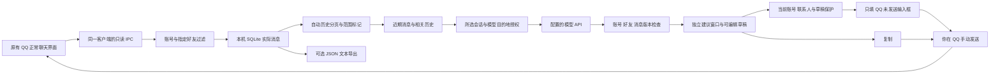

# 实际架构

> 2026-10-12 完整上下文实现已合入 `main` 并运行；当前人物理解、记忆维护与经验流程见 [关系助手完整流程](relationship-learning_CN.md)，基础五部分流程见 [上下文管理](context-management_CN.md)。以下保留原有 QQ 接入与快速回复架构/阶段说明，当前发布与实机记录见验证文档。

窗口通过已有 QQ 界面的插件入口打开，复用一个助手窗口。好友 QQ 号也可手动指定。历史读取只访问所选私聊，模型客户端和 QQ 发消息 API 没有连接。

原生适配器只允许 `getAioFirstViewLatestMsgsAndAddActiveChat` 和 `getMsgs`。前者读取并订阅当前指定会话；后者分页读取。原生登录、好友身份和消息更新使用 QQ 原来的事件，原调用语义保持不变。

消息以账号 UID、好友 UID 和原消息 ID 唯一标识，所有长 ID 保持字符串。只有 QQ 已确认发送成功的记录算作自己的回复。新账号的事件不能来自旧账号窗口。模型结果还需匹配生成时的账号、好友和消息版本。

本地代理地址并不证明模型完全本地运行。模型授权与 API 地址、模型、账号和好友绑定；未授权时不会把真实内容发给模型。关闭助手窗口暂停自动生成，但已选会话的记录仍可在本机保存。

当前模型和上下文的详细流程见 [context-management_CN.md](context-management_CN.md)。2026-10-12 已验证真实入口自动选好友和原生草稿回填，尚未制造新的来信/发送测试。图片本机预览和模型图片授权分开。
