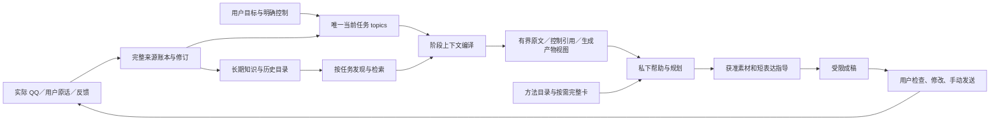

# 上下文结构候选 002：任务、证据与工作产物

本候选服务于围绕用户目的的长期辅助：理解处境、发现真实可聊内容、主动联系与持续商量，并在实际反馈后调整。恋爱是当前用途，不能强制覆盖朋友、工作或学习目的。它是正在评估的候选，不代表 Goal 完成或已经发布。

## 实际结构变化

- **任务只有一个持久所有者。** 使用原有 `topics`；模型与界面的任务操作经过同一转换。旧 `state.focus/openThreads/unknowns` 保存在待核对历史，不再作为独立当前控制；情况状态只保留有来源的证据条目。状态 CAS 同时检查任务版本，防止旧写入复活已结束任务。
- **完整存储与有限读取分离。** 原始 ID、时间、正文、修订和用途保持；模型只看当次交付的完整来源或明确标记的片段。来源是否找到、是否实际交付、是否仅部分交付分别记录。最新用户意图不默默截断。
- **直接证据优先于可选导航。** 巨大旧话题来源不再强制常驻；显式读取优先于无关近期窗口。最新完整讨论和可行的直接引文可借用剩余容量，不为软层预算牺牲原文。
- **任务适用性按当前请求核对。** 保留任务是候选，不凭来源仍有效就覆盖本轮意思；规划中的 `taskUse` 确认继续、另谈或仍不确定。控制引用有来源与版本，但不是可外发事实或分享许可。
- **谈资发现先于展示。** 从整个有效知识目录与原始来源建立小型导航；不再只依赖查询词和库存前六条。当前接话采用锚定检索，宽泛重新联系可发现旧事；也可显式请求扩展目录。导航保留日期、推测、过期和取消，不将说话者当作事件主体。
- **方法按需加载。** 中性核心、简短目录和零至两张完整卡各有职责；目录元数据不冒充方法已采用。生成讨论是可错工作产物，精确读取拥有原产物指纹；删除原产物会使相关派生回答失效。

## 已取得的工程证据

当前快照后端 source hash：`51aefa08752c038bacbb7063b95018339b98ca7516ddd7eef9afee6b34752353`。稳定源码扫描中 **119 个测试文件、810 项检查通过**，无跳过；这不是对话质量验收。

结构探针复现并修正了：30 条连续同向 QQ 绕过邻域限制；约 66.5 KB 的无关旧话题阻断短问题；显式查到的旧原文被近期干扰资料挤掉。基线创建的虚构数据库升级另验证原始消息、目标、素材用途、撤回状态、生成产物、反馈 ID／正文／目标及再次打开的一致性。

独立架构审查发现并修正四项消费者缺口：较新部分正文被误算为完整后续覆盖；实际方法数据仍强加恋爱目的；查询归一化位置不对应原 UTF-16；生成讨论读取指纹没有持久依赖。新增真实函数／Controller 正反检查后，引用、删除和失效行为分别复验。

## 下一步与未证明事项

先用冻结六例、十一动态步骤诊断：重新联系的有锚点／无锚点／忙碌对照、长私下商量、局部纠正、结束话题。再按影响加入单条长来源、出稿反馈、撤回、工作／学习目的和正常宿主生命周期。每版从相同原始前缀重建，不能预填正确记忆，不能合并不同版本的片段当完整通过。

以下仍需 Goal 后续处理，不能由自动检查替代：实际内容选择与自然性；旧许可遇到无关后续省略时的误拒绝；原稿修改对象是否精确送到成稿阶段；长期人物理解的语义更新；真实用户历史与个人声线。现有 38／81 是虚构可见开发集，不能代替本地私有历史验收或现实关系效果。

JEV、Embedding 与现有库是可选实验资源，见 [资源说明](available-resources_CN.md)。本快照没有启用新外部服务，也没有增加运行时 agent 群、向量库或第二个任务数据库。
