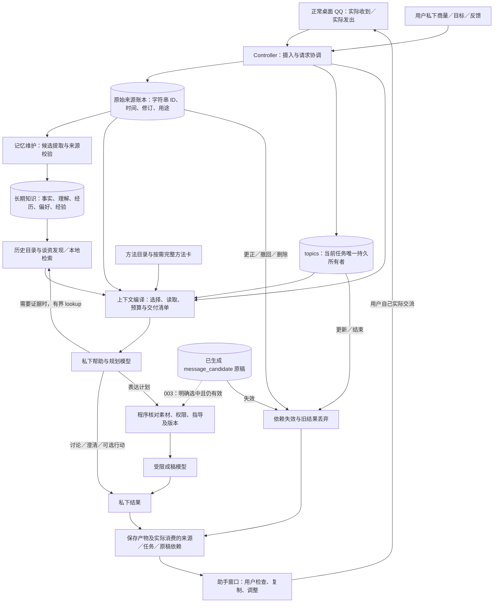
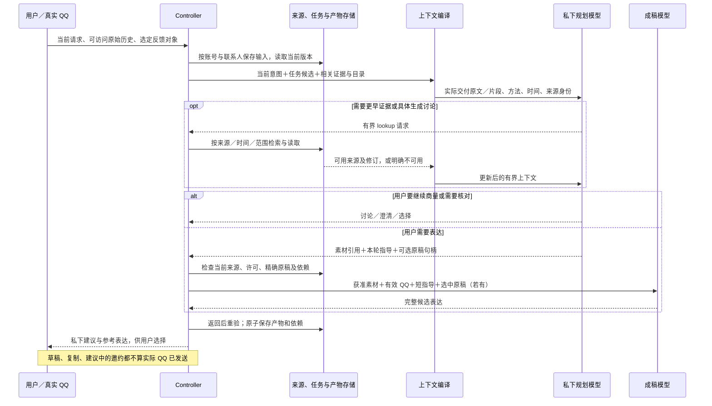
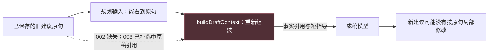
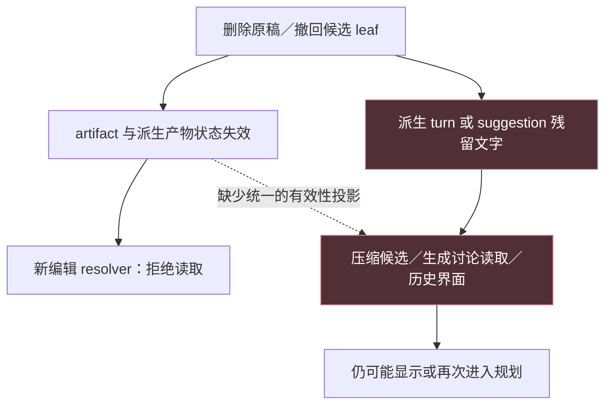

# QQ Assistant：当前结构、交接与待验证缺口

这份图用于结构与上下文问题的归因，服务于用户指定目的下的持续辅助：理解处境、发现真实可聊内容、主动联系、持续商量与真实表达。当前用途是与有好感的网友逐渐熟悉；图中的方法、记忆与任务不能强制导向恋爱推进。每条失败沿实际生产者、转换、消费者和失效路径定位，图本身不是根因证明，也不代表对话效果或桌面发布已验收。

## 版本与证据

| 范围 | 身份 | 已有证据 | 尚未证明 |
| --- | --- | --- | --- |
| 当前集成基线 | main `d7911da`；产品比较基线 `009b4aa` | 原有产品与独立回放 | 本轮新改动未部署 |
| 上下文候选 002 | `86c7d99`；后端 hash `51aefa08752c038bacbb7063b95018339b98ca7516ddd7eef9afee6b34752353` | 119 文件／810 工程检查；重新联系子比较局部接受，纠正／结束话题比较因一轮重复追问未接受；长私聊维护阶段两版均失败 | 完整阶段、长期人物理解、个人声线、桌面生命周期 |
| 编辑交接候选 003 初次快照 | `1b96bcd`；后端 hash `4f69ed3ec20889e75073efe2ad805f98aece27f32510932e3d8a307f812c56b0` | 此快照 121 文件／826 检查；九例十八步合成回放；复审发现并行读取失效缺口，修复进行中 | 实际模型改稿质量；修复后检查和其他阶段证据需按影响复验 |

评测轮次与产品版本分开。合成传输只能证明集成调用；真实模型使用虚构边界记录，仍不是实际 QQ 桌面或现实关系效果。

## 当前候选的组件图

总图用于导航，下面的局部图才用于定位具体失败。每个局部图都应注明源码快照、实际证据、首个偏差和能推翻诊断的检查。

图中的现有组件与调用顺序不是必须保留的设计。归因范围包括摄入、存储、记忆提取／更新、近期历史、压缩、检索、任务状态、方法、上下文组装、模型调用拓扑、失败恢复及 UI。证据支持时可以拆分、合并、替换或重排整条链路；例如核对回答是否必须等待全部记忆维护成功、是否需要两阶段模型调用、生成文本是否应延迟读取。比较替代结构时保持外部原始输入和行为标准独立，不把某个内部 tool call 或记忆格式写成成功条件。改动大小由完整因果修复决定。

`lookup` 是现有有界检索回路，不能理解为模型可无限读取。当前没有接入 JEV 或新向量服务，也没有运行时常驻多 agent 群。

## 一次持续商量怎样形成输入

## 组件不是按名称分工，而是按读写与权限分工

| 组件／实际位置 | 输入与输出 | 何时加载／写入 | 关键边界与待核对项 |
| --- | --- | --- | --- |
| `controller.cjs`、`server.cjs` | 原始 QQ、私下输入、当前控制 → 有作用域的请求与可见结果 | 实际事件及用户请求；按版本丢弃过期结果 | 不发送 QQ；不能把复制当实发 |
| `store.cjs`、来源快照 | 完整原始记录 → 可回查的来源与修订 | 原文持续保存；模型读取另行选择 | 存得完整不等于每次全量加载 |
| `memory-engine.cjs`、关系／经验存储 | 原始来源 → 有时间、主体、来源和不确定性的派生知识 | 维护触发时提取；按任务读取 | 一次疲劳不是稳定人格；用户转述不是她的原话；语义合并质量仍需实测 |
| `topic-store.cjs`、`topic-schema.cjs` | 当前明确控制与有据理解 → 当前任务及历史 | 新建、更新、结束走同一转换 | 旧 `state.focus` 等保存为待核对历史，不再并列掌权 |
| `conversation-discovery.cjs`、`memory-search.cjs` | 当前需要、有效目录、原始来源 → 少量相关或多样候选 | 接话时锚定；宽泛重联时发现旧事；可显式扩展 | 目录命中不等于原文已进入模型；不能靠“她以前说过”推断今天仍适用 |
| `context/*` | 当前意图、任务、证据、方法 → 有界实际模型输入与 manifest | 每次规划、检索重建和成稿分别组装 | 完整／部分／省略须区分；控制、事实、私事、生成文本身份不可混用 |
| `help-methods.cjs`、`help-behavior.cjs` | 当前需要与少量方法 → 程序性指导 | 简短目录和零至两张完整卡；核心规则常驻 | 方法卡不是话术模板；可组合、跳过，不强制升级关系 |
| `editing-reference.cjs`、`experience-store.cjs` | 明确选中的实际原稿 leaf → 有版本和正文 witness 的编辑引用 | 003 新增；真正改写时交付完整原句 | 不能作为事实或分享许可；删除 leaf 时不允许从残留 timeline 恢复 |
| `CandidateSession`、产物依赖 | 实际消费证据 → 持久依赖、候选展示与失效 | 返回后及提交时校验，源变化后失效 | 003 规划阶段目前会绑定所有已交付原稿引用；不能称为只依赖最终选中的一条 |

## 目前有证据的设计问题与下一检查

1. **事实、当前控制与生成内容的交接。** 002 已重组来源与任务；003 补原稿到成稿的显式渠道。下一步用原来的多轮素材／改稿案例做真实模型验收，不能用只会返回预设成功句子的 stub 证明改稿质量。
2. **时间窗口理解。** 重新联系的独立评审已指出两版都没有清楚识别周四与尚未到来的周五窗口。需要先看实际时间输入与提示，再确定是时间投影、状态适用性还是模型解释的问题。
3. **长历史失败发生在哪里。** 基线真实回放在记忆维护 rejected 后没有进入用户回答；生产 `maintainMemory()` 返回状态并延迟重试，而回放会把该状态升级为失败。须独立定位这是产品维护缺陷、回放准备前提，还是两者都有，保留原失败记录。
4. **隐式原稿的影响范围。** 规划阶段当前看见未选原稿正文，因此保存其依赖是保守且可解释的；但也可能让无关新话题受旧稿撤回影响。应比较仅交付句柄、明确读取正文等替代设计，不能为了少失效而漏记实际影响。
5. **人物理解和方法效果仍待验收。** 存储里有结构化字段不等于形成了准确可用的人物模型，论文和方法卡也不等于能持续聊得自然。需要核对它们是否实际改善内容选择、主体辨识、相互了解和跨轮接续。

优化依据应写成“观察到的偏差 → 首个交接问题 → 修改及反例 → 实际输出复验”。组件数量、图的完整程度、绿色测试数量都不能单独说明目标已达到。

## 归因图一：有历史，为什么仍改不好原句

适用快照：002。源码与消费者检查已经证明交接缺口；003 的功能检查证明新引用通道接通，实际模型改稿效果尚未验收。

首个偏差是规划到成稿的交接，不能直接归因为记忆没存、模型不聪明或缺少更多提示。区分性检查应捕获真正序列化的成稿输入，并让测试输出依据该输入中的原句执行修改；不能靠测试外部的 `corrected` 开关返回预设成功文本。

## 归因图二：明明撤回，为什么旧内容仍可能回来

适用快照：003 初次冻结 `1b96bcd`。独立源码审查找到两条并行消费者；完整消费者检查和修复正在进行，不能先画成已解决。

首个偏差是权威失效状态没有覆盖全部生成文本消费者。修复不能只给新 resolver 加判断。反例同时保留“父回答仍有效、单条 leaf 已撤回”和“不相关兄弟建议仍应可用”，并检查整个 UI snapshot、规划 payload、精确读取和压缩结果。

## 每次失败沿这条证据链定位

每个节点记录实际输入／输出、来源身份、时间、完整性、预算与丢弃原因；箭头记录转换责任和版本校验。先定位第一个有证据的偏差，再修改组件，并以同一原始案例和有意义的反例复验。图与轨迹不一致时先修正图，不把理想架构当实现事实。
