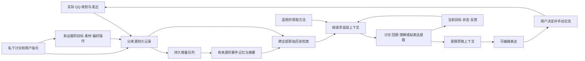

# 围绕关系目标的完整上下文流程

目标是帮助用户与选中的网友增加相互了解、自然交流和双向关心。软件负责持续理解与提供帮助；对方的意愿和真实关系结果不能由软件单方面决定。本文描述当前实现；实际运行与验证状态见 [验证记录](context-implementation-evidence.json)。

## 日常怎样使用

继续在正常 QQ 中交流，助手保持独立窗口。选中对应好友并允许配置的模型处理该会话后，可以直接说：

- “我的长期目标是慢慢互相了解，建立双向关心，记住这个目标。”
- “今天去了一个挺有意思的地方，但不知道要不要找她聊。”
- “帮我记下这件事，先只用于私下讨论。”
- “就按刚才那个方向，组织成一句话。”
- “以后回复短一些，但不要漏掉她说的事情。”
- “你把人记错了”“别再使用那条背景”。

不需要先填写目的、关系阶段或提示词分类。明确的保存指令会写入对应数据，显示结果并在适用时允许撤销；有实质歧义时展示具体待确认内容。目标/素材表单仍可用于直接查看和编辑，但不再是对话的必经步骤。

已允许用于此联系人的素材会按相关性自动进入拟表达候选；勾选只是本次优先选择。仅供讨论的素材不能由模型自行扩大用途。需要改变已有私密素材的用途时，要有明确对应的用户指令，或确认具体素材。对外表达始终可以修改，由用户复制或填入 QQ 后手动发送。

## 系统如何组织

所有入口共享 `Controller.assist`：私下讨论、回顾、快速回复、用户开启的自动建议。旧快速回复不再绕过长期目标和记忆。回复重点、图片选择、当前账号/联系人以及模型目的地授权沿用同一条边界。图片切换会使旧结果失效，被忽略的来源不会通过图片通道重新进入模型。

本机 SQLite 的实际 QQ 表独立于 companion（目标、素材、私下轮次、状态、反馈、操作记录）。长期记忆另有来源版本表、待处理日志、带引用的事件/条目、依赖关系和审核回执。原 QQ ID 始终是字符串；助手输出、选项、复制或回填都不建立实际发送记录。导出 QQ 仍只导出实际消息。

## 长期记忆并非最近几轮的别名

检索覆盖全部可用 QQ、全部用户私下历史、素材和反馈，结合中文双字词/BM25与模型整理的主题词、事件摘要。需要更多证据时，模型可以提出具体查询并得到来源，最多有界补查两次。近期私下交流按完整组进入上下文；较早背景由检索和状态引用找回，而非只能靠最近六组。

记忆整理单独使用持久的来源变更队列。在适用授权、可见窗口、空闲和来源版本仍有效时批量处理；不会每个 QQ 气泡重写整份状态。旧历史补载使用事件时间，新入库顺序不赋予旧事更高权威。每批使用短引用，模型明确确认对应批次后，程序还原完整来源审核回执；失败、迟到或格式不符不推进。没有新增语义仍可正确记为已审阅。超长来源有可续跑的分段游标，最后片段完成前不会冒充整条处理完。

模型传输临时失败会在同一目的地有界重试一次；格式错误最多修复一次。背景整理失败会保留待处理资料，以有限退避重试；多次失败显示原因与“重试整理记忆”。新原话仍可支持当前帮助，不需要等所有旧历史完成整理。关闭窗口暂停自动模型工作；重新打开后从持久队列继续。

检索与摘要提供候选依据，不保证任何措辞都能正确召回。来源、时间和覆盖缺口可查看；索引摘要仅作导航，需回到原始证据。后续未完整覆盖的旧 QQ 或旧私下记录标为历史提及，不据此断言旧计划仍有效。

## 自然指令、状态和帮助方法

用户自己的目标与分享权限由显式操作维护。模型只能提出带原文依据的操作，程序检查当前用户来源、目标对象与版本。否定保存、转述他人要求、条件式意图不会直接执行。具体确认卡从当前会话的已保存提案读取，客户端不能替换待确认内容。用户可以纠正；模型不获得自主决定目标或披露的权限。

当前工作状态保持当前卡点、必要背景、未完事项和未知。新信息使旧理解需要复核；背景记忆和实际原话一起帮助接续。状态更新与增量记忆审核不同：没有返回状态更新或明确 no-change 时，不宣称完成状态审阅。状态补丁不能写账号、目标、权限或发送记录。

七个固定方法包含理清、比较下一步、回应分享、组织表达、回忆回顾、共同活动和纠正。每个都有适用情形、避免事项、所需背景、来源及研究限制；按当前需要使用零至两个。没有每次必走的步骤，也不要求用户选分类。研究依据可在界面展开；不把群体论文结果变成对这个人的心理结论。

反馈绑定具体建议并进入后续私下上下文。“这次太正式”只影响相应情景；明确“以后都……”才作为持续偏好保存。不从收到回复、复制次数或使用时长自动提炼社交技巧，也不训练好感评分。

## 讨论怎样接到表达

讨论可提出有原始资料引用的表达方向，用户可点选，也可直接说“就按刚才那个”。模型先解析本次授权，随后构建新的草稿输入：拟表达的原文片段、实际 QQ、回复重点、简单语气/语言/额外提问开关。私人目标、完整私下历史、原始反馈不会直接放进草稿调用。

当用户明确引用之前自己的素材时，不要求重抄；指代涉及多个不同素材且会改变披露范围时才问清楚。默认不附加泛泛问题；素材仍不足时先帮助补足要表达的事情，不硬造通用开场。既有受限素材需要明确改用途，不能因为它曾进入讨论就默认能发给她。

来源与子串校验可以执行确定性边界，但自然语言的具体意图仍依赖模型判断。已测试的混合语句和跨次指代不是所有未知表达的正确性证明。用户保有检查、编辑、拒绝和不发送的决定权；软件没有发送或自动回复能力。

## 有界上下文与变更传播

优先保留当前请求、最新双方完整连续消息、明确选择的来源，相关旧资料随后进入。用户突然收到新消息时，合并后重新处理同一个求助，保留原始输入且限制重试次数；不把旧结果当成已考虑新消息，也不无休止生成。

可选历史按完整条目裁剪，记录遗漏。无关近况不会为了填满窗口而全部载入。文字请求的预算检查包含 system、JSON及实际输入；默认整个序列化文字请求上限64000 UTF-8 bytes，正文选择上限48000 bytes，输出最多2200 tokens。后台记忆请求也检查完整序列化输入。图片按既有文件大小/数量边界单独处理。字节上限不是经验证的模型tokenizer或窗口保证，极小窗口模型仍需相应配置。

来源修订、撤回、用途收缩或删除会清理派生记忆、摘要、缓存及依赖的助手内容；自然指令产生的目标/素材也绑定其来源版本，避免旧副本复活。修改长期目标保留私下历史，只更新当前方向和相关计划。

“忘记 QQ 来源”表示不再用于助手记忆和上下文，原 QQ 记录及其真实发生事实仍在；不会删除远端聊天。删除私下来源或素材则清理其本地派生内容。撤回后的同 ID 消息不能被迟到历史恢复。应用采用的失效草稿及浏览器保存副本一并处理，独立手写草稿保留。外部服务已处理的数据和外部备份不在本地删除能力内。

## 证据与使用边界

验证包含完整功能回归、真实浏览器执行的合成流程、多次实际模型的跨会话回放，以及真实桌面刷新/读取检查。各类证据分别记录，原始失败及评测修正保留；没有将界面模拟当成实际 QQ，也没有给网友发测试消息。

这些能力共同服务长期关系目标：少重复交代背景、找回值得接续的事、理解和回应实际内容、表达本人意思、考虑下一步并从真实后续修正。关系是否更亲近仍需在用户实际相处中观察，不能由测试通过率替代。
