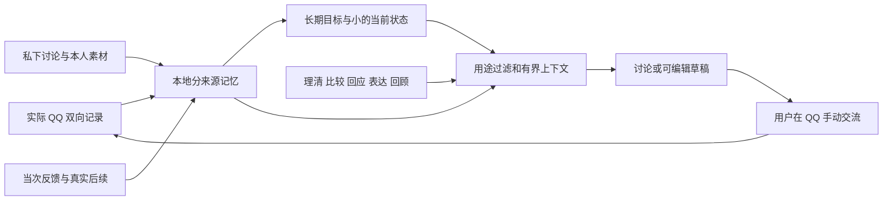

# 关系支持与上下文管理

本版围绕用户希望与所选网友增加了解和双向关心的方向，提供持续私下商量。具体目标由用户按联系人保存，不从对方性别、一次反馈或模型猜测自动建立。关系效果仍待实际使用观察；功能检查和模拟浏览器通过不等于关系改善。

## 怎样使用

在普通 QQ 中照常交流，打开助手并选择联系人、配置模型和允许当前会话使用该目的地。主区域可以输入“想找她聊聊”“这句怎么接”“先陪我想清楚”或“最近相处怎么样”。无需先填写目的，也不要求每次写草稿。没有可读 QQ 历史时，可以从自己提供的信息开始。

“背景与近况”可保存长期目标和素材。素材分为仅供讨论、可以写给此人、停用。生成草稿时，可勾选允许表达的素材，说明想表达的内容。仅供讨论的笔记不会因为模型建议自动获得分享权限。资料按已认证账号与当前联系人隔离。

参考表达可以采用、修改、复制或填入 QQ 输入框，最后由用户发送。选择、复制和回填不建立“已说过”记录；实际成功发送的内容以 QQ 记录为准。

## 五部分怎样连接

`src/store.cjs` 在原 SQLite 中增加按四字段范围隔离的 companion 记录：私下用户/助手轮次、用户目标、素材、当前状态、最近请求与反馈。实际 QQ 表和导出维持 actual-only。启用 `PRAGMA secure_delete`；这不代表外部备份或模型服务端内容已被删除。

原始记录持久保存；求助时只取必要内容，不每条消息调用模型重写状态。新配置的自动建议默认关闭；已有明确保存的自动建议设置继续生效。旧“快速回复”控件仍使用现有模型配置、回复重点和图片能力，与持续讨论入口分开。

## 讨论与草稿的输入不同

私下讨论接收当前请求、目标、相关用户/助手往来、完整近期 QQ、必要素材及有来源的旧状态。固定短方法根据问题选择理清、比较、回应或回顾；输出不要求三条建议。

明确起草时，先提取此次想表达的原文片段。程序验证片段来自当前用户请求，或此次选中且允许用于草稿的笔记。旧私下轮次、助手摘要和未选笔记不能成为拟表达来源。另一次草稿请求只含选中片段、QQ 语境、简单风格与覆盖信息，移除私人长期目标、完整原始请求和私下历史。普通讨论识别到明确写稿意图时也可走此路径。分享范围不清楚时返回一个具体问题。

**语义边界：**原文子串匹配只能验证出处，不能证明“愿意表达”的含义。模型若误选当前请求中的私密短语，程序不能仅靠 ID 识别全部错误。两阶段调用及合成样例通过，不构成任意混合语句的隐私保证。使用前仍需核对本意；重要私密素材宜保持独立的“仅供讨论”笔记。系统不代发。

## 历史、状态和预算

`src/assistant-context.cjs` 保护最新双方连续消息组，整段纳入而不截句；本人随后发出的多个气泡不会挤掉对方先前的边界表达。近期私下往来按完整交流组加入。状态引用回取原始证据；旧历史使用关键词和中文相邻字片段作有限检索。没有向量模型或额外分类模型依赖。

检索到较早事件时，尝试带入完整后续时间线。装不下时，为后续有缺口的消息标记 `historicalOnly`：它只支持“曾经提过”，不能据此断言约定仍有效。标记约束模型解释，不代表自动识别了所有语义取消关系。输入同时提供当前时间，原话保留发生时间。

状态包含当前焦点、少量有来源背景、未完事项、未知及覆盖。新输入使其需要复核，但保留接续线索；旧未完事项以 `needs_review` 投影，优先看新原话。模型 patch 无权改目标、权限或实际发送，只能更新有限字段，且引用必须来自本次实际提供的有效证据。来源修订与状态版本共同校验，迟到 patch 不覆盖新理解。

完整审阅无持久变化记为 `reviewed_no_change`；失败、只完成草稿或无效 patch 不冒充整理完成。只有此次包含全部当前可用事实来源，才允许覆盖为 complete。这表示当前本地来源已经提供给整理过程，不声称 QQ 服务器历史完整，也不保证语义提取无误。

新流程默认序列化输入上限为 48000 UTF-8 bytes，可通过本地 `assistantContextBytes` 配置；按完整条目裁剪可选内容，记录遗漏。它是有界输入措施，**不是已验证的 token 计数或模型窗口保证**；system 提示与最多 2200 输出 token 另有开销。必要请求或最新完整交流装不下时，明确报错要求分段。旧快速回复维持原有 18000 字符/单条 1800 字符路径，其“查看上下文”是预览；新入口“这次参考了什么”展示实际请求清单。

## 纠正、删除与迟到结果

修改/删除素材、删除私下用户来源、QQ 修订或撤回，会保守清理该联系人的派生状态、助手轮次、请求缓存和关联反馈，保留其他原始用户来源与实际 QQ。界面中从失效助手轮次采用的草稿及浏览器保存副本一并清理；独立手写草稿保持。清理范围较宽是首版取舍，用来避免旧摘要让删除内容复活。

已观察到撤回的同 ID 消息不能被迟到历史恢复。对没有可靠修订版本的其他任意文字修改，尚不能声称解决所有乱序。

切账号/联系人、改模型/指示/分享资料、撤销模型许可及新实际消息使在途结果失效。返回时再次核对修订、选择 epoch 和权限，同时丢弃旧输出与 patch。网络失败后保留用户输入。新消息保留正在编辑的草稿；是否刷新由用户决定或按其开启的自动设置执行。

## 反馈与验证

“太正式”“不像我”的反馈绑定具体请求，作为后续私下讨论输入，不自动晋升为跨联系人技能。真实回复、用户感受与建议采纳分别看待；不从收到回复推断好感或策略因果效果。改变长期目标需明确编辑，模型不能自动重写。

验证入口：`npm test`、`npm run check`、`npm run test:ui`、`npm run test:assistant-ui`。功能与浏览器使用合成 QQ 记录。独立真实模型合成样例只验证所测输入的协议和行为；这版尚未重新部署或验收实际 QQ 会话，不承诺关系目标已经实现。
