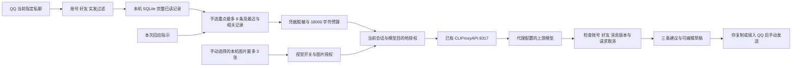

# 模型接入与真实上下文管理

## 后端连接

Node.js 服务负责记录读取、SQLite、上下文和模型请求。模型设置位于助手顶部，也保存在未纳入 Git 的 `data/settings.json`。当前代码使用 OpenAI 兼容 `POST /v1/chat/completions`；API key 只在后端使用。`http://127.0.0.1:8317/v1` 是已有的代理，不能据此称推理完全在本机运行。

## 文字如何选择

1. SQLite 保存当前账号、好友实际已发送和收到的记录，保留原消息 ID 字符串。失败发送、草稿、其他好友不进入这份会话。
2. 取最近最多 60 条。从指示中按连续字母/数字匹配长度至少 2 的词段；在更旧文字中做字面包含匹配，最多再取最近 12 条。中文整句可能被视为一个词段，因此它是简单匹配，不是语义检索。
3. 常见 token、带 token 的 URL、Bearer 和私钥在模型投影中脱敏；原始本机记录保持原样。脱敏为启发式规则，不保证识别所有凭据。
4. 单条文字最多 1800 字符，总消息文字最多 18000 字符。手动选择的最多 8 条回复重点优先保留，之后优先保留更近消息，预算不足会停止添加旧消息；它是字符预算，不是精确 token 预算，也不包含 system 指令、JSON 字段和图片 token 开销。
5. 请求包含 system 指令、本次回应指示、标明“我/对方”、时间和 ID 的所选记录，以及明确的历史可能不完整标记。未选择的图片只有媒体类型标记，模型不知道其内容。
6. 图片单独选择，要求启用视觉模型及图片授权；每张带时间和发送方，使用 `image_url` 低细节输入。单张本机文件上限 8 MiB，格式限定 PNG/JPEG/GIF/WebP；图片内容不会自动 OCR 入库。
7. 返回后检查生成时的账号、好友、消息版本、回应指示和取消状态。过期结果不替换当前建议；未改变指示的本机预览不应清空已有建议。

例如本机已读 739 条，并不表示把 739 条一起提供给模型。默认指示「自然一点，贴近我的说话方式」通常不匹配旧记录，主要使用最后 60 条；实际列表可以在「查看上下文」检查。

## 当前实现的边界

目前没有长期摘要、向量检索、跨好友资料库、自动关系状态判断或已确认个人事实管理。旧历史可通过手动勾选回复重点或上述简单匹配进入当前请求；这是 MVP 的上下文选择，不能宣传为成熟的长期记忆系统。

后续可考虑独立保存用户确认的交流目标、真实当天话题和约束，再接入分层摘要与可追溯事实。用户本轮要求先解决现有 UI/回填问题，因此这套流程暂未实现。不要把该建议写成当前软件功能。

主要实现：`src/model.cjs`、`src/controller.cjs`、`src/store.cjs`；图片 `src/media.cjs`；接口及设置 `src/server.cjs`。

## 多模型与回应重点

`src/providers.cjs` 从兼容服务的 `GET /models` 读取 ID；每套配置独立持有密钥，浏览器只接收是否已配置密钥。切换模型/配置会取消在途请求、清空旧建议和图片选择，文字授权仍按账号、好友、API 地址与模型匹配。不同模型的能力和权限需由服务端实际支持。

请求的 `replyFocus` 包含 `mode` 和消息 ID。未手选时使用最近连续来信最多 8 条；手选时这些消息优先进入同一个 18000 字符预算，仍保留上下文时间顺序。它不调用 QQ 的引用或发送能力。切换好友会清空手选重点；改变重点会取消旧建议。Prompt 版本为 `2026-10-12.3`。
