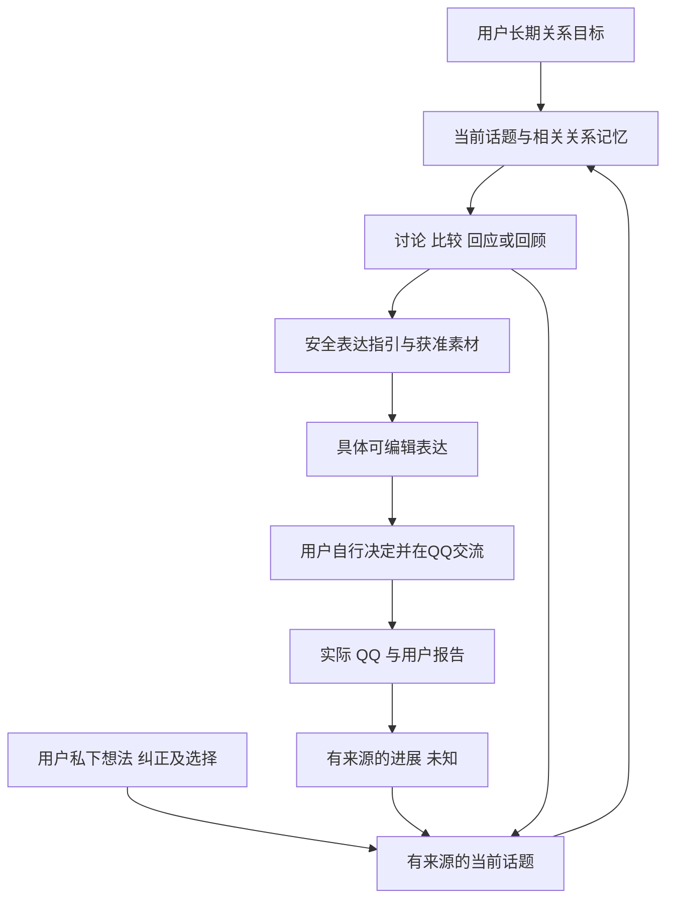

# 当前话题如何贯穿商量与表达

这轮补齐的目标是帮助用户与网上认识、有好感的女生发展成双方愿意的恋爱关系。当前小目的可以是了解兴趣、回应分享、考虑共同活动、邀约、表达好感或暂缓；助手在自然商量中理清它，沿用户确定的方向继续，并根据新意图和真实互动调整。

## 当前话题与记忆的区别

关系记忆回答发生过什么、谁说过什么；当前话题回答这轮正在做什么、怎样做、有哪些局部限制、进展如何以及还不清楚什么。话题保存在本机 companion 的可选 `topics` 字段：一个 active，最多三个 retained，不另建人物库或扩大原 QQ 表。

例如，以一段虚构交流为例：对方说最近改玩解谜游戏；用户想自然了解她的兴趣，暂不直接问名字或邀约。助手先商量方向，用户再说“轻松调侃接话，暂不追问”，随后说“那给一句”。此时仍沿当前方向组织一句可编辑表达；若用户后来明确想邀请一起玩，更新本次方向，不继续强加先前的含蓄限制。

## 怎样保持与改变方向

- 自然讨论可以形成暂定目的，用户不用填写目的表或关系阶段。`interpretationStatus` 区分暂定理解与用户明确陈述；助手的认同不能自动升级为用户确认。
- 新方向、局部纠正、暂停、恢复及结束须引用本次直接用户来源和原文。来源可以是普通私下输入，或明确“反馈并继续商量”动作对应的规范反馈。
- 单轮要“先商量”还是“给具体句子”，由当前请求和表达计划决定，不保存为这轮永远不许出稿的限制。
- 真实 QQ 可更新有来源的进展或完成一个当前小目的，不能替用户重写目的或恢复已关闭的话题。小目的完成不表示恋爱目标完成。
- 长期目标改变会暂停原有当前话题；目的来源被更正或遗忘会立即使对应话题失效。旧观察被撤回时清理观察与完成依据，不擅自恢复话题。
- 当前字段分别保留支持来源，方向更新替换旧方向的支持，保留仍有效的目的支持，避免每次纠正永久累积到上下文。

## 准备与成稿的交接

以前的成稿输入只包含获准片段、QQ、语气和几个格式开关；局部目的与纠正可能在此丢失。本次 `draftPlan.guidance` 可提供有来源的 objective、allowedApproach、avoidances 和 currentStep。程序核对来源与版本，并将短的安全投影作为 `draftingGuidance` 交给成稿。有当前有效目的时，必要的目的、方向和局部限制控制不能省略；遗漏会进入已有一次格式修复。显式撤掉的限制与已关闭话题不再强制携带，无当前话题的直接成稿仍可正常使用。

这些字段是控制表达的方法，不是待发送内容。最终输入继续排除完整私下讨论、长期关系目标及原始私人动机；真实可分享内容仍经过独立的片段授权。来源绑定能验证出处与时效，不能确定性证明自然语言理解或每句输出符合意图，因此还需多轮语义回放和用户实际反馈。

当前话题和最新完整纠正对话优先于旧工作摘要及可选历史。正文与完整请求仍受原来的精确字节预算约束；必要内容无法放入时明确报错，不截断关键内容。格式修复重新组装后，来源、控制、manifest 与获准图片保持一致。话题更新附在主模型结果中，不额外增加一个状态整理模型。

## 反馈如何继续

“记下反馈”保存一个规范来源，不调用模型；“反馈并继续商量”明确保存反馈、加载准确被评价对象，并执行一次有界帮助任务。失败后反馈仍在，HTTP 重试复用同一任务；用户明确再试才创建新模型任务，同时保留同一反馈。未提交的其他想法和编辑稿独立保留。

不把反馈原文复制成第二条普通事实，也不从“这次不要直接邀约”推导永久偏好。用户以后仍可明确选择直接表达兴趣、邀请或结束推进。

## 本次验收边界

验收包括 Store 的版本/来源/生命周期、真实 Controller 的多轮交接及反馈幂等、实际浏览器的自然操作与窄窗口，以及合成对话上的真实模型回放。具体结果、原始失败和实际桌面升级单独见 conversation-direction-evidence.json；浏览器与合成模型不冒充真实关系效果。

经典对话结构研究将话语序列、意图结构与注意焦点分别讨论，本实现借鉴其分工组织当下话题，没有复刻理论算法，也不据此保证恋爱效果：[Attention, Intentions, and the Structure of Discourse](https://dash.harvard.edu/entities/publication/73120378-7f26-6bd4-e053-0100007fdf3b)。
