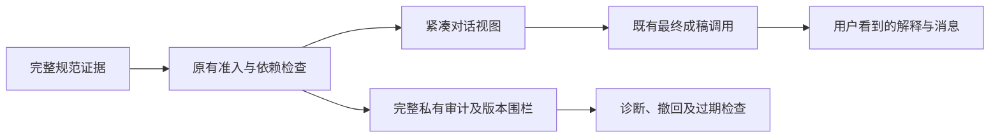

# 对话证据与程序审计分视图

本候选只改变最终成稿模型看到的资料视图。原始事实、来源权限、版本和依赖关系保持；当前人类要求、真实界面选择、实际 QQ 和真实旧稿也保持。目标是让助手依据真实内容帮助表达，避免把审计警示当作修改正确原话的理由。

第 033 轮已经由同一最终阶段生成解释和消息，但它仍把用户明示“今天已经能用”改成“现在”，并解释为避免把记录时间当成发生时间。这个警示不适用于该明确自述。现有证据支持规则误用，不能证明丰富元数据是唯一原因。

| 信息 | 最终成稿视图 | 程序与诊断 |
|---|---|---|
| 准入原句与来源 ID | 内容及绑定保持不变 | 保留完整规范来源 |
| 来源归属与直接记录时间 | 紧凑 `origin`，帮助理解谁在何时提供了什么 | 原始字段、范围和版本不变 |
| 笔记与其来源记录 | 区分 `noteEditedAt` 与 `recordedAt`；保留多项、部分及未知状态 | 全闭包、全部依赖版本和见证保持 |
| 修订、协议、根数量与见证细节 | 不整段转成对话资料 | 保留完整验证、撤回与调试依据 |

投影只在实际 `draft` 请求及其修复包装内进行，发生在来源别名编码前。规范请求和清单仍保留丰富出处；程序不能改用精简视图判断资料是否仍有效。

时间判断尊重原文含义。记录时间帮助理解相对词，不能凭空新增事件日期，也不能否认原文明示日期。不同断言保留各自的时间角色；昨天首次做成和今天能用可以同时成立。仅润色时保留仍成立的事实，解释围绕实际内容与改动，不用内部审计规则制造纠错理由。

`originalRecords` 表示来源记录集合，不保证每个时间都是原始发言日期。根节点也可能是笔记，其时间仍是 `noteEditedAt`。不会将多个根折叠为最新一天；部分或未知来源也不自动变成当前事件。归属信息不单独决定事件主体，原文明示的自述仍按原意理解。

当前完整功能检查为 149 个文件、1256 项通过；隔离界面、刷新与解释界面检查分别通过 22、5、5 项。第 034 轮真实模型四步、11 次请求，独立评审均为可用；这只接受该组证据。第 035 轮发现违反暂不邀请的边界及编造生活经历的硬错误；第 036、037 轮虽然恢复了长历史输入的实际交付，仍有遗漏明确时间、错误声称没有来源等问题，均未通过。候选因此不能合入主线。它不代表真实 QQ 桌面、个人口吻或关系结果已经验证，也不完成整体 Goal。
