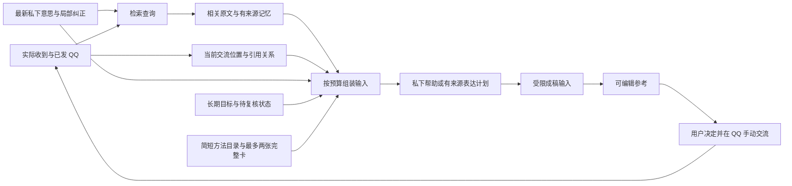

# 当前交流、私下意思与上下文修正

> 此文保留早期故障与任务字段的设计背景。当前组件分工与信息生命周期见[整体重构记录](relationship-assistant-refactor-note_CN.md)，最新入口见[使用说明](usage_CN.md)。

目标仍是帮助你与网上认识、有好感的女生发展双方愿意的恋爱关系。这一次可以是接话、主动联系、分享、邀请、表达好感，也可以先弄清想表达什么。长期目标不等于她已经有相同意愿。

实际故障中，用户已经分享找工作的事，助手却建议再说一遍，还添加了工资到账后充值的打算；对方问工作地点离常住地多远，助手没有用户距离资料却替他编写回答。最新 QQ 已进入输入，主要缺口是当前任务表达、检索查询、引用关系、私下讨论表示，以及输出契约与恢复行为不一致。

## 使用方式

底部可以直接说“她问这里离我常住地多远，我还没说自己的情况，先帮我想想怎么接”，或“我住得近，想回答她这件事，给完整一句”。可以逐轮补充、修改、取消，不需要填写固定目的或关系阶段。

「想和她聊」和「换个切口」只请求当前候选并保留未发送想法；「聊一聊」或 Ctrl+Enter 提交输入和已选讨论、表达或回顾方式。回复风格作为表达偏好传入，不代替实际检索问题。建议、采用和复制都不会成为真实 QQ 发送。

## 输入如何构成

每次输入明确提供：

- `taskContext`：最新实际发言者、最近两个交替发言段、时间与字符串序号、引用目标是否可用、双方最近各补充了哪些消息、读取覆盖范围。
- `sources`：真正加载的原文和来源版本。`selfEvidenceSourceIds` 只是寻找本人陈述的入口，不代表其中已经有距离、动机等答案，也不是披露许可。
- `privateConversation`：近期讨论带正文、时间、请求关联。旧助手话语标为生成内容，不能作为个人经历、实际发送或对方态度。
- 当前目标、仍有效或需复核的小话题、状态、有关记忆与反馈；最新原话及明确纠正优先于旧话题与草稿。
- 八种帮助方法的简短目录，以及最多两张适用完整卡；成稿只加载组织表达方法。可组合、跳过，不要求用户选择固定流程。生成记录区分目录与完整卡。

当前请求放在输入末尾。初次检索结合当前实际 QQ、手写意思、近期用户原话和相关小话题，不再只拿“自然一点”搜索。原生引用按可核验的 ID、序号与作者关联；引用目标不可用时明确缺失，不拿另一条消息补成原文。

实机进一步发现 `sourceMsgIdInRecords` 属于内嵌记录命名空间，不能当作本地 `msgId`。接收引用保留真正的 `replayMsgId`；缺少它时，前台按当前账号/好友的全部缓存实际记录，用序号、发送者与可用时间核对唯一目标，再检查撤回和排除状态。记录引用不成为新消息来源，已有明确本地 ID 的缺失目标不改用另一条消息。仅看一个背景整理批次不能证明整个缓存唯一，因此背景记忆对仅有序号的引用保留缺失标记，不凭批次内匹配制造确定关联。字段含义参考 [NapCat 原生引用消费与构造代码](https://github.com/NapNeko/NapCatQQ/blob/7471e3ecd648189a9e80530b00348a17a4528906/packages/napcat-onebot/api/msg.ts)，并由本机只读元数据核对。

## 长度、状态与失败处理

已有增量记忆与旧讨论压缩继续使用，不新增逐气泡 belief 模型调用。原始记录保留，整理缓存依赖来源版本、目标与话题、模型目的地及协议；变化后核查或失效。每次帮助继续共用有界 HTTP 调用额度。

预算紧张时，交流视图使用 `sourceTextLocation:sources` 引用完整来源，避免同一段 QQ 在两处重复序列化。可选旧内容按完整项取舍；最新原文与必要引用保持保护。完整必要内容仍放不下时明确停止，保留输入，不静默截断。字节预算是应用边界，不是模型 tokenizer 的窗口证明。

普通帮助要求有效 `kind` 与非空 `text`。独立的状态、话题、人物理解或经验字段失败时，可保留有效帮助，丢弃失败字段并记录来源版本绑定的待复核标记；不谎称记忆已经更新。用户操作、来源授权与最终成稿继续严格校验。真正无法使用的普通输出才走有界自然文字恢复，各阶段共享核心行为规则。

结果函数中的合法对象或数组若被代理包成 JSON 字符串，只按该字段的容器 schema 解包；文本字段不做这种转换。内部 JSON 本身损坏时不猜测补括号。有表达计划的失败使用已有的一次结构化修复机会，重新通过来源与权限校验后才成稿；普通文字恢复不冒充受限成稿。缺失事实时保留模型问你的具体问题，避免用内部资料缺口说明覆盖它。

成稿先抽取这次获准表达的原文与短控制，再进入仅含实际 QQ、拟表达片段和控制的调用。完整私下讨论、长期目标、未授权素材不直接进入成稿。缺少会改变回答的本人事实可以先私下问一个必要问题；已有事实足够则直接帮助表达。

## 验证范围

功能、合成浏览器、配置模型的虚构场景、真实桌面读取与输入保留分别记录在 [当前任务验证](current-task-evidence.json)。虚构场景检查已发与拟表达区分、未知不补造、最新任务优先，以及主动联系、分享、邀请和表意是否可用；这些结果不能证明追求一定成功，也不能保证模型对所有未见表达都正确。
