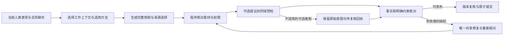

# 决策归属与当前验证状态

本分支实现版本为 `749f89b…`、提示 `.8`，尚未合入 main。目标仍是让助手围绕用户的目的持续提供自然、有用的帮助；当前是逐渐了解和亲近，也支持其他目的。不能以不报错、通过核对或功能全绿代替实际对话质量。

程序可以从当前确实提供、版本和范围相符的 QQ 素材推导已有公共来源规则，减少模型重复选择权限的负担。仅补全省略的权限；明确给错、未知、跨会话、过期引用仍拒绝，私下原话候选不自动成为分享许可。

可选推断被拒绝时先移除它，再按真实的当前控制重新校验核心帮助。同域预检处理不适用的旧回填，保留较新的真实状态；账号、来源、当前输入和版本边界变化仍使结果失效。最后提交时的 Store/CAS 拒绝仍终止发布。原始人类意图和未完成的维护不被伪装为已更新。

核对器区分有依据的事实、披露或明确动作冲突，与仅有可能性的语气和社交解读。后者只作私下诊断；明确的不确定仍不能审批通过。精确引文属于校验依据，不是语义正确的证明。草稿正文仍归属各自叶子，原始记录、撤回投影和手动发送边界保持。

全量功能检查为 157 个文件、1319 项通过，源码前后未变化；39 项界面检查及合成 38 用例、81 步只证明集成。第 040 轮实际回放的三个局部纠正步骤均被独立评为可用，第二步较基线更具体，第三步等效；首步仍是基线表达更具体。缺少自述素材的步骤未交付，因此整轮未通过。

该失败已定位为路径约定不一致：核对器返回 `candidate.suggestions[0].text`，代码只接受 `suggestions[0].text`。模型指出的具体经历缺乏依据，原文引证也有效；仅改变这个地址前缀的离线对照即得到有效拒绝。原任务两次调用已用、仍剩两次，可用于正常的完整重生成和再次核对。此处尚未修复，不能当已完成。

本轮实际模型调用为组件校验 4 次加端到端 8 次，本侧 12 次，连同复用基线 6 次共 18 次。组件中性接话、虚构经历和明确邀请有对应观察，但一段角色分配建议的分寸仍有评审严重度分歧。轮次工具另对端到端子上限 12 与冻结分配 16 的差异提出完整性问题；附加账本证明总额未超限，这不等于工具验收已通过。后续正常端到端比较继续使用两侧各 16 次上限。
