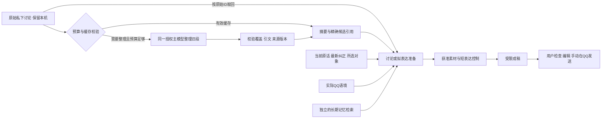

# 长讨论自动整理与接续

这项能力服务于同一个目标：帮助用户与网上认识、有好感的女生发展双方愿意的关系。它解决长篇私下商量挤满请求、无法继续“那给一句”或“按第二个”的问题。它不把恋爱划成必经阶段，也不把生成草稿或结束一个话题算成关系成功。

本轮冻结实现使用 `relationship-context-2026-10-12.18`。自动整理、复用缓存和旧原文取回已经实现；它们不再只是 [此前的配置研究](context-compaction-settings_CN.md) 中的建议。新的原生窗口更新和集成状态应以 [本轮发布证据](discussion-compaction-evidence.json) 为准，不能用以前版本的桌面测试替代。文档整理时主分支仍为 `8fa8dca`，新实现尚未完成原生更新；这条状态须由本轮集成验收另行确认。

## 用户会看到什么

正常输入近况、纠正或请求即可，无需点击“压缩”或填写整理表单。确需折叠较早讨论时，思考状态显示“正在整理较早的讨论”；有有效缓存时显示已接上整理过的讨论。“本次参考”提供覆盖条数、来源和相关技术记录；界面的整理前后大小是 UTF-8 字节，不是 token，也不是整个模型请求的固定压缩比。

输入框上方“帮助方式”选择的是**下一次**讨论、组织表达或回顾互动。选择本身不提交，忙时也能选择和继续编辑；空闲后点击发送或按 Ctrl+Enter 才提交所选方式。当前进行中的任务用途不变，发送按钮仍防止重复请求。模式选择或编辑后，旧回复到达不会清空这份待提交输入。选择按完整账号/联系人身份隔离，同一会话刷新可恢复；它不是长期表达偏好。

## 什么时候整理

程序先尝试用有效缓存组装本轮请求，再判断是否值得整理。当前规则是工程规则，不是论文给出的最优阈值：

- 只考虑本轮相关的最近最多六个私下交流组；必须有助手讨论，排除当前请求。整理输入最多覆盖 128 条原始轮次。
- 未覆盖旧讨论的相关正文达到约 12,000 字节，可因长文本触发；或完整文字请求达到预算约 82%/已经超限，同时相关旧正文至少约 6,000 字节、完整候选内容至少约 12,000 字节时触发。
- 可选 QQ 历史把请求填得很满，并不单独触发整理。没有值得折叠的私下文本，不购买一次无用摘要。
- 先估算当前请求、最新私下用户原话、必要 QQ 与当前反馈对象的下界。它们本身已不可容纳时，不先花一次整理调用再假装问题解决。
- 整理请求本身也必须容纳完整选定原文。必要时只去掉更早的完整组；单个必要组仍放不下时，保留原文并明确失败，不静默截掉否定或半句话。

后台长期记忆维护仍是独立队列与任务，私下讨论整理不是它的别名。

这不是每天或每条 QQ 气泡都调用一次整理器，也不是把所有历史压进同一份不断增长的摘要。一次未改变来源绑定的帮助通常只尝试一轮整理。若该任务中用户明确保存、更正或忘记内容，旧绑定必须撤销，可在同一任务剩余总预算内重组；不会因此获得无限整理次数。

## 摘要与原文怎样配合

整理器读取选定的**原始用户/助手轮次**，返回短摘要、完整覆盖的原始 turn ID 和逐字引用。程序核验引用角色、字段、索引、连续原文片段及对应候选版本。摘要最多 8,000 UTF-8 字节；最多 12 条引用，引用数组总计最多 6,000 字节。无法完整保留的候选应标为需要重新查看，不允许凭摘要补造。

摘要只表示“这段私下讨论曾怎样商量”，不是实际 QQ 事实、她的心理、长期偏好或分享授权。当前请求、最新纠正、有效目的和局部限制优先。最新用户原话仍保留；被折叠的助手长解释不再整段重复进入准备请求。结构化建议与表达选项保持原索引、原文和 artifact 版本；正文中的候选通过经核对的逐字片段保留。因此“第二个”应联系具体候选，而不只是“随意”“调侃”等笼统标签。

需要旧细节时，模型可使用已提供的 `discussionTurnIds` 请求取回，单次最多 8 个 ID，和既有检索共用最多两次补查及 HTTP 总预算。程序读取当前仍存在的原始轮次：用户内容回到可核对来源，助手建议仍标为生成内容。候选放不下时可以只保留查找引用；不能把这种引用当成已经读过完整内容。

最终草稿调用继续独立组装：只给获准片段、必要 QQ 语境和短表达控制。原始私下讨论、压缩摘要、长期目标和原始反馈正文不会整体带入成稿。助手候选可帮助理解用户选中的意思，但不自动成为外部事实或对私人材料的分享许可。

## 缓存、失效与原文保留

缓存保存在本机 SQLite，每个完整账号/联系人作用域最多保留三份。覆盖范围必须对应仍可用的连续原始轮次，并保存轮次指纹、来源修订、目标版本、当前话题绑定、模型/API 目的地以及提示词/压缩协议版本。

读取和保存均校验这些绑定。重启后仍可复用有效缓存；来源被编辑、删除、忘记或撤回，相关候选失效，目标改变，话题目的/方向/局部限制改变，或模型/目的地/提示词版本不同，都不能继续按旧缓存推理。只是从“准备表达”变为“待审核”等操作阶段更新，不会无条件使同一目的下的缓存失效。

压缩本身**不删除原始 QQ、用户讨论或助手讨论**。缓存淘汰只淘汰派生整理记录。显式删除/忘记仍走已有来源传播规则；新答复也记录其依赖的旧讨论指纹，避免摘要副本绕过原始来源的更正或删除。摘要不是递归替代原文的唯一真相：新整理仍从原始轮次构建。

## 请求预算与等待

| 项目 | 当前默认或行为 |
|---|---|
| 主上下文正文选择 | 48,000 UTF-8 字节 |
| 完整序列化文字请求 | 64,000 UTF-8 字节，包含 system、输出封装及 JSON 转义 |
| 单次输出上限 | 2,200 tokens；不等同输入窗口 |
| 每次帮助的 HTTP 上限 | 默认 4 次，整理、准备、成稿、补查后的调用、格式修复及传输重试共同计数 |
| 首次需要整理后出稿 | 通常 3 次：整理→准备→受限成稿 |
| 有效缓存下回顾 | 通常 1 次；没有再次整理调用 |
| 有效缓存下出稿 | 通常 2 次：准备→受限成稿 |

以上次数不包含失败后的额外修复承诺：格式修复或一次传输重试也占同一上限，预算不足就停止并保留输入。程序会在整理前为后续帮助预留调用，不能承诺任意复杂补查、修复与成稿都能同时装进四次。

正文和请求字节是两道不同的检查；中文、JSON 转义及输出 schema 都会影响实际大小。没有启用“64k tokens”输入窗口，也没有把此前研究中的 20–32k/48k token 候选参数写成运行阈值。图片按已有数量和文件大小约束单独处理，文字字节检查不是图像 token 计量。

## Claude 的结果格式兼容

当前仍使用已授权的主模型与 OpenAI 兼容 Chat Completions 目的地，不另选一个摘要服务。当前源码对非 thinking `claude-sonnet-4-6` / `claude-opus-4-6` 这两个 ID 自动选择具名结果函数封装，请模型返回 `assistant_result`、`draft_result`、`discussion_compaction_result` 或 `memory_result` 对应数据。它们只是结果载体，**不会执行为工具动作，更不会发送 QQ**。其他模型默认使用 JSON 对象封装；适配并不证明所有 Claude 型号或任意代理都兼容。

程序可解析单个完整 JSON、唯一的 JSON 围栏及已知结果封装，并处理已核验代理在特定 schema 位置加入的布尔占位。多个候选 JSON、截断内容、错误结果函数、错误阶段、无来源控制或不合法引用仍会拒绝。准备阶段直接返回草稿时，要求在有限修复内返回合规计划，再进入独立成稿；不会因为取出了 JSON 就把私下准备输出当作安全草稿直接交付。

`.18` 对自动结果函数返回的坏形状，在**已有的一次**格式修复中改用 JSON 对象载体，模型和目的地保持不变，不增加修复次数或四次HTTP上限。显式指定结果模式时不擅自改载体。嵌套对象被序列化成字符串、夹杂XML等内容仍必须由模型修正；程序不会递归解码它们来绕过字段、来源或必需guidance检查。该切换发生在助手结果修复路径，不应泛称任何阶段、任何代理都能自动恢复。

## 已有证据与仍未验证的内容

- 早期无损预算修复已经有自己的 [历史证据](context-overflow-evidence.json)。当时没有语义摘要；该历史结论不被覆盖成本轮结果。
- Claude 的旧合成格式回放两次 HTTP 200 后仍因阶段不符失败；后续受限修复回放完成“准备→修复→成稿”，但“解谜闯关啊，什么类型的？”仍较机械。HTTP 成功和 JSON 合格不能替代表达质量。
- `.16` 下 Claude 与 Astra 的同形合成压缩回放均以 4 次 HTTP 完成：首次整理/准备/成稿三次，随后复用回顾一次。压缩的是两条带重复长说明的合成旧轮；当前“第二个、不直接问名、不邀约”保留，原候选及来源可核对，私下哨兵未进入最终完整请求或草稿。它不是几十轮复杂真实聊天的全面验证。
- 同一 `.16` 案例中，Astra 的“哈哈，从跟人斗智斗勇，变成跟关卡斗智斗勇了。”保住了选定候选的温和反差。Claude 的“哦？洗心革面了，从打人改成动脑子了”加入较重评价，可能隐含此前不动脑或需要改过，不应算自然度验收通过；其摘要“均未实际发送”也强于仅见私下候选所能证明的内容。
- `.17` 收紧既有表达控制：准备阶段传递选中候选的具体意思和修辞方式；没有既往这种玩笑的证据时，成稿避免对智力、人格或道德的评价。Astra同形回放以4次HTTP完成并保住温和反差；Claude则在准备及其修复阶段返回被字符串化的嵌套结果，其中含XML片段，3次HTTP后停止，未进入最终成稿。这个失败保留，不能将Claude格式兼容称为已经普遍解决。
- `.18` 在原有修复额度内增加上述载体切换。实际形状的回归检查保留了嵌套字符串和缺失guidance的拒绝行为。同形真实模型合成回放中，Astra仍以4次HTTP完成；Claude在坏形状的嵌套结果之后切换载体修复，又返回含未转义内部引号的非法JSON，3次HTTP后停止，没有交付最终草稿。输入校验阻止了不合格结果，不应将“兼容路径已实现”写成“Claude格式问题全部修复”。
- 本轮菜单与既有流程的最终合成浏览器检查共 40 项：模式选择 4、方向接续 6、私下助手 22、体验/来源 8。覆盖忙时选择不提交、输入保护、跨联系人迟到结果、同作用域恢复与字节说明；不能当作真实 QQ 集成或关系结果证据。

来源版本校验不能证明摘要每句话在语义上正确。自然语言“第二个”的解析也不同于界面明确选中结构化选项的验证；模型可能保住引用却把语气改重。缓存回放证明这次复用没有再次压缩，不证明所有重启、边界变化或多年关系经历都能无损压缩。最终是否贴近本人、是否适合当下关系以及对方如何回应，仍需用户检查和真实互动反馈。

如果用户遇到这组相同的Claude格式错误，且其当前授权服务的模型列表实际提供 `gpt-6-astra`，可以在设置中手动选择、核对目的地并按页面要求授权，再比较同一请求。这是基于上述已知案例的可选绕行，不代表Astra普遍更会聊天；项目没有借此自动修改用户模型或默认配置。

代码入口：[整理计划与模型调用](../src/discussion-compaction.cjs)、[缓存与来源校验](../src/discussion-compaction-store.cjs)、[上下文投影](../src/assistant-context.cjs)、[统一调用账本与调度](../src/controller.cjs)、[结果封装](../src/model-response-format.cjs)。可运行 `npm test`、`npm run test:mode-ui`、`npm run test:compaction-goal`；默认合成回放不接触真实聊天，真实模型执行与原生验证须分别标明。
