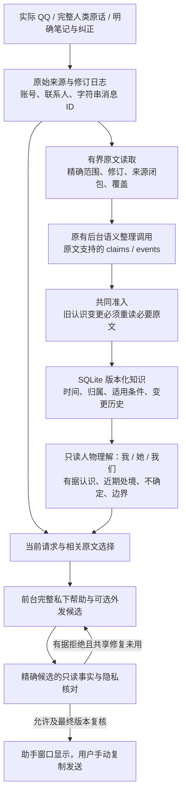

# 基于原文的长期理解

旧条目无需继任解释即可停用，以及来源日志结束后的有界复核，见[023 补充](memory-retirement-recovery_CN.md)。

022 候选继续使用[薄前台答复](thin-answer-ownership_CN.md)：用户在正常桌面 QQ 交流，在独立助手窗口商量，自己修改、复制和发送。长期记忆服务于理解当前处境、找到真实谈资、分享自己、回访和持续商量；当前用途是相互了解与亲近，也支持朋友、工作、学习等目的。核对通过和开发测试通过不是这些目标的完成证明。

[原文读取](../src/original-evidence.cjs)与[Store](../src/store.cjs)区分三个进度：来源日志游标、实际交付原文的覆盖、语义认识的审核状态。旧摘要是导航和更新对象，来源别名不代表读过正文。更新、重申、合并或停用旧认识，需要本次实际交付其必要原文及新证据，且范围、修订与完整会话身份相符。未读余文、缺失来源或脱敏隐藏的正文不能证明完整审核。不会预载全部历史。

[后台整理](../src/memory-engine.cjs)是正常模型路径的唯一人物知识写入者，输出 typed claims/events 与导航用 episodes。前台直接回应当前原话；兼容路径收到的人物推断只作为待原文审核的导航提议，不直接写成有效画像。明确用户笔记、更正、停用仍即时保留为人类来源，不能冒充她的事实或感受。正确来源与角色只是必要条件，不能证明模型解释符合原意。

[知识语义](../src/relationship-schema.cjs)保留主体、直接陈述／转述／观察／推测、局部／短期／反复／有条件适用性。条件不能被省略后变成长期特征，兼容兴趣也不会按同一 aspect 自动合并。报告时间、审核时间和事件发生时间分开；不知道何时发生就保持未知，不复制报告日期。晚到的旧接受报告不能覆盖后来实际取消；撤去取消来源只留下不含正文或活动名称的内部不确定屏障，不使旧接受重新成为当前约定。

[人物视图](../src/relationship-store.cjs)由现存知识和有效来源生成，不是另一份可写传记。UI 和前台上下文保留归属、条件、日期及不确定性。数据库结构迁移保留原始 ID、修订、纠正、撤回、笔记和未完成游标；旧派生记录标记 `legacy_unreviewed`，不因升级而获得语义确认。后台重读原文后，可以显式、带版本地用 typed 认识替代旧导航记录，旧记录保留为停用历史。

旧偏好分类还可引出有界的原始人类指令读取，供本次重新理解反复、有条件或仅这次的范围；不会盲用旧摘要，也不要求用户重填已经给出的指令。只读原文提示与已确认的无条件表达控制分开，局部、有条件或适用性未定的认识不会自动变成全局措辞规则。

[上下文选择](../src/context/selection.cjs)先确定实际提供范围的连续性与许可候选资格，再测量完整请求，最终整理后重试相同检索队列。持续商量可恢复以前实际准入的原始事实片段及其完整语境，不依赖外发草稿的有效期，也不将生成话语、所有输入引用或旧准入记录当作新分享许可。近期人类商量按实际顺序呈现，完整当前请求优先；局部纠正不写成全局偏好。

[核对器](../src/whole-answer-fidelity.cjs)严格解析核心决定、事实缺陷、精确候选与原文绑定，再单独解析可选诊断。错误的可选诊断被私下记录为不可用，不阻断有效事实拒绝进入现有一次修复，也不能授予事实或把不确定变成允许。社交节奏与文风仍仅为建议。已知 QQ 内容可先给有据回应，并在唯一私下解释中问一件必要的真实素材；不会用虚构经历或空泛“以后再说”替代帮助。

候选沿用所选模型／提供方、普通两次前台调用、共享一次修复、每任务四次、48 KB 上下文和 64 KB 完整请求上限。没有新增每消息理解调用、嵌入服务或图数据库。来源撤回、账号／联系人切换、产物与修订版本检查仍在发布前执行。

验证证据分开保存：功能测试和虚构旧库迁移检查证明结构及生命周期；默认 synthetic replay 和浏览器检查只证明集成。补充[记忆观察器](../scripts/eval-memory-understanding.cjs)通过实际公共状态接口，记录声明空闲期前后的人物视图、来源身份和后续答复，保留待处理覆盖与所有后台 HTTP。它不强制整理、不改原冻结 H、不把审核标准输入模型；短于原生空闲阈值的间隔可以仍有待处理任务。实际模型的记忆准确性及后续帮助质量仍需独立真实输出审核，不能从这些检查推断。
