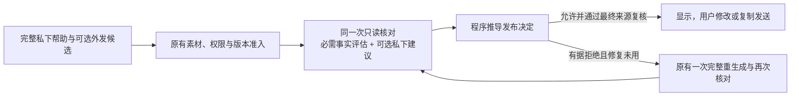

# 事实核对与发布决定

024 保留主调用完整帮助、程序素材准入、同一次只读核对和用户手动复制发送的流程。改变的是核对结果的决定权：模型必须逐字段给出事实评估，程序据此决定能否发布；模型另报的 `allow` 不能覆盖它已指出的无依据事实。没有新增模型调用或自动发送能力。

[字段地址与用途](../src/candidate-field-paths.cjs)由程序从精确候选生成，绑定账号、联系人、原文修订、时间、图片和完整候选。每个可见字段必须评估一次。事实断言须提供本次实际交付的完整原文支持，或明确记录“本次所供证据不支持”；必要证据不能核实时不发布。缺失或畸形的新核心不会退回旧的空 `issues` 加 `allow`。

个人已发生／当前事实、声称已有的计划与偏好，以及问题中的必要事实预设，都属于需要核对的断言。普通交流意愿、感受和没有事实预设的问题可以保留。私下举例若本身明确带有真实条件，可以在同一私下字段保留完整条件和例句；另处说“只是占位、使用前替换”不能使独立可复制候选中的虚构经历成立。已获准的真实自述仍可使用，不是一律删除自我分享。

[核对解析器](../src/whole-answer-fidelity.cjs)从必需事实评估和严格事实／隐私／限定冲突项推导拒绝、不确定或允许，分别记录模型报告和程序决定。社交节奏、文风和比喻仍仅为建议。可选建议或可选解释性文字格式错误，会私下记为不可用诊断，不能取消有效的事实拒绝或有效核心允许，也不会授予事实、权限或执行动作。

无本人近况时，仍可回应已经知道的 QQ 内容，并在唯一私下解释中核对一件真实素材；不应靠虚构日常凑成完整消息。正常两次调用、每任务最多四次、共享一次修复、48 KB 上下文／64 KB 完整请求、来源撤回与账号／联系人切换复核均沿用原约束。

功能和 synthetic 检查证明程序契约、调用顺序及生命周期，不能证明模型会完整识别每一条事实或正确判断语义支持。漏识别、误分类和错误理解原文仍需通过实际输出与独立审核检验；这些检查不构成对话质量或桌面集成结论。
