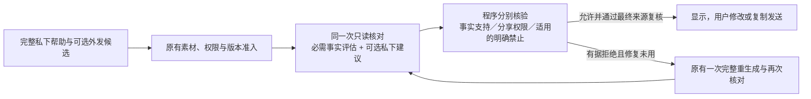

# 事实核对与发布决定

026 延续 024 的完整帮助、素材准入和同一次只读核对，进一步区分证据的用途。目标是让用户用真实素材理解情况、接续交流和分享自己，避免有效回应被无关的文风判断阻断，也避免“事实是真的”被误当成“可以对外分享”。用户仍自行修改、复制和发送；没有新增模型调用或自动发送能力。

[字段地址与用途](../src/candidate-field-paths.cjs)由程序从精确候选生成，绑定账号、联系人、原文修订、时间、图片和完整候选。每个可见字段必须评估一次。事实断言须提供本次实际交付的完整原文支持，或明确记录“本次所供证据不支持”；必要证据不能核实时不发布。缺失或畸形的新核心不会退回旧的空 `issues` 加 `allow`。

个人已发生／当前事实、声称已有的计划与偏好，以及问题中的必要事实预设，都属于需要核对的断言。普通交流意愿、感受和没有事实预设的问题可以保留。私下举例若本身明确带有真实条件，可以在同一私下字段保留完整条件和例句；另处说“只是占位、使用前替换”不能使独立可复制候选中的虚构经历成立。已获准的真实自述仍可使用，不是一律删除自我分享。

[核对解析器](../src/whole-answer-fidelity.cjs)以必需的逐字段事实评估作为唯一事实决定来源。必要的时间、频次、程度、主体、否定、条件或范围限定必须依附具体断言与原文；候选内部事实冲突必须指向另一条实际断言。旧 `issues` 里的事实意见与全局 `verdict` 只保留诊断，不能绕过这条路线。具体断言无法核实时仍不发布；核心缺失或畸形仍关闭发布。模型报告和程序推导决定分别保存。

真实原文与对外权限分别核验。私下分析可读完整原文，但可复制候选中的私人断言必须同时落在实际准入片段中；范围更广的事实证据不能自动授权整段私人来源。公开 QQ 和独立的外发素材笔记沿用程序已有的来源规则。私下占位免责声明仍不能使可复制候选中的虚构自述成立。

明确禁止某项外发内容时，核对须给出适用的用户指令、原文与具体违反内容。只有实际面向助手的用户控制可以作为这类指令，QQ 对方话语和用户已发 QQ 不自动取得该权限；后续明确改意保留其作用。正向关注点、社交节奏、文风和比喻仍是私下建议。私人分析中提及被禁止的行为不等于建议发送它。可选建议或解释格式错误只记为不可用诊断，不能取消有效核心结果，也不会授予事实、权限或执行动作。

[偏好编译](../src/context/wording-controls.cjs)保留完整条件的来源依赖，不再把逗号后半句变成无条件风格要求。`use=discussion` 的用户偏好仍能内部指导帮助，私人原因不会混进外发措辞；条件是否适用于当前事实由模型结合完整原文判断，程序不按“忙”等关键词激活偏好。普通无条件偏好及本次明确改意仍有效。

无本人近况时，仍可回应已经知道的 QQ 内容，并在唯一私下解释中核对一件真实素材；不应靠虚构日常凑成完整消息。正常两次调用、每任务最多四次、共享一次修复、48 KB 上下文／64 KB 完整请求、来源撤回与账号／联系人切换复核均沿用原约束。

功能和 synthetic 检查证明程序契约、调用顺序及生命周期，不能证明模型会完整识别事实、正确区分疑问与断言，或正确理解条件和指令适用性。上述语义判断仍需实际输出与独立审核；这些检查不构成对话质量或桌面集成结论。
