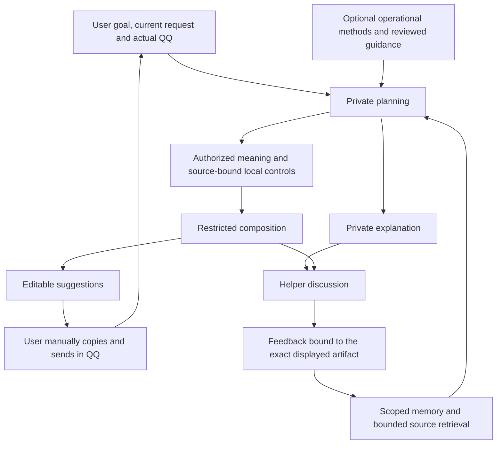

# Goal context acceptance

The assistant serves the user's wish to develop a mutually desired romantic relationship with an online acquaintance. Appropriate help includes understanding each other, sharing real life, responding to what she says, considering shared activities, expressing interest and deciding how to handle uncertainty or boundaries. These are choices, not fixed relationship stages.

## Diagnosed boundaries and resulting behavior

| Boundary | Previous behavior | Current behavior |
|---|---|---|
| Discussion to wording | A response with a draft plan lost its readable explanation; the composer replaced it. | Planning explanation is saved and displayed separately. Whole-response feedback uses the exact visible explanation and summary; outgoing artifacts contain only proposed wording. |
| Local expression controls | Without a saved topic, the final composer could lose the user's current approach or avoidance. | Current plans require a source-bound objective, approach and explicit avoidance evaluation, including the latest intent. Clarification remains available when essential facts are missing. |
| Operational methods | Specific relationship methods could appear only as names or short catalog labels. | All eight compact operations are supplied. Under payload pressure, canonical operations and selection rules move to the measured system channel; restricted composition supplies only compose. Up to two supporting full cards can be repacked when space permits. |
| Experience guidance | A different phrasing could miss an active approved rule. | Lexical matches plus at most two recent active candidates are offered for applicability checking. Current instructions win; inactive, foreign, withdrawn and stale-source guidance is excluded. |
| Optional raw history | Many lexically similar coworker notes could enter the context despite being unrelated to her. | Automatic raw retrieval and recent-note fallback share an eight-source bound, retaining temporary relevance scores before recency. Explicit selection, source closure and requested lookup remain separate. |
| Factual wording | A live sample strengthened occasional play into a habitual preference and treated overtime as late-night work. | Shared grounding preserves time range, frequency and degree. Viewer timezone is provided as display metadata, without implying either person's location. |

## Execution and evidence

Ordinary private discussion can finish in one model call. Requested wording normally uses planning and composition. Lookup, compaction or one bounded format repair remain within the existing four-HTTP-request task cap; methods do not add a routing call. Pictures retain their own scope, consent, source map and byte limits.

Functional tests verify information preservation, permissions, budgets, source changes, actor identity and UI behavior. The preregistered fictional model cases test whether useful advice and wording follow those structures. Independent readers inspect actual outputs rather than treating delivered instructions or source IDs as proof of correct understanding.

The first eleven-case live run had zero deterministic failures, but reviewers qualified two small wording distortions. A later targeted run retained an HTTP 408 failure and a skipped case. The successful retry does not erase either record. Reviewers also disagreed about whether a source-and-local-intent rationale sufficiently explained the longer-term goal; the stricter interpretation led to a further focused rationale check.

## Limits

- Source-bound controls can still be semantically contradictory. Provenance and field validation cannot replace interpretation of current intent.
- The original experience case has lexical overlap and repeats guidance in recent history. It cannot isolate a causal benefit of fallback retrieval; separate in-memory checks establish only routing behavior.
- Seeded prior acknowledgments test handoff of supplied direction, not the model's independent formation of that earlier understanding.
- A bounded fictional suite does not establish unseen-case generalization, romantic interest, relationship success or an effect on her future replies.
- The local proxy's configured/reported model identity is recorded; the physical upstream model identity is not independently established.

Executed candidate, integration and preservation evidence is recorded in the accompanying evidence and Chinese acceptance summary after completion. Real chat bodies, credentials and images are excluded from these records.
