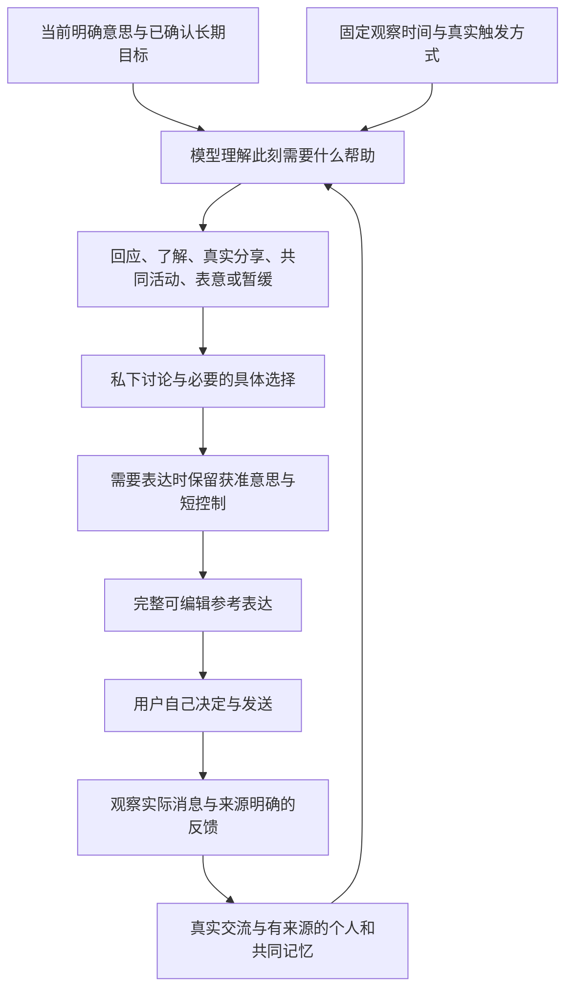

# 围绕关系目标选择此刻的帮助

目标是帮助用户真实表达、了解对方，并寻找双方愿意的相处机会。增加消息数量、避免所有停顿、猜测好感、固定每日联系次数都不是成功标准。

前一版已经有较完整的近期交流，但仍把十几个小时前的内容称为刚才，或者只围着末句有没有问题作答。本轮修正的是从“此刻咨询”到“具体帮助”的组织方式，而不新增一个关系阶段评分系统。

## 实际处理流程

方法可以组合或跳过。用户明确要分享、邀请或表意时，应保留这个意思。没有明确小目的时，助手给一个可修正、有事实支撑的方向；不会强迫先填表。选择不继续这一轮也可以，但理由需要符合具体处境，不能仅因没有问号。

## 工程投影与权限

- `taskContext.invocation` 只记录实际调用方式：自动观察、手动建议、私下请求或反馈接续。它不是意图分类器，也不代表用户已决定发消息。
- 顶层 `asOf`、`viewerTimeZone` 与 `timeContext.localNow` 共同给出固定观察时间；近期记录有本机显示时间，最新记录及显式焦点有距今分钟数。用户本机时区不代表对方所在地。时间差不直接推出冷淡、收尾、重联或联系频率。
- `consultationTask` 说明用途和来源重点。旧重点后已有的可见消息数量可供核对，选中重点不会抹掉当前原话。
- 同一稳定观察的检索、整理、修复与成稿共用时间基准；新消息导致重新观察时再取新时间。
- 成稿仍只接收实际 QQ、获准素材、短表达控制及安全的时间和调用信息；不传私下完整理由与长期目标。`askFollowup=false` 限制擅自附加的尾问，不删除已经选定的相关问题或邀请。
- `reply/suggest` 是入口提示，不再标成用户明确选择了某个人际方法。旧的自动结果指纹绑定提示词版本，避免新指导仍复用旧结果。

## 人际研究提供什么依据

[Laurenceau、Barrett 与 Pietromonaco（1998）](https://affective-science.org/pubs/1998/LaurenFBPl1998.pdf) 用两项自然互动日记研究检验自我披露、对方披露和被感知回应感与亲近体验的关系。这里借鉴的是：帮助用户表达真实内容，也回应对方具体分享。它不能证明某句话的效果，或要求每轮深度披露。

[Huang 等（2017）的研究和作者存档](https://dash.harvard.edu/entities/publication/73120379-2eb6-6bd4-e053-0100007fdf3b) 支持把贴近对方回答的跟进作为一种可选交流行为。不能据此把每轮变成采访或将实验中的喜欢等同稳定恋爱意愿。[PubMed 条目](https://pubmed.ncbi.nlm.nih.gov/28447835/) 还列有 2019 评论及 [2025 更正](https://doi.org/10.1037/pspi0000491)；本轮未能完整读取更正与审计资料，因此不引用未核对的效果量，也不将原结论视为无条件通则。

调用方式、时间字段、字节边界与来源排序是本项目根据实际失败作出的工程选择，不是上述论文提出的算法。论文不提供应隔几小时联系、应该用哪句台词或保证关系成功的依据。

## 验收边界

功能测试检查来源、时钟、调用身份、私下信息隔离与字节预算。13 个全虚构主场景检查实际规划与最终表达；源冻结后再由独立评审者提供 3 个未公开案例。标准预先写在 [语义场景说明](goal-help-quality-scenarios.md)，包括正向与反向边界。

JSON 合法、来源齐全或成功交付都不足以通过建议质量验收。评审还需检查此刻处境、意思保真、具体帮助、自然表达与双方选择。测试结果及运行启用状态另行记录；现实恋爱效果仍未知。
