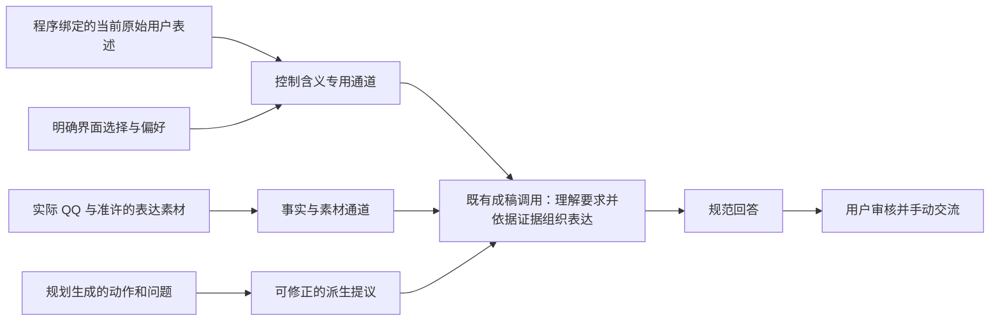

# 有证据约束的成稿与澄清所有权

这个候选服务于持续、有目的且真实的交流。已经发生的失败是：她只介绍了双人拼图的计数功能，规划却提出询问已经各自拼了多少；成稿提示又要求保留这个规划问题。原文提取正确，未能阻止派生计划获得过强的执行权威。

## 成稿应看见的不同依据

| 内容 | 实际作用 | 不应获得的权力 |
|---|---|---|
| 当前用户的原始表述、明确界面选择与偏好 | 理解用户此刻要什么、行动强度和边界 | 不能自动充当给对方讲述的新事实或分享许可 |
| 实际 QQ 与已准许的表达素材 | 支持具体回复所用的事实与内容 | 功能或可能性不自动成为已有参与、体验或约定 |
| 规划层的指导、问题与动作提议 | 提供一种可能的交流组织方式 | 不能仅因结构、来源 ID 校验通过，就被当作必须执行的人类选择 |

控制通道保留当前原始表述的整段条件、否定与引语。其来源由程序绑定，不能由模型自报“已获用户明确要求”。生成的续聊包装、调用占位符和额外历史私下笔记不能混进来。来源撤回、遗忘、联系人切换、版本变化与取消仍须使旧结果失效；完整控制输入参与同一实际字节预算。

成稿可以修正一个证据不支持的规划问题，但仍应遵守用户明确的行动方向。例如用户已经决定直接邀请，就应帮助表达邀请，不能统一退回试探、含蓄或确认兴趣。这个职责调整使用已有成稿调用，不增加一个循环核验系统。

## 一个澄清问题，一个正文所有者

结构化 blocker.question 提供规范提问，可选 blocker.explanation 明确说明所缺信息及原因。旧的未类型化正文不再自动变成另一段可见解释；原始响应通过既有诊断或哈希保留。正常的私下讨论、依据说明及“为什么”的回答继续存在。

界面与实际回放都读取规范记录。不能通过评测适配器隐藏仍在界面展示的第二个问题，也不能依靠语义正则或字符串去重猜测两句是否相同。

## 限制与验证

CONTROL_ONLY 是模型使用约束，不是形式化信息流保证；成稿阶段看到的当前私下文字增加，仍需检查泄漏风险。原文存在也不能形式化证明模型已正确理解。可选解释字段也可能被模型误写成重复提问，必须观察真实输出。

功能验证检查来源绑定、权限底线、预算、生命周期和正文所有权。对话质量使用原有冻结案例、实际模型回放与独立评审。前一候选在长咨询和当前素材上恢复了交付，但因局部提问预设错误被拒绝；这些通过评分不能自动转移到本候选。

## 候选接口与加载时机

| 接口 | 什么时候加入成稿输入 | 来源和使用范围 |
|---|---|---|
| currentHumanControl | 存在可信的当前原始人类表述时 | 从 intentAuthority 绑定完整的当前表述；只解释当前要求，不是新增素材或许可 |
| selectedDirectionControl | 用户确实选了仍有效的具体表达方向时 | 程序验证选择身份、标签、版本和素材元组；独立于规划提议保留，模型自行选的 option 不算 |
| 实际 QQ 与 outboundQuotes | 已经取得实际记录并通过素材准入后 | 作为回复事实及获准表达素材；保留原来源、时间语义和限制 |
| draftingGuidance | 有适用的规划提议且预算允许时 | 标记为 GENERATED_PROPOSAL，成稿可以根据证据修正；省略不能使实际人类选择消失 |
| blocker.question 与可选 explanation | 确实需要补足关键事实或许可时 | 组成一个规范澄清正文；普通的“为什么”讨论不因此被改成索要资料 |

这里的选择控制不是另一份长期记忆，也不使生成草稿成为已发送的消息。它绑定本次实际请求和有效选择；来源或联系人变化后，旧绑定不能继续使用。

第 028 轮的实际结果仍不足以接受此候选：局部聊天首轮返回了互相冲突的私下帮助标记与消息计划，修复后未解，故尚未进入成稿，后两步也未执行。缺少素材的单次澄清已由独立评审判为可用。完整功能检查 1150 项及隔离界面/刷新检查通过，不能代替缺失的对话质量证据。此版本只作为下一轮可重现基础，不据此发布或宣告语义改进。
