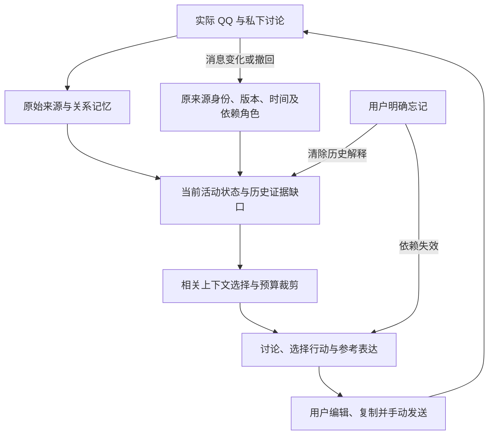

# 记忆与上下文中间版本集成记录（042）

候选代码为 `ff034e0b7ad9afa5d35fc6721b1ec09e387aab8f`，后台源码 SHA 为 `37788817320479d56a31d7ffbc978ff878845926df9ab214e8ab8b4fe401e691`。本次按用户要求，将已验证的记忆改造作为本地 main 的中间集成，集成前 main 为 `cb89232`，保留备份 `backup/main-before-memory-context-042-20261101`。代码集成不是全部行为验收，也不代表 QQ 已加载或整体 Goal 完成。

## 为实际交流解决什么

助手需要分清“她确实改变了安排”和“原先判断安排的依据不可用了”。否则，撤回消息可能被误当成重新答应，或者助手不知道撤回的究竟是哪条，进而给出不合处境的建议。

相对 main，这组改造贯通了记忆写入、活动身份、证据失效、当前状态和上下文选择：

- 导航记忆更新明确选择已有记录或新建，减少已有记录被当作新记录而拒绝维护的情况。
- 活动采用独立身份及有来源的定义，显示名称不再承担身份判断；同一消息涉及多个活动时分别处理。
- 原消息不可用后，保留有限的历史失效元信息，区分原作者、原判断、依赖角色和未知的撤回操作人；这些信息不能充当原文或外发许可。
- 原消息时间、旧状态或世界事件时间、知识变化时间和未来计划时间分别保存。旧资料没有保留的时间继续标为未知。
- 调用前按相关活动加载这些信息，并限制详情数量；明确忘记会清除历史解释，并让依赖它的已发表或在途建议失效。

## 已有证据

- 187 个文件、1,763 项功能检查全部通过，没有跳过；检查期间源码、界面及样例哈希不变。
- 38 场景、81 步合成回放完整执行，176 次虚构传输；只证明链路整合。
- 当前候选 8 组真实模型比较、27 个请求全部交付，候选共 77 次 HTTP。各比较仍遵守每侧 16、合计 32 的上限，包含维护和修复。
- 五组公共记忆/状态比较均完成独立评审：12 个记忆判断可用；12 个回答为 11 个可用、1 个需小改，没有本组硬错误。新的原消息时间反例相较前版有改善，其余多数等价。多活动第二步仍应更清楚地区分看展依据缺口和电影此前有答应、未见取消。
- 103/104/105 的实际回放均已完成独立评审。103 拒绝：6 个回答中 3 个可用、3 个需重写，包含无依据的否定经历等事实错误。104 接受：长私下讨论及话题结束的 4 个回答可用。105 拒绝：5 个回答中 3 个可用、2 个需小改，仍遗漏已提供的具体可用时间，并有重复邀请。正式轮次决定继续保留，本次部分能力集成不改变它们。
- 后续 106 在相同代码上检查重新联系、仍忙碌、没有旧话题和普通朋友观展交流：5 个实际回答均可用，没有本组硬错误；这是有限的开发回放结果，不是未见场景或个人口吻证明。
- 部分早期记忆维护曾拒绝模型输出；后续恢复和回答交付不代表全程维护均已完成。原始 incomplete、错误及未通过决定保留。
- 旧版本实际生成的虚构数据库用于升级检查；没有用当前实现伪造旧库。旧缺失信息不猜补。
- 沿用并核对了 041 的六项隔离浏览器流程共 61 个检查：当前 UI、Controller、Store 和 experience-store 与被测版本字节相同；新增时间处理另经功能和独立副本检查。均不是实际桌面 QQ 接入证明。

## 保留问题及下一步

已有独立评审证实：来源删除或排除后，模型可能把“没有可用个人素材”写成“我没有做过”。调查发现实际输入没有这条否定经历，首次错误在模型生成的结构化建议中。已申报素材的来源校验不保证所有生成事实都被申报。当前候选对应的“没修过欸”“我还没补过包”已被 103 独立评审判为事实错误。本次记忆时间修复不声称解决这一独立问题。它是成稿可靠性的下一优先项，不能用记忆验证通过替代。

整体 Goal 继续覆盖真实话题、主动联系、持续商量、真实自我分享和目的变化。个人口吻、未见场景与现实关系效果尚未验证。模型能力对照已有具体隔离提案，但替代模型授权仍待用户答复，没有运行其他模型；也没有偷偷修改推理参数、提供方或全局设置。

代码集成与桌面加载分别执行。本次仅作本地代码集成，未重启 QQ、未写入生产数据库、未 push；加载新版前继续保护未发送文字。

## 集成决定与限制

采用用户再次确认的“有用中间版先集成、继续完整 Goal”策略：不以整个 Goal 完成为合并前提；一组能力有实际收益、相关反例检查未发现新增严重退化时，可先本地合入并保留回退点。本次合入已验证的活动记忆、来源失效和时间区分能力，同时保留独立评审中的小改、执行失败和其他生成问题。已知问题不被改成通过；正式轮次的拒绝决定保持，整体 Goal 继续。

真实 QQ 发送始终由用户完成。代码和原始数据保留；本次没有更改已选模型、提供方、审批、全局 hooks、角色配置或冻结评测标准。
