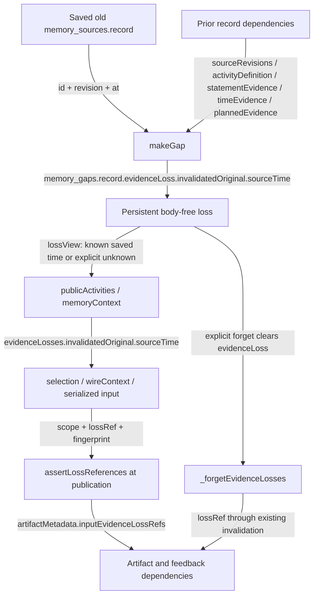

# Original source time in evidence-loss provenance (C042)

The preserved actual041 dependency-counter input delivered two definition-loss
records for the same recalled invitation. Both included the affected coordination
claim time and knowledge-change time, but omitted the original source timestamp.
Store still had the old source's `at` when it called `makeGap`. This change carries
that timestamp through the existing non-evidence provenance path. It does not
establish why the model used a different date in the actual output.



New `invalidatedOriginal.sourceTime` has one of two shapes:

```json
{"status":"known","at":"<exact saved original.at>","basis":"saved_original_source_at"}
```

```json
{"status":"unknown"}
```

`makeGap` copies the exact saved string only when its original ID and revision
match all present bindings for that dependency. This includes the activity
definition even when it is absent from `sourceRevisions`. Missing, invalid,
unbound or conflicting saved time remains unknown. The function does not look up
today's same-ID source, substitute a newer revision or normalize the saved zoned
representation into different text.

The four clocks keep distinct meanings:

| Field | Meaning |
| --- | --- |
| `invalidatedOriginal.sourceTime.at` | Timestamp on the saved original version: for QQ, message time; for other original types, their source timestamp. |
| `affectedWorldAt` | World event or reported state time of the invalidated prior interpretation. |
| `knowledgeChangedAt` | When evidence loss changed program knowledge. |
| `plannedFor` | Planned activity time in the existing world-event contract. |

These are not interchangeable. An authored/report/note source timestamp does not
automatically establish event occurrence. The change does not move, remove or
reinterpret `plannedFor`, reorder world events or change current arrangements.
Original author and unknown operation actor remain separate.

Old losses without stored source time project as explicit unknown. Projection
does not mutate their persisted JSON or reconstruct the timestamp from remaining
clocks, a current source or a test fixture's expected values. Older opaque gaps
still have no recoverable original identity or source timestamp.

The existing public and memory projections, bounded activity selection, optional
loss-detail budget trimming and single correction consumers already carry the
complete nested object. It stays outside delivered sources, source receipts,
`s#` handles, `m#/a#` material authority, original lookup and new event evidence.
When a same-ID source becomes readable at a newer revision, its current handle
continues to bind only that new revision; the historical time stays with the old
revision.

The existing loss fingerprint covers the new projected time. Publication rejects
a changed time dependency inside the existing atomic artifact path. Explicit
forget still removes the whole loss interpretation and invalidates dependent
artifacts and feedback; actual user input is retained. No new table, publication
stage, model call, actor inference or semantic validator is introduced.

Memory version becomes `evidence-backed-understanding-2026-11-01.5` and foreground
context version becomes `goal-context-2026-11-01.15` because their delivered input
contracts changed. Existing schema/storage versions remain unchanged. No other
producer, selection or controller edit is needed: the existing path projects and
fingerprints the nested loss object, which the focused tests exercise.

The regression fixture includes complete actual fictional041 counter canonical
and serialized inputs, exact old source and prior records. Scripted initial and
single-correction consumers retain all six original sources and fit at 38,170 /
40,546 bytes under 64,000. This is complete-input projection evidence, not a full
historical runtime reconstruction or fresh model result.

Portable pre/post041 SQLite fixtures were created by actual frozen041 Store and
decoder APIs using fictional originals, then exported in the existing logical
snapshot format. Hash-pinned restoration verifies raw old state before current
Store opens it. A new invalidation after the pre-loss snapshot captures the saved
time; already-lost post-state stays unknown and completes processing as no-change.
Default tests do not import a personal historical worktree. Generation scripts,
source/backend/input/logical hashes and checks are retained with the handoff.

Mechanical checks do not prove that a model will use these distinctions correctly.
Historical interpretations may themselves be wrong, and membership of a source
does not prove entailment. Full functional checks, actual replay and independent
output review remain coordinator-owned. No provider call, commit, main merge,
configuration change or QQ activation is performed by this implementation task.
