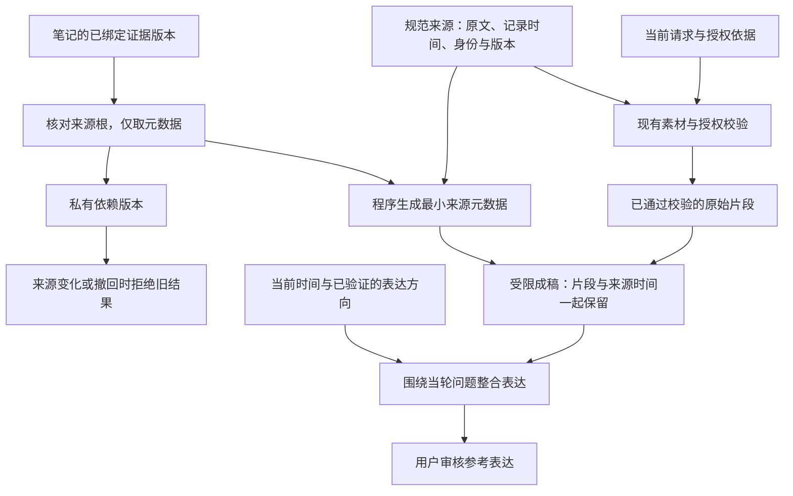

# 成稿阶段的来源时间与材料语义

长期记录找到了，不等于成稿模型仍看得到它的时间。原先受限成稿只接收已选片段的来源 ID 和文字，同时看到当前时间。八月陈述中的“终于做好”，可能因此在十月被改写成“刚做好”。

本层在素材通过原有校验之后，补上程序从同一份规范快照取得的来源元数据。它不改写原始片段，不重新授予分享权限，也不增加模型调用。

## 时间分别表示什么

| 信息 | 能说明什么 | 不能据此断言 |
|---|---|---|
| QQ 消息或私下陈述的记录时间 | 原话在何时进入对话 | 所述事件恰在那一刻发生 |
| 笔记编辑时间 | 笔记何时修改 | 内容中的旧事件刚刚发生 |
| 已绑定版本的证据根时间 | 笔记所引用的原始记录时间 | 最新一条记录就是事件发生时间 |
| 当前授权或当前请求的时间 | 本次表达的使用范围与当前任务 | 旧事实已经重新变成新近事实 |
| 草稿生成、改写或复制的时间 | 助手产物或用户操作发生的时间 | 素材中的事件刚刚发生，或消息已经实际发送 |
| 当前 `asOf` | 这次帮助的参照时点 | 缺失时间可以自动补成现在 |

缺少日期或无法核对依赖版本时保留未知。旧记录不等于事实失效；未知时间本身也不要求重新盘问用户。明确的原始时间含义继续保留，确有依据的新近进展仍可表达为新近进展。

## 笔记与依赖

`buildMaterialProvenance` 从已捕获、按账号与联系人限定的来源取得元数据。对有证据根的笔记，只使用能够核对原绑定版本的根信息；没有 `evidenceRevisions` 的旧关联不能冒充已核对来源。

直接 QQ、私下陈述和反馈使用自身的记录时间，不因为回复所引用的上下文缺失而丢失这一时间。笔记在捕获时就存在缺失、循环或无法核对的时间来源时，根时间保持未知；已有素材权限校验继续独立生效。已经核对并用于请求的依赖若后来变化，则拒绝旧结果，不能事后用“未知”绕过原来的快照。

传给成稿模型的是有界的元数据；截取根列表时必须明确完整性。完整的来源依赖版本留在私有清单中，继续参与修改、撤回和提交时的校验。不会为此转发额外的私下原文或授权文本。

## 材料不是逐条待发送句子

表达方向负责控制行动和组织方式，片段提供事实依据。成稿应整合它们，让同一含义表达一次，而不是先复述方向中的事实，再把原片段接上去。

本层不按相似文字自动删除事实。不同人物、日期、否定和细节仍须保留；来源记录时间也不应被输出成未经证实的事件完成日期。

## 证据边界

程序测试验证时间从真实规范来源取得、未知值不被补造、依赖仍有效、原文与权限保持不变，以及元数据计入实际字节预算。自然表达和时间解释是否改善，仍由完整原始历史的实际模型回放及独立评审验收。
