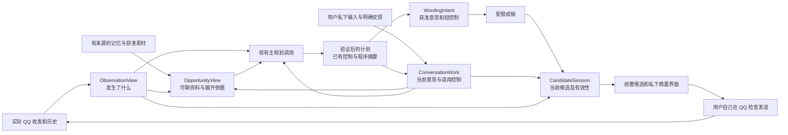

# 关系聊天助手重构提案：可聊内容、当前商量与候选生命周期

状态：供 root 裁决的设计提案，尚未批准为实现契约。本提案依据[整体重构记录](relationship-assistant-refactor-note_CN.md)、当前 Controller／上下文／UI 源码和虚构回归夹具。示例均为虚构；没有读取真实 QQ 数据，没有调用模型，没有修改运行中的应用。它不宣称建议已经改善真实关系。

推荐实施按 root 的收紧意见：使用 QQ revision、privateInputSeq 和程序计算的 validated plan digest 建立候选发布边界，不增加模型必填的 no-change／intent receipt 协议。私下新输入先撤下当前稿；新成稿发布；纯解释仍可在历史中查看和取用原稿，不自动恢复旧稿。

## 已实现状态（2026-10-16，隔离工作树）

- `src/candidate-session.cjs` 已成为当前候选、私下输入序号、发布 ticket、计划摘要、TTL 和自动去重的唯一拥有者；Controller 的旧 `publishAdvice` 与平行有效性判断已删除，`advice` 仅保留本地 API 兼容访问。发布时核对四项身份、QQ revision、privateInputSeq 与验证后的计划摘要；当前来源有效性复用既有 artifact 依赖检查，不绑定后台记忆 generation。
- `src/conversation-work.cjs` 导出纯派生 `buildConversationWork(payload)`；`src/context/planning-view.cjs` 实际消费，再传给 MaterialView。当前意思、目标与适用控制引用已有来源／字段，不重复私下全文，也没有第二套持久状态。
- 用户私下新请求先撤下旧主候选；新完整 draft 无论从 reply 还是私下 discussion 生成，都发布到前置区。解释不恢复旧稿；原始工件、私下历史和编辑稿保留。输入序号与计划摘要记录在程序 manifest，不成为模型输出义务。
- “想和她聊”和“换个切口”均只请求当前候选，不提交未发送的私下输入。自动请求期间可以提交用户商量并抢占旧自动任务；过期响应不能再进入成稿或发布。
- “换个切口”通过显式 `alternative:true` 请求不同的内容方向，而不只是重新调用同一提示词。仅在有完整当前候选时提供单条 generated 对比引用；无当前候选退回常规手动找话题，自动观察不继承该动作。比较对象不成为事实、分享许可或旧输入闭包。
- 两条既有私下纠正红测已转绿；独立 session／work、来源撤回与后台维护区分、既有 Controller 相关守卫通过。连续合成浏览器覆盖私下改写、解释、真实 outgoing／新来信、TTL、用户抢占自动任务与编辑保留。完整批次、语义效果及最终集成由 root 统一验收；本段不代表实际桌面接入或真实关系结果。

## 1. 产品首先要交付什么

用户想联系她时，应先有一个具体、自然、可以展开的切口和完整参考表达。对方来信时，应接住她实际说的内容；她问用户时，也应帮助用户表达自己，而不是始终收集她的资料。用户只想先商量时，系统可以暂不出稿；用户纠正后，旧稿不能继续占据主位置。

“随时有话可讲”在产品上的含义是始终可以主动请求帮助，无需等新来信、先补一件个人近况或填写小目标。它不意味着自动不停生成、不尊重对方当前明确的暂停，或保证任何一句都会得到回应。没有可用旧材料时，可以给一条明确不依赖已知事实的低假设开场，同时说明个性化程度有限；不能编造一次经历来让开场显得具体。

主要工作流是：

1. **主动找切口**：用户点“想和她聊”，从当前生活细节、共同话题、可跟进旧事和已获准的自己素材中，先给一个可调整的方向及表达。没有新来信仍成立。
2. **接着聊**：新来信稳定后，先考虑具体问题、分享和语气，再选择回应、相关展开或真实自我分享。不是每轮加一个问题，也不是每轮只能认同一句。
3. **私下商量与纠正**：自然输入直接改变当前商量；可以解释、比较、补事实、改表达、改方向或暂停出稿。局部纠正只在适用工作里生效。
4. **从历史找素材**：用户可看“换个切口”或指定旧话题。系统按需取回原文，核对已经说过的部分，不能把“没有检索到”当作“从未问过”。
5. **共同活动**：兴趣和条件允许时，可以提出活动方向、商量分寸、形成邀请，再根据实际 QQ 回应更新当前事项。计划、邀请、愿意、拒绝与实际发生分别保留依据，不合并成“关系推进成功”。

这些是同一个助手的工作能力，不是要求用户先选好的五个模式。

## 2. 组件与消费方



| 组件 | 提供的内容 | 直接消费方与作用 | 不承担的职责 |
|---|---|---|---|
| ObservationView | 当前真实双方交流、原消息 ID、时间、引用、媒体是否已理解、覆盖范围、QQ 修订 | 机会视图和规划器判断当前说到哪里；候选会话处理真实收发变化 | 不把草稿、剪贴板或相似文字变成已发送 |
| ConversationWork | 当前用户意思、已选方向、本轮控制、未确定事实、最近用户输入的处理凭据 | 机会选择与成稿保留“这轮想做什么”；候选会话判断旧稿还适不适用 | 不重新保存一套人物事实；不把局部限制升级为永久偏好 |
| OpportunityView | 相关具体素材、自己／她／共同事项的来源、已经表达的内容、可核对的覆盖与未知 | 规划器有内容可选；界面可展示少量确有区别的其他切口 | 不凭字符串断言“她感兴趣”“没问过”；不每条消息另跑一个机会抽取模型 |
| 主规划调用 | 理解当下需要，形成工作凭据、选方向、必要时 lookup 或私下澄清，交接短表达意图 | ConversationWork、受限成稿与候选会话 | 不把内部推理直接当作待发内容 |
| 受限成稿 | 基于必要真实事实、获准意思、短控制与表达偏好生成完整文字 | CandidateSession 与用户 | 不接完整私人动机、不自行另选目的、不新增事实 |
| CandidateSession | 某个候选版本、绑定依据、有效状态、替代和失效原因、用户当前可做的动作 | 前置候选、复制／采用动作与连续控制器 | 不靠 UI 临时条件代替服务端生命周期；不把复制或实际收发自动归因为采纳 |

长期记忆、后台维护、检索和讨论压缩继续使用现有机制。以上分工不要求运行时增加多个 Agent 或多个模型；规划器在已有主调用中返回工作变化和选择即可。

## 3. ConversationWork：把当前商量与长期记忆分开

建议建立明确的当前工作记录，复用现有话题和原始用户来源，不让 `advice`、最近几条私下文本和某个提示词分别成为事实上的当前状态。

```text
ConversationWork {
  workId, scope,
  objective: { text, authority: user_stated | tentative, sourceRefs },
  selectedOpportunity: { opportunityId, viewVersion } | null,
  controls: [{ meaning, applicability, sourceRefs, supersedes }],
  unknowns: [{ question, whyItChangesThisWork, sourceRefs }],
  phase: exploring | consulting | composing | ready | awaiting_fact | paused | closed,
  controlVersion, selectionVersion,
  latestPrivateInputSeq,
  validatedPlanDigest
}
```

`objective` 可以是“先接她对小店的分享”“含蓄了解她平时玩的内容”“想约一次双方愿意的共同活动”。系统能先提出暂定方向，不能要求用户每次亲自填写；暂定方向也不能作为用户已经明确表态的证据。

用户的本轮“不直接问游戏名、不邀约”应进入有适用范围的 `controls`。用户后来明确“现在想问名字，也想一起玩”，以更新的直接用户来源替换旧控制。一个话题关闭后，原控制可以作为历史被查看，不能继续控制新工作。

### 私下新输入先建立边界，再理解它改变了什么

收到新的用户私下输入时，程序立刻增加 `latestPrivateInputSeq`。即使模型尚未返回 `topicPatch`，旧候选也不能继续被当作已核对过这次输入的当前稿。当前稿进入“正在核对你的新要求”，保留内容和编辑，不直接恢复复制。

已有主规划输出继续使用有来源的目的／短控制、方向选择和 draftPlan；程序核对来源后计算计划摘要，与请求开始时的 QQ revision 和 privateInputSeq 一起绑定，不另加一次分类模型调用或模型必填协议。

- **纯解释**：不发布新候选。私下解释和原工件保留，用户可以在历史或已编辑草稿中明确取用；不自动把旧候选恢复为当前稿。
- **纠正、改口或新方向**：先采用有来源的工作变化，再接收新稿。原候选被替代，新稿失败也不能恢复成当前稿。
- **暂停写稿**：保留讨论，撤下当前可复制候选。
- **意思确实不清楚**：保留待核对状态，问一个会影响当前处理的问题。不能凭问号或关键词把“为什么总这么直白？”简单判为纯解释。

程序能核对来源角色、作用域、版本、目标工件和请求序号；自然语言理解是否恰当仍需语义验收。原先考虑过 no-change receipt 自动恢复相同候选，但它增加了语义误判后的重新发布边界，本提案不将其作为实施要求。

## 4. OpportunityView：给规划器具体资料，而不是更多关系标签

视图先提供当前需要考虑的对方问题／分享及用户当前意思，再提供可选展开。它既能支持了解她，也能支持用户分享自己；未知字段不自动变成待填问卷。

“问题”和“已处理”由主规划器结合完整实际来往及用户控制理解，不由程序见问号就判定。比如“难道就我这么倒霉吗😂”可能是抱怨分享；两天前的问题如果已经有实际回答，也不能重新列作必答槽。程序负责提供原句、回答依据与覆盖范围，模型判断的正确性由连续语义案例检查。

```text
OpportunityView {
  viewId, scope, asOf,
  currentFocus: { actualMessageRefs, sourceCoverage },
  mattersToAddress: [{ actualQuote, sourceRefs, handledEvidenceRefs, uncertainty }],
  ownShareableMaterials: [{ bodyOrHandle, sourceRefs, permittedUse }],
  evidenceBundles: [{
    bundleId,
    concreteDetail,
    parties,
    sourceRefs,
    alreadyExpressed: [{ meaning, actualMessageRefs }],
    followupEvidence: [{ actualMessageRefs, relation, uncertainty }],
    coverage,
    availableUse,
    unknowns
  }],
  applicableControls: { workId, controlVersion, sourceRefs },
  missingCoverage: [{ range, lookupHandle }]
}
```

`concreteDetail` 必须可回到原文，例如“她买的旧植物百科里有几页奇怪插画”“她说拼图不想拆、打算装框”。“适合以这件事重新开场”是规划提议，不是已证实的人物事实。视图不保存“她就是喜欢被追问”之类推断。

规划器选定一个具体 `OpportunitySelection`：

```text
OpportunitySelection {
  opportunityId, basedOnViewId,
  evidenceRefs,
  intendedMove,
  whyThisDetailNow,
  alreadyExpressedRefs,
  expectedContribution,
  workControlVersion
}
```

`expectedContribution` 说明这句给当前交流增加什么，如回答她的问题、接住一个具体细节、让用户表达自己的真实兴趣或提出一个可选择的活动。它不能写成“提高好感 20%”。

### 何时加载、何时保存

1. 触发请求时，从当前完整交流、72 小时近期候选范围、当前工作和少量核心知识建立资料视图；不为填预算加载旧档案。
2. 现有资料够用就直接规划。只有缺失依据会改变切口、重复判断、事实或表达权限时才 lookup。
3. 非当前必要的老原文继续保存在本机；提供可取回的具体线索，不能把“未进入本次输入”描述为“不存在”。
4. 机会资料视图是有版本的派生输入，不新建一个永久的 AI 机会清单。选中的方向及其依据保存在当前工作／生成工件中，供后续改写、解释和反馈追溯。
5. QQ 新消息可能使一个机会从“跟进计划”变成“回应已经完成”；旧视图失效后重建，不靠关键词删掉单个标题来冒充理解变化。

## 5. CandidateSession：独立管理当前可用版本

当前候选不能只绑定 QQ revision 和五分钟 TTL。它还必须覆盖最新用户意思；完整 `contextGeneration` 又包含后台记忆变化，不宜直接作为唯一有效键。

建议独立服务负责当前投影，候选文字和 artifact 保持不可变：

```text
CandidateSet {
  candidateSetId, requestId, workId, origin,
  basis: {
    scope, qqRevision, focusMessageIds,
    workControlVersion, opportunitySelectionVersion, validatedPlanDigest,
    coveredPrivateInputSeq, sourceRevisions,
    modelBinding, promptVersion, observedAt
  },
  primary, alternatives, explanationRef,
  createdAt, expiresAt
}

CandidateValidity {
  candidateSetId,
  state: generating | checking_new_intent | current | superseded | expired | unavailable,
  reason,
  checkedThroughPrivateInputSeq,
  replacementCandidateSetId?
}

CandidateProjection {
  workId, status, userVisibleReason,
  currentCandidateSet?, copyEnabled, adoptEnabled,
  canRequestNewOpening, canContinuePrivateDiscussion
}
```

后台维护仅改变摘要或新增可检索记忆时，不直接使候选过期。依赖来源被更正／撤回、真实 QQ 改变或用户意思改变才触发相应失效；TTL 是时间有效性和去重的补充，不能替代上述绑定。

| 事件 | 候选会话行为 | 用户稿和主动请求 |
|---|---|---|
| 新来信 | 旧当前候选退出；可见且已开启自动时，对稳定的新交流规划一次 | 编辑稿保留；主动私下问题按已有有界机制带新证据重算 |
| 实际本人发送 | 旧应答候选退出；不自动再接一句，不宣称用户采用了某稿 | 自己编辑的未发内容保留；实际文本按 QQ 记录 |
| 新用户私下输入 | 建立新输入序号边界；候选先待核对，避免旧稿压过新要求 | 输入原文保留，不被刷新按钮提交 |
| 纯解释 | 不发布或自动恢复旧候选 | 增加私下解释，原稿仍可在历史／编辑稿取用 |
| 修改控制／改方向 | 提交版本后替代旧候选；旧请求即使迟到也不能发布 | 用户编辑保留；新稿与旧编辑分别呈现，绝不自动覆盖 |
| 私下请求生成新 draft | 通过版本核对的新稿成为当前候选，不再由旧 auto 稿占位 | 私下解释与工件仍可追溯 |
| 暂停写稿 | 无当前可复制候选；显示正在商量或已暂停 | 继续私下讨论 |
| 生成失败或 unavailable | 显示未交付和重试入口，不把旧稿恢复为 ready | 保留用户请求、编辑及错误位置 |
| TTL 到期 | 当前稿退出复制入口；不自动花费模型调用 | 手动“想和她聊”始终可用，与有无新来信无关 |
| 关闭自动 | 取消 automatic-origin 排队与请求；不调度后续自动工作 | 不取消 user-origin 主动商量 |
| 切换账号／好友／模型目的地 | 按现有 epoch、四项身份和授权取消旧请求与投影 | 分会话保存用户稿；迟到结果不跨会话发布 |
| 来源更正或撤回 | 根据精确依赖使对应候选失效 | 沿用已有来源复核／删除传播，不删除独立用户编辑 |

“实际本人发送”只说明交流继续了，不能把候选标成“已采用／成功”。相似文字与复制事件仍只是可能关联，沿用现有 ExperienceStore 的权限和确认边界。

自动去重键使用上述有效依据和时间有效期，排除“助手刚生成了一个建议”本身。自动观察输出保留工件供明确选择、解释或反馈，不再默认为最近用户商量的一部分。

## 6. 生成器真正收到什么：两个完整流程

### 流程 A：没有新来信和自己近况，主动重新开口

虚构 QQ：昨天下午她说买了本旧植物百科，其中几页插画很怪；用户问“怪到像外星植物那种吗”，她说“哈哈有几页真的像，我还没仔细看”；随后她去开会，双方已说好先忙。现在已过 17 小时，用户点“想和她聊”。

**观察视图**给规划器：固定当前时间和时区；完整的上述交流及原 ID；末条确实是用户自己的“好，你忙”；“开会／先聊到这”发生在昨天下午，不能被视为她现在仍在开会；更早记录覆盖如果不完整，明示未知。

**当前工作**给规划器：本次直接用户动作是现在想聊天；没有用户提供的新近况，不需要虚构；没有当前“必须等待”的用户要求。已确认自然简短的表达偏好提供安全投影。

**机会资料视图**给规划器：

```text
bundle book-illustrations
  grounded detail: bought an old plant book; several odd illustrations; had not yet examined them then
  evidence: contact-message A, C
  already expressed: user-message B joked about alien plants
  latest actual position: the old exchange closed; no new incoming
  unknown now: whether she has since read the book; whether she is currently free
  coverage: visible recent exchange, older correspondence available by lookup
```

**主规划输出**选择“跟进那本书的插画后续”，而不是重复外星植物玩笑、猜她现在空闲，或让用户先贡献一天的新鲜事。若核对是否已经跟进会改变句子，使用已有 lookup；不能因为当前视图没有找到就声称从未问过。

**受限成稿输入**只包含：这次想具体重开话题的短意思、书和插画的真实依据、已经说过的玩笑、语气偏好、当前时间和“不要编用户读过／忽然想起该书”等限制。完整恋爱动机和私下担忧不进入成稿。

一份可接受的虚构表达形状是“你那本旧植物百科，后来有仔细翻翻那些插画吗？”它不是必须的标准台词；验收检查是否具体、有依据、不重复、可自然接续。不能只写“可以找一个她感兴趣的话题”，也不能仅因末条是用户就输出 wait。

### 流程 B：私下改含蓄，新稿之后继续解释

虚构来信：她说路过一家小店，手工摆件太多，逛了好久。自动候选却直接邀请下次一起逛。用户私下说“别这么直白，换含蓄一点，接她刚分享的细节就好”。

1. 原始私下输入入库，建立新序号。QQ revision 没有变化，但 CandidateSession 立即把原邀请稿标为待核对，不能继续前置为可复制当前稿。
2. 主规划器得到：原来信、小店这个资料束、原候选作为被评价工件、这次直接用户纠正、现有工作控制。旧候选是评价对象，不是用户的原始意图或已经发出的邀请。
3. 规划器沿用现有控制交接，明确本轮回应具体分享；不直白表意、不追加邀请；来源指向这次用户原文。程序验证后更新控制版本并计算计划摘要。它不是“用户永远不喜欢直接表达”的长期偏好。
4. 受限成稿只接实际小店事实、当前回应意思与短控制，可给“听你这么一说，这店像个小宝库，难怪逛了那么久”一类完整表达。不能把“我怕她觉得我太急”之类私人理由写出去，也不编用户去过该店。
5. 通过当前 QQ、控制版本、新输入序号和来源版本核对后，新含蓄稿成为当前稿；原邀请稿仍可在历史工件里被准确评价，不能再占据主候选。
6. 用户接着问“为什么这样接？”：先建立输入边界，私下解释以同一份新稿为对象。没有新成稿就不发布当前候选；新稿仍可在历史／编辑稿中明确取用，不会恢复原邀请稿，也不必重新生成一份措辞不同的稿。
7. 如果用户说“为什么总这么直白？”或“换个方向聊散步”，不能简单判成解释。无论旧 topicPatch 是否已经保存，新输入序号先阻止旧稿发布，再由有来源的新工作变化解除或替换原控制。

当前新增[private-candidate-refresh 回归](../tests/private-candidate-refresh.test.cjs)证明了第 1–5 步缺口：新私下稿已成功产生，旧 auto 稿仍在当前区。它是本重构必须变绿的真实拒绝路径，不是靠增加一段 UI 文案可以消除的问题。

## 7. 界面作为工作流的投影

主界面保留普通 QQ 加独立助手窗口。顶部仍清楚绑定账号／好友，不增加发送按钮。建议入口和文字区如下：

- **当前可聊内容**：首屏展示选定切口、针对的真实交流、当前完整主候选。正常解释折叠；关键澄清、暂缓理由或生成失败必须直接可见。
- **想和她聊**：明确的手动入口，即便没有新来信也可使用。所有“更新／找切口”类按钮都只更新候选，不提交私下输入框里的未发送思想。避免两个名字近似的按钮却具有不同提交语义。
- **换个切口**：展开少量确有实质差别的方向，如回应她这一细节、分享用户真实材料、跟进一个旧事项或商量活动。不是把同一句分成自然／轻松／温柔来冒充多个内容方向。选中即更新当前工作选择版本。
- **和助手私下商量**：固定输入框，用户可直接说“别这么直白”“先不要邀约”“我想一起玩但不知道怎么开口”。不用先切模式或填写关系目标。候选与私下讨论分开，但可以选择某稿解释、反馈或改写。
- **用户编辑稿**：独立保留。新候选出现时提示已有新的参考，不覆盖用户编辑；依据改变时说明需要核对哪处。不能因为它属于用户编辑，就继续把旧内容当作当前主候选推荐。
- **QQ 记录／关系与记忆**：真实双方消息、引用、范围和原文入口独立可查；当前工作仅显示需要的短信息，不让维护日志占据聊天主流程。

自动生成期间，用户应能开始私下输入并明确提交；user-origin 工作优先于 automatic-origin。提交会停止旧自动任务并保留已输入的文字，而不是必须等自动分析完成才能说“别这样写”。关闭自动只停自动任务；关闭窗口停止窗口相关推理并保留可恢复的用户工作，不在后台继续无提示消耗。

工作状态在界面上使用“正在找具体切口”“按你刚才的要求改写”“需要先确认周日下午是否有空”“这次没有生成可用候选”等可行动描述，不展示内部版本号或状态机枚举。完整版本证据放在“本次参考”中。

## 8. 交叉质疑与不能回避的反例

| 提出方与反例 | 本提案的回答 | 必须检查的失败证据 |
|---|---|---|
| 我向 context 架构师：昨晚说再见，今早没新来信 | 手动想聊是当前直接意思；旧结束只约束原交流。机会视图给具体旧细节，不等新鲜自我材料 | 仍只输出 wait／让用户先选目的／重复再见 |
| 我向 context 架构师：改含蓄后只问为什么 | 新输入边界先保护；只增加解释，保留原新稿的历史／编辑入口 | 旧直白稿复活，或历史和编辑稿也丢掉 |
| context 架构师反例：为什么总这么直白 | 不按问号分类；凭据需可复核，不明确就保守待核对 | 把隐含纠正标成 no-change 并维持原稿 |
| context 架构师反例：游戏切散步，topicPatch 还没保存 | latestPrivateInputSeq 先建立发布边界；不能只检查已保存的 topic version | 新意图已经存在，旧游戏句仍可当前复制 |
| 我向质量审查员：不追问但只说“挺有意思” | 少问不等于有内容；具体帮助和自然展开独立评分，贴具体细节的一句问题可能更好 | 因为语气安全就把无内容句判为通过 |
| 我向质量审查员：她已把拼图装好，旧稿还问计划 | 重建资料与机会的当前位置，撤下旧问题，用户编辑标需核对 | advice 只是换新 ID，实质仍问她已回答的事 |
| 质量审查员反例 A：她问用户平时玩什么 | 当前对方问题先于可选了解她；有对她已披露或获准的用户素材时帮助用户回答 | 系统继续追问她，或编造用户也玩某游戏 |
| 质量审查员反例 B：用户本轮不直接问游戏名 | 未知不是必填槽。机会选择与成稿都携带当前适用控制；改口后即时更新 | 机会层把 gameName 未知改成必须问，或旧限制永远解除不了 |

共同活动还应覆盖：用户想邀请但自己的时间未知、对方仅答应讨论活动而未答应出席、对方改期、用户报告已经见面但没有 QQ 原始证据。每种状态都影响具体可说什么，不能用一个“计划已完成”布尔值表示。

## 9. 与现有实现的交接及裁决点

建议把 CandidateSession 做成独立的本地生命周期服务；Controller 保留 QQ 读取、授权、调度和有界任务协调，把状态变化交给该服务。不能继续让 `suggest()`、`assist()` 的 `purpose==='reply'` 分支和 UI 各自决定谁是当前稿。

ConversationWork 可以重构现有 topic／当前任务语义，复用其用户来源、版本、关闭、纠正和反馈权限；不应同时保留两份互不一致的“当前目的”。OpportunityView 是规划输入投影，和长期事实存储分工。CandidateSet 的文字／出处继续使用现有 artifact 和精确反馈目标。

以下方案暂不采用：

- 把完整 contextGeneration 作为唯一候选键：后台维护与纯解释会引起不必要失效，仍没有表达“已处理最新用户意思”的具体凭据。
- 靠 regex 判断纠正或机会：合法边界组合会绕过，且无法说明自然语言理解是否正确。
- 每条消息新增一次独立机会抽取调用：没有证据表明额外成本换来了更好具体内容；主规划已可形成选择。
- 永久保存所有 AI 机会并作为关系记忆自动注入：没有消费方的旧提议会积累成自我建议，容易混淆真实事实和用户目标。
- 只在 UI 清空旧卡片：后台仍可能接受过期结果，无法覆盖重开窗口、多窗口、反馈继续或迟到响应。

需要 root 裁决的核心问题是：批准三个组件的唯一职责和上述发布边界；ConversationWork 如何兼容现有 topic 权限；机会视图由哪一份上下文组装入口统一构建；以及现有主规划输出如何由程序归一成工作变化与机会选择。裁决后再写源代码和迁移策略，当前不启动第二套并行状态系统。

实现验收应包括确定性生命周期与来源测试、真实浏览器连续操作、同配置虚构模型场景的独立语义评审。至少覆盖流程 A/B、上述八个反例和活动状态。比较是否给了用户可以直接采用或只需小改的具体内容、是否接住当前意思、是否重复／编造、是否支持真实自我分享与适用控制。结果不等同真实关系成效；自动生成更多消息也不是通过标准。
