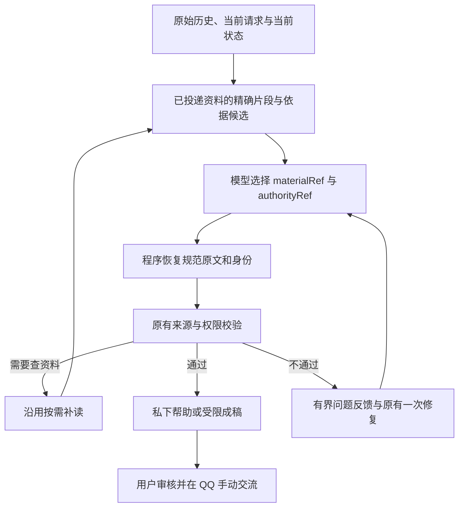

# 主助手的引用选择协议

本次候选调整模型和程序的职责。模型应理解用户、挑选相关材料和表达方向；原始资料的身份、准确文字和版本已经由程序持有，不应再要求模型把这些值重新抄写一遍。

已有回放中，资料和分享意愿都已提供，但模型把源句末尾的分号改成句号，或漏写重复的授权结构，导致整轮建议失败。引用选择协议旨在消除这类转录任务；它不证明模型一定理解了用户，也不改变哪些素材可以使用。

| 程序负责 | 模型负责 |
|---|---|
| 当前账号、联系人、请求与来源身份 | 用户现在希望怎样得到帮助 |
| 已投递原文的准确片段、范围和版本 | 哪些材料相关、适合本次表达 |
| 不可变的引用表及规范数据恢复 | 原始用户表述是否适用于所选素材范围 |
| 来源、限制、撤回、字节预算和提交校验 | 对话行动、分寸与自然表达 |
| 原始时间与来源角色传到正确阶段 | 不把记录时间变成事件时间或新近进展 |

## 两种依据不能混同

已有程序使用规则只适用于原本就允许的素材，例如用户明确设为可用于草稿的笔记。它不能被借给另一条私下材料。

原始用户陈述则只是**需要解释适用范围的依据候选**。引用该条记录不会让转述、否定、条件未满足的说法自动变成许可。片段地址不是事实分类，引用表成员也不是分享授权。

本轮帮助模式可以绑定到程序已经捕获的当前输入，模型只需选择模式。这种身份绑定既不授予分享权限，也不表示程序已经证实模型的语义判断。真正的私下讨论仍保持私下讨论。

## 原文、生命周期与兼容

来源正文以带引用的分段形式展示，目录避免重复整段文字；片段及句子范围由程序记录。原始消息 ID 仍为字符串，存储和界面继续使用规范身份。模型引用只能指向本次确实提供的范围，不能用目录地址冒充已读原文。

同任务的补读、修复、预算重建和恢复复用引用所有者。预算预览不提交编号；每次实际请求使用不可变的可选范围。来源变化、撤回、切换联系人或取消后，旧结果不能写回。

句子或子句仍太大时，素材选择可以使用本次明确提供的边界引用，恢复同一来源、同一版本、同一可见范围内的精确短语。模型不需要计算 UTF-16 偏移，也不提交改写后的引文。边界选择不适用于把授权陈述里的否定或条件截掉；权限解释仍须阅读原始上下文。

模型面对当前协议；既有规范数据和本地接口的兼容应独立保留，不能把互相竞争的旧写法都宣传给模型。已生成草稿仍仅是编辑参照，不能成为事实、许可或实际发送的证据。

## 验收边界

函数测试验证精确恢复、引用范围、权限底线及生命周期。产品效果仍以冻结原始历史上的实际助手回放和独立评审为准。合法引用不是自然、有用或得体的充分条件。

2026-10-31 的冻结候选已完成一组真实模型回放：长私下咨询与已结束话题共四步，独立评审均判为可用，长咨询相对缺失输出的基线恢复了交付。它使用虚构原始历史及正常宿主调度的隔离环境，不能代表真实桌面、个人口吻、记忆维护或整体 Goal 已完成。后续仍须验证局部修正、当前素材、实际反馈与新近分享的对照。粗粒度时间用语及预算截取后的语义保留也不能仅凭来源校验通过而宣告解决。

扩展回放未通过整体候选验收：局部修正场景中，规划把双人拼图的计数功能变成了询问既有游玩数量的前提；成稿又被要求保留这个派生问题。缺少自述素材时，非结构化正文和结构化澄清问题还被同时展示。来源选择协议恢复了部分交付，但不能保证规划语义正确；本候选因此不能据上述四步的通过直接发布。下一轮需修正规划提议的权威层级及澄清问题的展示所有权。
