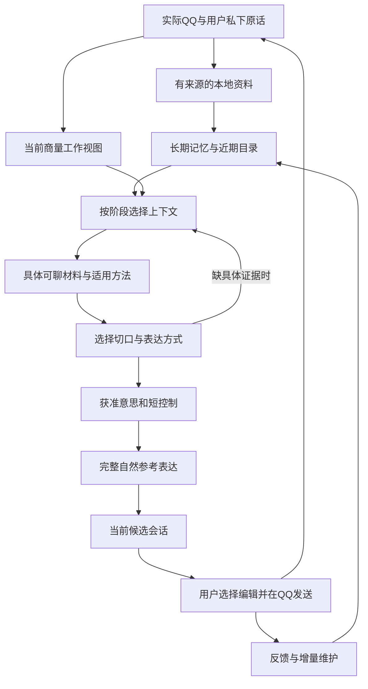

# 关系聊天助手整体重构：目标、职责与决策记录

## 核心目标

用户想与网上认识、有好感的女生逐渐熟悉并拉近关系。助手要在用户想联系或接话时，提供具体、自然、可展开的内容；协助了解彼此生活、表达真实想法、延续共同话题和创造共同经历。不能以增加消息数、格式正确、上下文变短或记忆条数代替这个目标。

## 从最初反馈到当前的实际需求

1. 同时支持主动找话题与接着聊；用户没有新鲜近况或不清楚小目的时，也应先给有依据的切口。
2. 可以先陪用户理清想表达什么，也可以直接给完整可复制表达；不强迫每次配置提示词、填写目标或选择模式。
3. 含蓄了解、适度分享、轻松反应、邀请和表达好感都是可选方向；不用固定的循序渐进剧本。
4. 已讨论的目的、表达方式、局部限制和用户最新纠正必须传到最终表达，话题结束后应失效。
5. 建模双方已说过的事实、生活、兴趣、共同话题和实际互动，区分原话、推测、未知、计划和发生。
6. 讨论历史可以提取记忆和偏好；助手建议、复制和草稿不能成为实际发送或对方态度。
7. 旧原文保留本地；长期记忆、近期交流、当前任务和方法应分工，并明确何时写入、加载、更新及失效。
8. 近期按时间选择，72小时可作为可检验的默认候选范围；不能把最近N轮或三天原文全塞当作完整设计。
9. 需要旧依据时按需取回；反证、改口和纠正不能因为与旧理解不一致而被过滤。
10. 识图、结构化输出恢复、模型调用预算和运行状态都服务实际建议质量；不以换大模型掩盖输入和交接缺陷。
11. 主界面先给当前候选，分析可展开；私下商量、真实QQ、关系记忆各自清晰。任何旧候选都不能压过新纠正。
12. 保持普通桌面QQ加独立助手窗口，读取真实收发；由用户手动检查与发送，账号和联系人严格隔离。

## 需要明确的组件职责

| 组件 | 要回答的问题 | 输入与输出边界 |
|---|---|---|
| 观察与原始资料 | 实际发生了什么？ | 原始QQ、图片、私下用户原话、反馈；保留身份、日期、来源与用途 |
| 长期记忆 | 哪些信息值得跨会话保留？ | 有据事实、情节、稳定偏好；更新、更正、撤回及来源版本 |
| 当前商量状态 | 此刻想做什么、已选什么、还缺什么？ | 当前小目的、表达分寸、局部纠正、未完事项；不变成永久偏好 |
| 可聊素材与机会 | 现在具体有什么值得说？ | 她的分享、用户真实素材、共同兴趣、可跟进旧事、可选共同活动；不编造自我经历 |
| 帮助方法 | 怎样把内容转成自然互动？ | 少量可组合方法与实例，有适用范围；不把研究结论当台词效果保证 |
| 上下文控制 | 哪些资料此刻进入哪个模型阶段？ | 常驻核心、近期完整片段、按需历史、检索和压缩；给出可追踪选择理由 |
| 规划与表达 | 选什么交流方向、具体怎样说？ | 私下理解和讨论独立；成稿只接获准意思、必要事实和短控制 |
| 候选生命周期 | 当前建议针对什么、何时失效？ | 绑定QQ变化及私下纠正，保留编辑；实际发送后撤下旧应答 |
| 反馈与维护 | 哪里不合适、哪些经验可复用？ | 用户评价、修改、实际收发分别记录；局部适配和长期经验分开 |
| 验收 | 是否真的帮用户有内容地聊下去？ | 连续场景、独立语义评审、已知差例、上下文与模型对照；不能只有功能绿灯 |

## 当前交付状态

2026-10-17已补普通压缩的自动产物旁路、核心表达偏好交接，以及旧origin回填影响历史指纹的问题；620项功能检查和连续合成浏览器检查通过。8317代理经用户启动后已恢复，新增三个虚构场景完成6次模型调用。源码修复提交`583abe3`已快进合入main，45个源码/UI文件与测试版本逐字节一致。用户保存文字并进一步授权SIGTERM后已重建worker，实际服务为`2026-10-17.1`；登录、原好友、888条所选记录及原生读取均已核验。最新执行状态见[修复记录](context-handoff-repair-review_CN.md)；[首次审查](relationship-refactor-review_CN.md)及旧语言失败保留，不代表自然交流目标已全部验收。

## 基线证据与状态演变

- 新隔离工作树基于 main@5153834；尚未合回main或刷新真实应用。
- 窄修已覆盖：来源排序、当前/近期与旧历史分层、偏好安全交接、自动候选契约、候选前置、实际发送失效、自动取消。
- 本轮第一次冻结实现的550项功能检查通过；当前候选连续合成浏览器流程通过。
- 同一配置模型完成7个虚构连续场景、9个生成步骤，共17次HTTP；源码和配置在该批内未变。语义评审尚未完成，不能据此宣称效果合格。
- 该基线随后完成独立可见输出评审：6步采用、3步小改、未发现预声明硬失败。薄荷、蛋皮与夜班三处仍分别有复述、替对方评分和过早收尾风险。这不验证主动找话题，也不等于整体质量已完成；评审原件保留在 `/tmp/qq-lazy-live-independent-review_CN.md`。
- 后续独立红测确认：私下纠正后当前候选仍可能显示旧句。这是候选版本应绑定用户意图的缺陷，必须在整体重构中解决。
- 用户进一步明确允许整体重构，要求从完整反馈和组件职责重新设计。上述窄修作为基线和回归证据，不作为整体任务完成声明。

## 批判性设计约束

- 每个组件必须说明它给可聊内容、自然表达或跨轮一致性带来的作用；没有消费方的存储和工具不加入。
- Jev-Mem与fast-jev-compaction仅提供可参考的控制分工与选择机制，不等于本项目已经具备可验证的语义加载控制。
- 不把某个用户举例立即升级为无条件规则；默认72小时和具体预算都需要场景证据。
- 不假设所有差稿都来自上下文；分别检查资料、选择、任务状态、帮助方法、规划、成稿及模型能力。
- 多个开发子代理需要交叉质疑并记录未解决分歧；运行时是否多模型或多代理必须另有收益证据。

## 设计决策与验收记录（持续追加）

### 根代理裁决：组件重构

1. 接受上下文提案的独立职责：来源快照/规范化、加载策略、记忆与历史目录、材料视图、预算选择、规划视图、受限成稿视图、来源与预算清单。公开facade保留现有接口，内部只有一条生效链；不能新增一套未消费的“新架构”与旧builder并存。
2. 接受ConversationWork作为长期goal、局部task和当前原话的派生工作视图，不另存第二份人物/关系状态。OpportunityView/MaterialView提供具体内容锚点、主体、日期、用途和已说过的证据；主规划仍判断怎样接，不靠程序关键词认定她的心理或话题新颖性。
3. 接受CandidateSession独立拥有当前候选、失效和发布；绑定QQ修订、当前私下输入序号和程序产生的计划摘要。新私下请求先撤下旧主候选，完整新稿可成为当前候选，纯解释保留在历史，不凭模型no-change自动恢复旧稿。用户编辑始终独立保留。
4. 拒绝新增模型必填的focusDetail/interactionMove/alreadyAddressedRefs/intent-receipt表格。实际内容选择用现有guidance/quotes及来源表达；内部派生字段必须有消费方。也不引入逐条全史Jev调用、多代理运行时或第二个记忆数据库。
5. 保留SQLite与既有增量记忆、typed事实/事件、局部topic、来源撤回、反馈工件和压缩。重构读视图及消费关系，同时为每种内容写清写入、装载、更新、失效时机。时窗和预算均为可检验策略。
6. 方法库要帮助做具体交流动作和选择有内容的反应，而非只列谨慎原则；程序性方法与个人反馈经验区分，按当前任务加载。人际研究只提供方向依据，不能给某句台词作效果保证。
7. 整体验收在重构后统一执行：全部功能守卫、连续界面、私下纠正覆盖旧候选、同一批虚构实际模型场景与两例主动找切口。17请求基线和3处弱例保留，不挑最好结果，不以模块拆分或绿灯宣称自然性已完成。

当前架构消费链：

### 内容的写入与加载时机

| 内容 | 何时写入／更新 | 何时进入模型 | 何时退场 |
|---|---|---|---|
| 原始QQ与用户原话 | 实际收发或主动私下输入先保存来源 | 本轮必要原文、近期完整段，或显式补查 | 从本次上下文退场不删除本地历史；撤回／排除即时禁止使用 |
| 稳定偏好和长期核心 | 明确长期要求或增量记忆批次；来源校验后生效 | 简洁核心常驻规划；成稿只读安全的表达控制 | 来源改口、修订、失效或适用性结束时更新；不保旧解释作当前事实 |
| 情节与共同旧事 | 后台增量维护形成有据摘要与索引 | 先给有界导航，具体内容需要时取回 | 本次用途结束后不继续占输入；原始来源保留可回看 |
| 最近72小时交流 | 每次求助按固定观察时刻重建候选 | 当前回合先载，其他完整段按预算载；未知只局部补查 | 超过时窗转冷历史；超预算标明遗漏与取回入口 |
| 当前商量状态 | 新原话、选定方向、纠正、完成／取消 | 每次规划加载，成稿只传获准意思与短控制 | 最新意思覆盖旧方式；结束任务不改长期goal |
| 可聊材料视图 | 从本次已选资料即时派生 | 只进入规划，帮助选具体切口 | 每次QQ／意图变化重建，不存一套永久机会清单 |
| 帮助方法与示例 | 程序版本与有范围的用户经验更新 | 简短目录；选中方法才加载完整操作与少量虚构例 | 不相关的完整方法不加载，示例永不当本次事实 |
| 当前候选及反馈对象 | 规划与成稿完成产生不可变工件 | 新私下请求或显式手动换切口可带一条生成对象引用，不展开全旧输入 | QQ变化、私下新输入、来源失效或到期撤当前稿；编辑和历史独立保留 |

本表描述LLM上下文的加载，不声称本地SQLite缓存不读取或保存完整原始历史。

### 从收藏文章采纳什么，以及不直接照搬什么

本文采用文章中的信息生命周期、常驻必要核心与按需检索组合、结构化外置记忆、私下讨论压缩、方法渐进加载和上下文隔离。对应实现分别落在 `src/context/`、既有增量记忆与讨论压缩、`conversation-work.cjs`、`conversation-materials.cjs` 和 `help-methods.cjs`；不是新增几个需要用户填写的提示词类别。

不把“最少token×最高信噪比”当可计算的质量公式，也不把70%/80%压缩阈值、固定中文token换算或年代演进当工程标准。当前字节预算负责完整请求传输约束，未声称精确token计数；72小时负责候选资格，不负责证明相关或决定全部加载。重要规则在每次请求重新组装，不能将一个始终处于首位的system消息简单描述为被新增历史推到中间。长上下文位置和干扰效应要按具体模型与任务检查。

开发子代理承担独立探索、交叉反例和输出评审，向根代理交付摘要；产品运行时保留单一主帮助链和有界lookup，不因为文章介绍了多代理就让每条QQ触发多个模型。

### 内容质量的最终分歧

一次有上限的方法校准没有显示稳定收益。独立评审的四对结果为三对持平、一对校准前略好，蛋包饭两版都需重写。两次主动话题检查中，首次两例可采用，末次重联稿却增加了未提供的“突然想起”，按预声明边界不通过；具体游戏接话仍可采用。没有回改gold、删掉失败或继续重试挑稿。

这些结果支持工程职责与失效机制已经可追踪，不能支持“自然交流目标已全部实现”。后续应从用户实际采用、编辑或弃用的具体产物定位材料选择、规划与表达的偏差，而非继续增加约束、记忆服务或调用次数。

手动入口分别表达明确动作：「想和她聊」请求现在可聊的具体内容；「换个切口」通过 `alternative:true` 请求与当前完整候选有实质区别的内容方向，不只是换词或换语气。后者只携带一条当前生成候选作为比较对象，不赋予事实或分享权限，不加载上次生成的全部输入。没有有效完整候选时走常规手动帮助；自动观察不继承 variation 动作。是否实际提供了自然、有内容的变化仍须独立语义评审，不能以参数和结构通过代替效果。

分歧及反例见[上下文提案](refactor-context-proposal_CN.md)与[工作流提案](refactor-conversation-proposal_CN.md)。它们是可追溯设计讨论，本文裁决为实施边界。
