# 面向恋爱目标的关系助手

用户的长期目标是与网上认识、有好感的女生发展成双方愿意的恋爱关系。系统要帮助判断当前处境、选下一步并组织真实表达，也要能根据实际后续改正理解。聊天、邀约、一起做事、表达好感、讨论彼此意愿、适时收束都属于行动范围。实现完成与这段关系成功是两件需要分别验证的事。

## 实际使用链路

你在 QQ 正常聊天，独立助手自动读取所选会话能访问的历史和实际新消息。在助手里直接说近况、想法或困惑：不需要手工填写一套提示词分类。

例如：你说“想周末约她玩，也希望她知道我不只是随便找个队友”。助手结合她实际说过的游戏兴趣、考试安排和已有约定，讨论邀请方式以及是否表达好感。你明确要参考表达后，才把愿意说出口的意思放进单独的草稿上下文。她后来改期、取消，或你们实际玩过，由真实消息或你的回顾更新理解；旧的“答应了”不能盖过后来的取消。

```mermaid
flowchart TD
  I[实际 QQ 消息 / 用户近况与反馈] --> R[保留原话 来源版本 时间与范围]
  R --> M[持久记忆：事件 摘要 我 / 她 / 我们]
  R --> Q[当前问题 目标 卡点 未知与未完事项]
  M --> C[按当前需要检索并组装有界上下文]
  Q --> C
  H[八个帮助方法 + 已启用且适用的个人经验] --> C
  C --> A[讨论下一步 / 理解回应 / 回顾 / 表达好感]
  A --> D[只用获准意思的可编辑草稿]
  A --> U[用户自己决定与行动]
  D --> U
  U --> I
  A --> F[准确建议版本与反馈对象]
  I --> F
  F --> E[局部反馈 / 经验候选 / 用户启用或停用]
  E --> H
```

## 分别存什么，怎样维护

| 内容 | 存储和更新 | 对目标的用途 |
|---|---|---|
| 原始事实来源 | QQ 原 ID 字符串、方向、时间；用户私下输入、近况、反馈分别标识，按四项账号/联系人身份隔离 | 知道谁说过什么，避免把助手草稿或你的愿望当成她的话 |
| 人物与关系理解 | `subject=self/contact/dyad`，兴趣、近况、明确偏好、边界、共同了解、安排、关系意图或互动假设；附来源版本、时间、事实/报告/推断及不确定性 | 选择贴合实际的联系、话题、活动和表意方式；不做人格式打分或好感预测 |
| 活动事件 | 邀请、接受、拒绝、改期、取消、实际发生分别记录，按活动读取后续链条 | 已取消的邀请不能因为载入旧历史而重新生效 |
| 当前状态 | 有界的当前卡点、已知、暂定解释、未知和未完事项；目标由用户明确修改 | 长期方向保持一致，本次帮助又能变化 |
| 帮助经验 | 准确生成版本、草稿修改/复制/回填、实际消息、使用关联、局部反馈、适用范围和启用状态 | 回顾帮助是否贴合你，避免重复不合适的表达 |

类型化理解复用 `memory_records` 和来源依赖表；经验放在 `experience_objects`。无需再维护一套互相矛盾的人物数据库。迁移是事务性的，有版本号；未知未来版本拒绝打开。原始 QQ 消息表保持原契约。升级先停止本项目拥有的旧助手进程，再打开新版数据库；旧版本程序本身没有新版协议保护，不能与新版同时写入，也不能直接降级打开新版库，回滚应使用升级前的本机备份。

新事实增量排队。前台有根据的理解可以随主回答一并提交，后台统一批量补全，不增加一个强制的“人物建模模型”。默认达到 8 项或空闲 10 分钟触发，自动整理每个会话每 10 分钟最多 6 次实际 HTTP 尝试；窗口关闭或未授权不自动调用。显式“重试整理”可立即处理一批，单独记账。首次升级会重新审阅旧来源以补齐类型化信息，队列可恢复且不阻塞原话检索。

更正、撤回、删除、用途收缩先在本地使派生理解失效，再按需重新整理。普通更正保留你已编辑的草稿，核对后可继续用；再次更正会要求重新核对。真正遗忘或删除会清理关联正文和浏览器待同步副本，即使此前已经核对过也不能绕过。更新来源不能替旧模型推断更新出处版本。推断没有新证据不能升级为事实；新问题不能刷新她很久以前的话的有效时间。同一内容不同标签会合并，不重复累计证据。

## 上下文腐化与费用控制

上下文不是把所有记忆、历史状态版本和论文一起塞给模型。常驻的是必要规则、用户当前目标与有界状态；其余按问题检索，去掉源文与摘要重复，保留可回看原话。活动状态需包含后续证据，信息裁剪与历史缺口可见。已过期或待复核的理解携带状态，不冒充当前事实。没有明确有效结束时间的理解不标记为当前有效；不靠固定 TTL 猜测她的偏好或边界失效。运行指引要求按原消息时间理解相对日期，跨周含糊处保留未知，具体邀约前确认；模型仍可能理解错误，因此保留来源日期和纠错入口。

默认正文预算 48,000 UTF-8 bytes，整个序列化文字请求上限 64,000 bytes；选材与传输共用真实序列化计量，包含 system、模型名和双层 JSON 转义，格式修复也按其实际封装重新选择可选资料。后台请求上限默认 48,000 bytes，必要时重新缩小并绑定来源批次，不裁坏已绑定分段。这些字节上限不是 token 数或所有模型的适用保证。图片另有限额。论文全文和长书目留在资料层；运行时使用短方法卡。

普通讨论的基本路径为一次调用；草稿分为理解意图与生成表达，基本路径为两次。记录操作后的接续也可能增加调用，以实际账本为准。补查、格式修复、网络重试、新消息后的接续共享同一任务预算，默认最多四次实际 HTTP 尝试，而非四个“逻辑步骤”各自重试。后台整理独立记账。任务记录调用阶段、次数、输入字节和服务实际返回的 token 用量；缺失用量保留未知，不伪装为真实。

这些是防止无界增长、来源混淆和失效记忆的工程约束，不能保证模型面对任意长输入都不会遗漏或误解。需要保留原始证据、回归案例和你实际使用中的纠错。

## 方法与经验怎样起作用

八个运行时方法是：理清意思、比较下一步、回应分享、组织表达、找回与回顾、共同活动、表达好感、纠正。每个包含适用条件、避免事项、所需上下文、具体指引、版本与研究限制；每个推理阶段按需要选择零至两个，受限草稿阶段最多一个。它们确实进入调用，界面中的依据来自同一定义。记录“提供了哪些方法”和模型“声明用了哪些方法”，未知不补造。

这些是程序内的方法契约，不是自动执行任意外部工具的通用 Agent Skill 系统。研究不足以支持自动演化追求策略：仅在明确回顾或选定反馈时允许提出至多两个经验候选，附准确反馈来源、适用场景和方法。候选必须确认启用才能成为后续长期帮助依据，也可修改、停用。明确长期偏好仍可直接通过自然指令保存。

“这条太正式”绑定具体答案或第几条表达，未被遗忘或清除的完整原文独立保留，不因最近 12 次请求缓存淘汰而丢失；相关来源被删除后明确显示目标不可用。相同反馈别名只有一个权威来源，不能伪装成多次支持。实际 QQ 发出后，文本与时间匹配仅构成可能使用某条建议的候选，需要确认；她回复了不证明该建议有效。独立写的消息和用户报告的共同活动也可以进入回顾。

## 依据和适用边界

| 依据 | 本实现借鉴 | 没有因此得到的结论 |
|---|---|---|
| [LongMemEval](https://arxiv.org/abs/2410.10813) | 更新、时间、多阶段召回和不知道时保留未知 | 通过记忆问答就能提高恋爱成功率 |
| [Lost in the Middle](https://arxiv.org/abs/2307.03172)、[Context Rot](https://www.trychroma.com/research/context-rot) | 控制无关内容，检查长上下文与位置相关遗漏 | 存在通用于所有模型的安全窗口阈值 |
| [披露、回应感与亲近研究](https://doi.org/10.1037/0022-3514.74.5.1238) | 优先理解具体分享、回应内容，保留用户真实自我表达 | 某种话术会让这位女生喜欢你 |
| [在线互动中的兴趣与不确定性实验](https://doi.org/10.1016/j.chb.2018.04.023) | 明确的真实好感可以讨论和表达，不强制无限等待信号 | 应通过忽冷忽热制造吸引，或性吸引等同长期承诺 |
| [早期关系纵向研究](https://doi.org/10.1177/08902070221085877) | 看这个对象与这段实际互动，区分普通友好、活动意愿和浪漫意图 | 能从通用人格模型或单次回复预测她的意愿 |

以上是研究启发与工程取舍，不是逐字复刻某篇论文算法。当前项目不依赖 Jev、embedding 或自动 Skill 演化；未来是否引入应由已发现的召回或适应问题决定。

验证分为功能/对抗测试、合成数据的真实浏览器、合成情境的真实模型、真实 QQ 桌面集成四类。最新执行范围和上游失败见 [发布证据](relationship-implementation-evidence.json)。真正的目标效果需看你实际交流是否更能表达自己、理解对方，以及双方是否愿意向恋爱发展。
