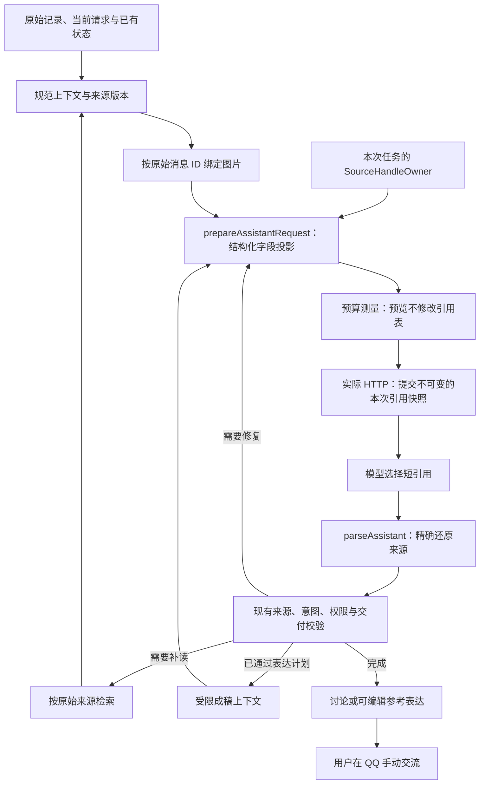

# 前台助手的来源引用交接

这层交接服务于持续商量：模型可以选择相关材料和表达方向，程序负责把选择准确关联到原记录。它不负责判定对方的态度，也不代替记忆提取、素材检索或分享授权。

原始 QQ 消息和私下商量仍使用原有字符串 ID。前台模型请求把结构化来源字段投影为 `s1` 这样的短引用；模型返回后，程序先还原原始 ID，再运行现有来源、当前意图、披露权限和交付校验。改稿候选的 `e1` 是另一种引用，维持原有合同。

同一个任务在补读、结构修复和成稿时复用引用所有者。每次实际请求保留自己的引用快照；预算预览不能提前分配并消耗正式编号。修复沿用同一套寻址方式，不增加既有修复次数。

## 身份与使用范围分开

| 当前具备的内容 | 作用 | 仍需检查 |
|---|---|---|
| 目录中的短引用 | 可以准确请求补读 | 原文是否已提供、是否完整 |
| 已提供的来源片段 | 可以核对原话与时间 | 本轮是否相关、是否能用于所选字段 |
| 用户原话与披露依据 | 为表达计划提供依据 | 是否适用于这一素材、限制与版本是否仍有效 |
| 旧助手草稿 | 可以成为明确选中的改稿起点 | 事实与分享依据，及是否真的已经发送 |

短引用不增加上述使用权。核心字段中不存在或本次未提供的引用继续严格失败，不做模糊纠错，也不删除个别引用来保住一个无效字段。原有 best-effort 可选整理字段中的错误，则整字段拒绝并记录诊断，保留有效主要回答。原文中的 `s1`、UUID、代码和引号不作替换。

## 代码边界

- `src/source-handles.cjs`：引用所有者、结构化投影、快照与精确还原。
- `src/controller.cjs`：按账号、联系人和任务持有引用所有者，接续现有取消及恢复流程。
- `src/assistant-model.cjs`：规范图片绑定之后投影，实际发出请求时提交快照，在业务校验之前还原；再次解析已还原结果时保留私有绑定。
- `src/context/planning-view.cjs`、`src/context/wording-view.cjs`：传递同一所有者，保留内部规范上下文。

独立的记忆批处理和讨论压缩继续使用原有协议。持久化记录和界面来源引用保持原始身份；诊断同时保留实际请求的短引用和程序内部的原始来源映射。

## 证据边界

引用边界及控制器测试检查寻址、版本、权限隔离、预算和原文保存。它们不证明聊天建议自然、有用或符合个人口吻。对话质量仍须从冻结原始历史重建实际助手状态，执行所选模型回放，再由独立评审判断；测试中的诊断修改不能冒充实际模型输出。
