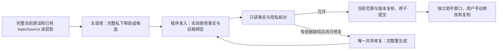

# 薄前台答复契约

021 延续长期、按目的帮助用户理解处境、寻找真实谈资、分享自己和持续商量的目标。当前应用是相互了解与逐渐亲近，也支持朋友、工作和学习。它移除完整主答复之后已无成稿消费者的强制规划交接，而不是把核对通过当作产品目标。020 的源码与失败证据保持冻结。

## 一次完成答复

正常主调用使用 `primary-operation-v2`：

```json
{
  "operation": "prepare_message",
  "answer": {
    "privateExplanation": "可选的唯一私下解释",
    "suggestions": [{"text": "一条完整、可修改的表达"}]
  },
  "currentFacts": ["实际用于外发表达的本轮本人事实原句"],
  "materials": [{"materialRef": "m#", "authorityRef": "a#"}],
  "editingReference": {"choice": "e#"}
}
```

`currentFacts`、`materials` 和 `editingReference` 均按需省略；前两者合计最多 8 个事实片段。纯控制、普通反应、愿望或回应已知 QQ 不要求素材申报。准备答复禁止外层 `text`，也不返回 `draftPlan`、`guidance` 或 `taskUse`；`answer.privateExplanation` 是唯一私下解释所有者，省略就保持缺失。规范草稿的 `text` 仍为空，候选正文各自属于可撤回的 `suggestions` 叶子。

私下理解、比较或找方向继续使用 `advise` 的完整 `text`，不强制给联系人写话。只有其中明确可发送的示例使用私有本人事实时才申报素材；对用户讨论其私人理由本身不是外发披露。缺关键事实或许可时可提出具体的 `clarify` 问题；材料已经提供且本次许可明确时，不要求用户重抄或重复确认。

## 原话、事实与许可分开

[`primary-reference-registry`](../src/primary-reference-registry.cjs)将完整当前人类原话保留在直接请求中，移出外发片段菜单；QQ 则直接保留已选原文、说话人、时间和部分交付标记，不再让模型替程序选择公共素材权限。来源 ID 仍由程序绑定，QQ ID 仍为字符串。旧局部任务仅为有来源的只读候选，当前完整原话和明确 UI 选择优先，不自动改写长期目标。

`currentFacts` 只接受[当前原始人类来源](../src/context/current-human-control.cjs)中的精确事实片段，绑定当前账号、联系人和版本。权限解释的上下文是完整原话，不能切掉末尾的否定、条件或私人理由；绑定不是整段分享授权，也不能把旧事实伪装成本轮事实。

历史私有事实继续使用现有精确材料与权限引用。`currentPermission` 只指向完整当前人类表述候选，既不是程序授权，也不是可外发的当前原话片段。已确认分享用途的笔记仍按其真实范围使用；过期许可、仅私下、禁用、排除及撤回来源仍不能绕过准入。旧稿只恢复为带版本见证的修改参考，不证明事实、采用或实际发送。纯方向选项可使用空 `quotes`，选择方向不会新增事实或分享权限。

方向选项也可独立申报事实：`expressionOptions:[{label,currentFacts?,quotes?,style?}]`，最多 3 个选项，每项的本轮事实与历史私有引用合计最多 8 个。省略两者表示纯控制方向；程序不会把顶层事实或其他选项的素材自动分配过来。它们使用同一个事实准入解析器，然后只把精确 `{sourceId,text,revision}` 元组保存到该选项，不保存模型的权限解释或永久授权。

因此，本轮真实近况可以先成为私下商量的方向，再经用户选择进入下一次完整表达；不需要把整段当前指令放回素材菜单。初次核对中的 `optionMaterials` 按选项索引保留事实绑定，与顶层外发示例的 `admittedFragments` 分开。该投影不可修改并纳入帧哈希，实际选项元组也在私有见证中；下一次选择仍复核原来源与版本，并保留原始完整条件、否定和私人理由。撤回、修订或账号联系人变化不能沿旧选项恢复事实，也不能借用兄弟选项素材。精确匹配只证明出处及范围，不证明语义分享许可。

## 实际消费者



[`resolveAnswerMaterial` 与 `buildAnswerAdmission`](../src/context/wording-view.cjs)复用原素材解析、当前人类、出处、已选方向及旧稿检查；正常路径不构造无人消费的 `purpose:draft` 模型上下文。私下帮助与候选都通过同一个程序准入视图，最终诊断的 `answer_admission` 保留实际素材绑定；原主调用输入独立保留在请求记录中。旧的独立成稿 API 可用于既有隔离消费者，不是正常主答复的必经步骤。

[`whole-answer-fidelity-v3`](../src/whole-answer-fidelity.cjs)保留事实、隐私、必要事实限定和事实矛盾的硬检查。`current_boundary`、社交推进、问句含义、节奏与文风判断只作为带原始见证的私下顾虑；不得换成其他硬代码继续否决。用户明确的“不邀请”等安排仍是主调用必须遵守的要求，外部行为 rubric 仍会判定违背要求的输出失败；运行时 advisory 并不使这些输出合格。

模型调用仍通常为主答复加核对两次，共享唯一一次修复；默认单任务 4 次尝试、48,000 字节上下文和 64,000 字节序列化请求上限未增加。独立持久化提议仍按原有领域预检与原子事务处理；范围、来源、操作者或版本变化仍会阻止过期输出。已实际执行的独立本地动作保留真实回执，候选在提交前只标记 `prepared`，不会因额度耗尽或核对失败而声称已交付。

完整 QQ 历史仍是按需查读的语料，不是每次输入的全知视图；没有新增记忆所有者、服务、JEV 或 embedding 框架。桌面 QQ 与独立助手窗口、实际收发观察和手动发送边界保持不变。功能检查与合成回放只能证明协议及集成路径，不能据此宣称语义改善、核对可靠性、个人口吻或真实关系结果。
