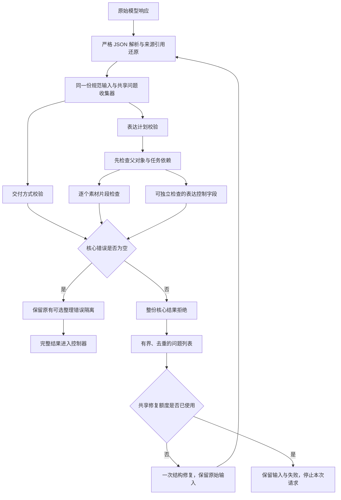

# 一次修复所需的完整校验反馈

这层改动服务于连续商量：回答即使已经找到相关材料，也可能因多个结构或来源绑定错误无法交付。程序只报告第一处错误，会让模型用掉唯一修复机会后才遇到第二处错误。

`ValidationIssues` 收集现有校验器的独立错误，不另建一套可以放行答案的验证器，也不改写模型的引用或授权。只有核心校验全部通过，结果才会交给控制器继续处理。

## 哪些检查可以继续

- 交付方式不一致时，结构有效的表达计划仍可提供独立错误。
- 一个素材片段不合法，不妨碍检查另一个结构有效的片段。
- 父对象、任务解释或话题绑定不合法时，需要依赖它的检查必须等待，不能猜测子字段含义。
- JSON 无法解析或来源引用无法准确还原时，不臆造后续语义诊断。

## 保持的边界

核心错误存在时，不返回可用的部分计划，不提交动作、状态或素材授权。原有 best-effort 可选整理仍按整字段隔离，并记录诊断。修复次数、请求额度、截止时间和来源权限不变。

反馈使用稳定的 `path`、`code`、`message`。诊断不是新的来源或许可，不能把模型编造的来源 ID 注册为可用引用。反馈与原始输入都受实际请求字节上限约束；超出边界必须明确失败，不能静默删掉问题。

## 证据如何解释

保存的旧模型响应及其哈希用于离线反例：网页素材的缺失授权与另一片段的范围不符应同时报告；交付方式矛盾与表达步骤的来源角色错误也应同时报告。原始响应继续拒绝。

这些检查只说明程序能完整反馈已知错误。模型是否能据此修好回答、建议是否适合用户，仍由完整原始历史的实际回放与独立评审判断。
