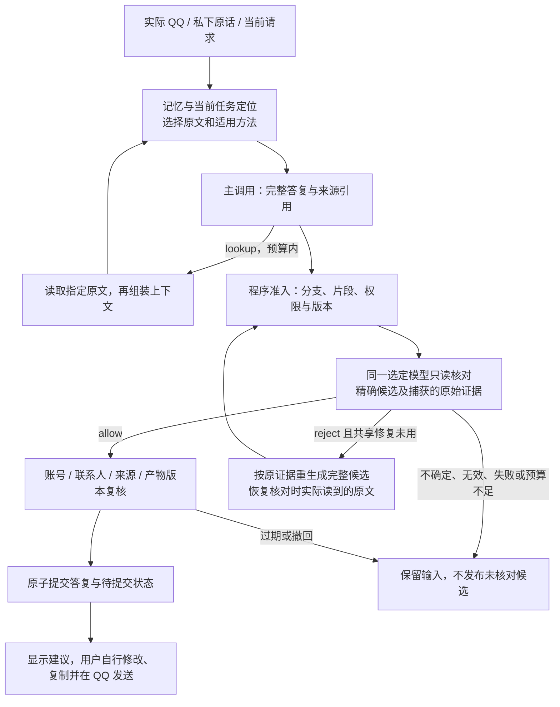

# 完整答复与证据核对

> 本页记录此前冻结的完整答复候选。021 的当前前台契约见[薄前台答复契约](thin-answer-ownership_CN.md)：不再要求正常主调用回传 `draftPlan/guidance/taskUse`，事实准入与完整当前指令分开。以下历史实现身份和证据不自动转为新候选的结论。

当前决策归属及实际第 040 轮状态见[后续说明](decision-ownership_CN.md)。下文保留此前冻结候选的实现说明。

本文记录冻结候选 `1b041c97d6afbde687171409aed023af76b2a7593001123816c5d8bdfd98d5ed`，提示版本为 `goal-context-2026-10-31.7`；它尚未合入主线。旧的独立成稿路线见[历史说明](conversational-evidence_CN.md)。

助手的目的仍是长期帮助用户理解处境、选择下一步、找到真实谈资、分享自己并延续双方愿意的交流。当前应用是相互了解和逐渐亲近，也支持朋友、工作、学习等其他目的。记忆、检索、方法和核对服务于这些能力；核对通过或开发用例通过本身不是产品目标。

## 当前调用路径

用户照常在桌面 QQ 交流，在独立助手窗口私下商量。选中会话后由现有 QQ 接入读取可访问历史与实际收发，不以导出导入作为主流程。实际收发记录、用户原话、笔记、反馈、记忆和当前任务参与上下文选择，均绑定已认证账号与所选联系人；原始 QQ 消息 ID 保持字符串。

主调用选择 `advise`、`prepare_message`、`lookup` 或 `clarify`。`prepare_message` 必须同时给出完整 `answer.suggestions`、可选 `privateExplanation` 和来源绑定的 `draftPlan`；主路径不再等待另一个模型重写成稿。私下建议、示例、选项和澄清也必须经过完整答复核对。

[主操作解析](../src/primary-operation.cjs)负责完整答复契约；[来源准入](../src/context/draft-material.cjs)及 [`buildDraftContext`](../src/context/wording-view.cjs)仍检查精确素材、披露依据、当前人类控制和真实界面选择。此处 `buildDraftContext` 用于准入，不表示发生了独立成稿模型调用。[控制器](../src/controller.cjs)编排查读、核对、修复、版本复核和提交。

## 原文、意图和权限边界

长期目标提供目的背景，本轮完整人类意思决定当前动作。历史局部安排不能自动变成永久限制，助手旧建议也不能替代用户的新选择。用户当前想邀请，可以提出未来邀请；暂不邀请时不能暗中替用户安排共同活动。具体自我经历仍须有真实素材，缺少关键事实或许可时才提出对应的私下问题。

[上下文组装](../src/context/planning-view.cjs)和[选择器](../src/context/selection.cjs)使用已有记忆、时间、当前任务和有限原文；可访问历史是可查读的语料，不是每次完整输入。摘要、目录、旧理解和未读余文只提供导航，不能证明某件事不存在或新增分享许可。已交付的精确片段可支持其中明确陈述的事实；日期、说话人、否定、条件和已知后续缺口仍须保留。笔记编辑时间不能替代事件时间。

[核对器](../src/whole-answer-fidelity.cjs)绑定精确候选、原文版本、时间、范围和实际图片。它检查正文、私下解释、建议的文字与样式标签、选项标签，以及正文中的示例和问题，关注事实支持、当前边界、必要限定和内部一致性。核对没有全历史视野，也不能把未准入的私下原文变成外发素材；`allow` 不是事实、权限或质量的独立证明，更不能执行动作。

## 提交、撤回和调用记录

正常完整候选经过一次主调用和一次核对；查读、整理历史或已授权动作后的重组可能增加调用。格式恢复与核对拒绝后的重生成共享唯一一次 `delivery_repair`，不是各自一次。重生成后仍须重新准入、重新核对。核对返回无效或不确定结果、传输失败、预算耗尽时停止；核对请求不自动重试。

候选外发正文只属于各自可撤回的 `suggestions` 叶子，规范草稿的 `text` 为空；父答复拥有可选的私下解释。[产物投影](../src/experience-store.cjs)让被撤回的叶子不能通过旧版精确正文副本、诊断、反馈或经验链接重新出现，同时保留独立解释、其他候选和内部原始证据。草稿、采用和剪贴板操作均不代表实际 QQ 发送。

发布前再次检查账号、联系人、模型绑定、QQ 与私下输入版本、来源版本及引用产物；提交采用原子检查与写入，过期结果不能覆盖当前会话。待提交的状态、话题、关系和经验提议在允许后处理；严格成稿路径的话题权限拒绝会回滚最终输出。已经独立授权并实际执行的本地动作保留真实回执，不能被核对器授予或伪造。

每个调用记录自己的结果和实际交付。核对清单只有所需机械绑定、证据覆盖和空的方法交付记录；不继承主调用的辅助错误或方法使用声明。重生成保留来源、版本、方法指令和真实动作回执，但重新建立本次结果及方法记录，原错误只留在原调用上。

## 预算与当前证据

冻结条件沿用同一选定模型与提供方，没有采用 JEV 或新增 embedding 系统。上下文上限为 **48,000 字节**，完整序列化文字请求上限为 **64,000 字节**；必要证据放不下时显式失败，不放宽预算。

[产品任务账本](../src/request-budget.cjs)按任务计实际 HTTP 尝试；控制器默认任务预算为 4，可配置，查读后的生成、压缩、修复和核对均占预算。实验另有每个比较分支最多 16 次、基线与候选合计最多 32 次模型 HTTP 的全局上限。实验上限不替代或扩大产品单任务预算。

以下是本文编写时的证据快照；回放与独立评审由协调方维护。

| 证据 | 能确认的范围 |
|---|---|
| 冻结源码 `1b041c97…`，154 个文件、1296 项功能检查通过，运行前后源码不变 | 功能、协议与生命周期回归；不是对话质量评分 |
| 5 组浏览器检查，共 39 项，使用合成数据与模型结果 | 助手、候选、解释、刷新和恢复界面的集成检查；无真实模型或桌面 QQ 集成结论 |
| 第 038 轮候选尝试 4 次，传输失败，无输出 | 结果不确定，不能据此判断候选语义行为 |
| 用户恢复代理后，第 039 轮同一候选实际请求 8 次且均返回 200；仅局部纠正首步交付可用，后续纠正及缺少自述素材路径失败 | 独立评审与轮次结论为未通过；功能全绿没有替代持续交付和语义验收 |

检查记录位于[候选实现证据目录](../.implementation-checks/whole-answer-fidelity-018/)。目前不能据此宣称对话改善、运行时核对可靠性、个人口吻适配、真实桌面 QQ 集成或关系结果已经得到验证。
