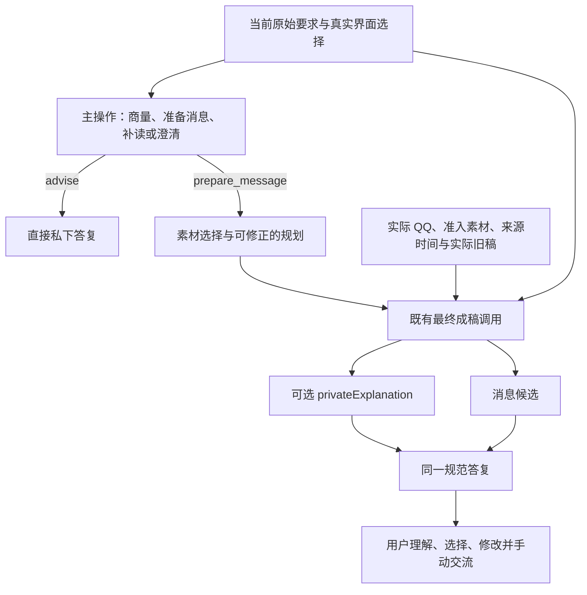

# 完整准备答复的最终所有者

这个候选服务于两件同时重要的事：帮助用户弄清表达的依据，以及给出真实、合适的消息。第 032 轮的失败说明，消息写对了，并不代表解释也对了。主规划曾把“昨天首次做成”和“今天已经可用”误当矛盾；最后的消息保留了正确的当下状态，程序却把另一阶段的错误说明原样拼在旁边。

## 责任边界

主规划中的文字仍可作为规划或既有审计，不能自动成为最终私下解释，也不因引用了来源就变成事实。最终阶段从同一批实际证据、当前要求和真实旧稿生成说明与消息；不增加另一位核验者或一次模型调用。

正常的私下“为什么”、梳理想法与比较选择继续走直接答复，不为解释强制出稿。消息准备中的最终 `privateExplanation` 映射为既有的私下说明字段；未提供、空白或空值就保持缺失，不能从主规划补一个。用户明确要说明却没有收到，仍然是质量缺口。

阻塞回答保留单一所有者：明确的 `blocker.explanation` 和 `question`，不再附上规划阶段的另一段文字。消息仍是独立的对外候选，私下解释不能混进复制内容或被当作新的外发事实。

## 修复、反馈与生命周期

准备答复发生格式或结构错误时，已有一次修复继续要求同一完整结构和同一载体。即使载体是普通文本，也要求可区分的 JSON；不能把任意未分离的私下说明和消息整段当成对外候选。普通私下帮助的恢复不受此调整影响。格式无法恢复时保留失败与输入，不能宣称解释已经恢复。

存储、界面与回放读取同一个实际最终答复。对解释的反馈绑定实际解释；消息候选有自己的叶子引用。引用解释不等于用户已发消息，也不是认可其中的事实。旧回合和原始失败证据保持原样。

来源撤回、版本变化、遗忘、取消与联系人切换继续使过期结果失效；同请求的消息交付要求和修复次数也继续沿用。真实动作回执与尚未执行的提议分开。

## 当前验证边界

完整功能检查为 147 个文件、1234 项通过。隔离界面、刷新与解释界面检查分别通过 22、5、5 项；原有 4600 字符和请求字节限制保持。它们证明接口和接线，不能证明解释一定正确。

第 033 轮已在冻结原始历史上完成五步真实模型回放，共 11 次请求，独立质量评审尚未记录。整体 Goal 仍需相应反例、长历史、持续帮助及宿主证据；不从功能绿灯或少量开发场景推断真实关系结果。

第 033 轮独立评审已记录并拒绝当前轮次：五步中三步可用、两步需小改，无硬失败。当前素材反馈的说明仍将原文明示的今天可用当成记录时间问题；一条邀请的比喻对象不够清楚。前者说明同一最终所有者仍可能误用输入规则；后者不足以证明路由架构退化。保留这两个反例，后续实验区分对话事实和审计信息的消费用途，不据此做日期或比喻词语黑名单。
