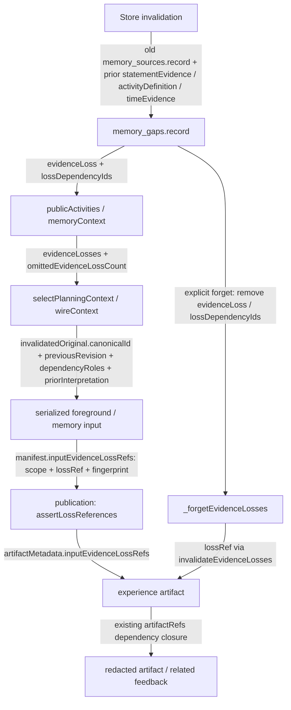

# Historical source-loss provenance (C041)

The preserved actual040 M4 cancellation record bound its statement to
`qq:72057594049927937003`, with contact as the event actor. On native recall,
Store still had that prior proof and the original revision. The gap retained only
timing/identity barriers, and the final foreground input lacked both the removed
source identity and the prior event classification. This change preserves that
minimum relation without preserving the removed message or its summary.

`evidenceLoss` is a body-free program record. It stores the invalidated original's
string canonical ID, previous revision, type and author role; the known operation;
separate dependency roles; and the prior record type, event kind/actor or reported
current-state type. The operation actor remains unknown: a message's author does
not establish who recalled it. `priorInterpretation` is explicitly historical
derived understanding, not a current fact. Only a lost statement dependency
identifies what that original previously served as evidence for; loss of a
definition, clock, planned-time witness or generic support does not establish the
original message's meaning.

The existing activity ID, `knowledgeChangedAt` and `affectedWorldAt` keep separate
identity, knowledge-change and world-order meanings. Later supported world or
current-state reports remain usable under the existing ordering rules. Loss
metadata cannot cancel, confirm or complete an activity. Display labels still
require surviving original anchors. One original affecting several activities
produces separate activity-bound relations.

Foreground selection keeps relevant activities through admitted records,
surviving anchors, ordinary relevance and recent knowledge changes, with a bounded
activity count. Memory retains its existing bounded activity navigation. Both
paths carry bounded loss detail and explicit omitted counts; budget trimming
removes optional loss detail before displacing originals. Late reconciliation can
remove a label or current report without converting historical loss into evidence.

The loss namespace deliberately avoids `sourceId`, `sourceIds` and
`sourceRevisions`. The foreground encoder recursively treats those names as
evidence and would otherwise offer an unavailable original as an `s#` handle.
`canonicalId`, `previousRevision` and `lossRef` remain separate. Loss records never
join delivered sources, source delivery receipts, `m#/a#` material choices, source
lookup authority or event witnesses. If an original later has a readable new
revision, its ordinary current handle does not rebind the historical revision.

Publication records independent semantic dependencies as
`inputEvidenceLossRefs`, bound to scope, loss reference and exact projected
fingerprint. These are not original-delivery or citation receipts. The controller
includes all captured request dependencies, and the existing atomic artifact
publication validates them. Explicit forget works even after recall made the
original unreadable. It clears the historical interpretation, retains only the
uncertainty barrier, and uses existing artifact/feedback invalidation. In-flight
results with changed dependencies cannot publish; actual user input remains.
Calls without these dependencies retain the previous artifact path.

No SQL table/schema version changes. Existing gaps lacking the new fields stay
unknown; no classification is reconstructed from a digest, clock, author or later
question. Portable fictional pre/post040 SQLite snapshots were actually created
with frozen040 product code, then exported using the existing logical snapshot
format. Tests verify exact historical state before current Store opens it. The
pre-recall snapshot can produce new provenance upon a new recall; the already
recalled snapshot does not recover missing provenance and can finish as no-change.
Snapshot metadata pins revision/backend/input/generator and logical hashes;
default tests do not import a personal historical worktree.

The memory protocol version advances to
`evidence-backed-understanding-2026-11-01.4`; foreground context version advances
to `goal-context-2026-11-01.14`. Their actual delivered contract changed. The
previous concrete temporal prompt example is replaced by the general rule that
world order is compared against the affected event, separately from evidence-loss
time. Store admission, body/RV/scope/CAS checks, semantic event judgments, manual
send boundaries, model selection and HTTP allowances remain unchanged.

Evidence is scripted functional integration, with preserved actual fictional040
inputs. The complete captured final canonical foreground input, plus the
program-projected actual loss relation, fits initial/correction envelopes at
40,158 / 42,534 bytes under 64,000; all six original sources are unchanged.
This is not a full reconstruction of the historical runtime or a fresh model run.
Historical classification may itself have been wrong; a valid citation relation
does not prove entailment. Actual model use of this information and conversational
usefulness require the coordinator's independent replay and review. No provider
call, commit, main merge or QQ activation is performed by this implementation task.
