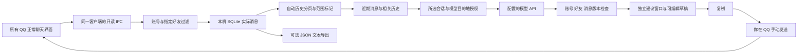

# QQ Chat Assistant: research, implementation and verification

Personal documentation archive. No real chat text, API keys, access tokens, QQ credentials or original profile data included. Real-chat model disclosure remains pending explicit user approval.


---

## research/contract_CN.md

# 调研契约

日期：2026-10-11。用途：选择可在用户 Ubuntu 电脑上实现的第一版方案。

## 要回答的三个问题

1. 哪些现成工具可复用，哪些必须开发？
2. 如何按指定 QQ 号读取历史和新增消息，并支持桌面 QQ 人工聊天？
3. 第一版的界面、数据边界、开发顺序和验收标准是什么？

## 已确认需求

- Ubuntu，已有桌面 QQ 和本机模型 API。
- 自动读取指定 QQ 联系人的对话，而非以手动粘贴作为主流程。
- 自动加载可取得的过往历史，持续同步双方新消息，支持导出。
- 用户提供指示，AI 给参考文本，用户亲自复制并发送。
- 调研材料存入 OpenViking 个人空间。

## 待核验的假设

- 新登录的 Docker QQ 能访问原桌面 QQ 的历史：尚未验证，不作为事实。
- 桌面 QQ 与同账号数据接入运行实例能稳定共存：尚未验证。
- 旧记录能全部恢复：不能仅由存在历史接口推导。
- 恋爱回复质量：需要用户样例评估，不宣称提升恋爱成功率。

所有界面示例均为合成数据，不采集或上传真实聊天内容。


---

## docs/requirements_CN.md

# QQ 实时恋爱聊天助手：需求 v0.1

日期：2026-10-11。阶段：需求和方案；QQ 接入尚未开发。

## 1. 一句话目标

用户正常使用现有桌面 QQ 和某位好友聊天，打开一个辅助窗口；AI 自动取得该会话可访问的历史和双方新消息，根据用户指示生成参考回复，用户挑选、修改、复制后亲自在 QQ 发送。

## 2. 用户已确认的主流程

1. 正常打开 QQ，进入好友私聊。
2. 点击该会话的“AI 建议”入口，出现新的辅助窗口。优先由 QQ 插件传入当前联系人；用户也可明确按 QQ 号锁定一个联系人。
3. 后台自动加载可取得的过往记录，显示同步进度、最早/最新时间和覆盖状态。用户不需要先导出、再导入。
4. 对方新消息和用户实际发送的消息持续出现在辅助窗口上下文中。
5. 用户设置“我想表达什么”和语气；AI 给出 2–3 条可以修改、复制的建议。
6. 用户在原 QQ 里自行发送。只有随后观察到 QQ 的真实已发消息，才更新正式聊天历史。
7. 需要备份时，可从辅助窗口导出当前会话。导出是附加能力。

## 3. 第一版功能与验收

| 功能 | 行为 | 验收标准 |
|---|---|---|
| 新窗口入口 | QQ 当前私聊中打开/关闭助手 | 同一会话重复打开复用窗口；不创建重复聊天或重复订阅 |
| 指定联系人 | 当前会话自动绑定；可按 QQ 号明确锁定 | 以登录账户 + 联系人标识隔离；其他好友消息不写入该会话上下文 |
| 历史自动加载 | 初次进入分页回补；再次进入增量恢复 | 提供加载条数、实际时间范围、错误或缺口信息；不把未知范围称作全部历史 |
| 实时双向同步 | 对方来信、用户真正发送的内容均观察 | 来信不丢、已发文本以 QQ 实际文本为准；重复/乱序事件不重复展示 |
| 指示与语气 | “自然接话”“轻松一点”“关心一下”等；可写自己的指示 | 修改指示后生成新版本；建议符合当前实际上下文，不能擅自编造个人经历或约定 |
| 参考回复 | 默认 3 条，附一句选择理由，可改写/缩短 | 每条可编辑、复制；不提供 QQ 发送按钮或发送工具 |
| 切换会话 | 默认跟随当前会话；明确锁定时显示锁定对象 | A 会话的迟到结果不能出现在 B；关闭窗口停止推理和该窗口订阅 |
| 导出 | TXT、JSON，后续 HTML | 仅选定会话；保留原消息和来源/覆盖元数据；不把 AI 草稿当成已发消息 |
| 连接异常 | QQ 离线、接口变化、历史拉取失败、模型失败 | 清楚显示原因和最后成功同步位置；保留已显示文本，不伪报完成 |

## 4. 窗口内容

- 顶部：联系人、对应 QQ 账户、跟随/锁定状态、监听开关。
- 对话摘要：最近双方消息；可展开查看历史；显示记录覆盖范围。
- 指示区：想表达的意思、语气、长度；可开关来信后自动刷新建议。
- 建议区：自然接话、较轻松、较温柔三个选项；编辑区和复制按钮。
- 附加区：同步状态、重新生成、导出、清空该联系人的本地助手数据。

打开窗口即绑定并同步会话。首次可生成针对最近一条来信的建议；没有来信时等待用户指示。新来信可以按当前指示刷新建议；用户正在编辑的草稿不会被覆盖。

## 5. 第一版范围

优先文字和引用文字；图片、语音、表情保留类型和提示，未解析的内容不得冒充已理解。后续再接可选视觉/语音模型。默认只处理打开或锁定的一个私聊，避免首版做全账号抓取。

保留完整本地可取得记录，不把全部历史直接发送给模型。模型请求使用近期消息、经确认的重要事实和必要的相关旧片段；界面应能展开查看采用了哪些上下文。

## 6. 数据与建议的区别

`QQ 原消息`、`AI 建议`、`复制行为`分开记录。点击复制不等于发送，用户修改后发送的实际文本才是新的 QQ 历史。消息 ID 和 QQ 标识按字符串保存。

## 7. 阶段边界

项目已有需求、源码调研和界面草图。尚未在当前 Ubuntu + QQ 上验证插件兼容、历史覆盖和实时双向同步。不能把普通聊天窗口、截图分析或“导出后导入”宣称为主需求已经完成。


---

## docs/research_CN.md

# 调研结论与组件选择

日期：2026-10-11。结论置信度：整体组件路径中等偏高；用户当前 Ubuntu/QQ 版本的端到端兼容尚待实盘验证。

建议开发“桌面 QQ 只读接入 + 辅助窗口”，以现有 QQ 登录实例为主。先验证同一客户端的历史与双向消息读取，再实现建议、复制和导出。现有 Docker 机器人适合托管消息，不提供当前桌面会话绑定或原客户端历史可达性的证明。

## 证据如何分级

- 【经验级·维护方文档/源码】：可核对的功能、参数、实现路径，不等于在本机可用。
- 【现场执行证据】：本次实际执行的本机检查；只证明该检查覆盖的事实，不是效果对照实验。
- 【推断级】：本项目架构选择和预计代价。
- 【实验级】：需要有对照样本与数字；本轮没有恋爱建议效果实验，也没有完整 QQ 接入实验。

## 已核验的候选组件

| 组件 | 正向证据 | 负向/缺口 | 判断 |
|---|---|---|---|
| LiteLoaderQQNT-GPT-Reply | QQ 内图标/右键入口、自定义模型接口、复制建议；当前源码只有复制监听器生效 | 生成入口传入提示文本；未发现自动历史回补与双向监听的完整链路；当前 QQ 兼容未实测 | GUI 接入与复制交互的参考，不直接当成成品 |
| NapCat Framework | 官方当前文档描述桌面 QQ 插件方式，可配置 OneBot | 前提是 LiteLoader 支持当前 QQ；文档不能证明 Ubuntu 26.04 的这版客户端兼容 | 只读采集候选，M0 先验证 |
| NapCat 历史/事件接口 | 存在指定好友历史接口；自发消息可上报 | 无游标时读最新窗口；空结果实现会抛错；自发消息默认不上报 | 核验分页和方向识别的基础 |
| QQ Chat Exporter | 有成熟历史分页、导出、进度和覆盖信息处理 | 官方发布包中桌面 Framework 标为 Windows；Linux 的 Shell 支持不能移植成桌面兼容证明 | 参考/复用已验证的数据读取方法，不能用导出导入替换主体验 |
| Cherry Studio 快捷助手 | 浮动窗口，可读剪贴板、复用助手提示 | 官方流程仍基于输入或剪贴板；未证明 QQ 会话历史与双向实时同步 | 快速体验文案建议的辅助选项 |
| 本地 FisherAI | 现有侧栏、模型调用、流式显示和复制结构 | Manifest 是 Chrome sidePanel/网页内容脚本；没有桌面 QQ 采集层；工作区有既有修改 | 可参考交互与异步防护，保持其项目不变 |

依据：[QQ 内 GPT 插件](https://github.com/wangyz1999/LiteLoaderQQNT-GPT-Reply)、[NapCat Framework](https://napneko.github.io/guide/boot/Framework)、[QCE 使用手册](https://qce.sdjz.wiki/docs/guide.html)、[Cherry 快捷助手](https://cherryai.com/docs/en/cherrystudio/preview/quick-assistant/)、[Chrome sidePanel](https://developer.chrome.com/docs/extensions/develop/ui/create-a-side-panel)。均属于【经验级】功能资料。

## 历史接口：存在，但不能等同于完整历史

冻结的 NapCat 源码显示：QQ 号先解析为 NTQQ UID；无有效游标调用 `getAioFirstViewLatestMsgs`，有游标才调用 `getMsgHistory`。空消息列表会抛错误，响应没有一个可以证明腾讯服务端“全部历史”的标记。

[具体实现](https://github.com/NapNeko/NapCatQQ/blob/7471e3ecd648189a9e80530b00348a17a4528906/packages/napcat-onebot/action/go-cqhttp/GetFriendMsgHistory.ts)，【经验级·源码】。

工程选择【推断级】：后台做分页、去重、进度和覆盖记录；游标不前进或错误时显示部分加载，不能把错误转换成“已读完全部”。QCE 的分页和漫游文档可供参考。其漫游资料明确限定验证环境，并提醒查询可能触发 QQ 同步/缓存更新；不是完全无副作用的数据库读取，也不证明服务端历史完整。

[QCE 私聊漫游边界](https://github.com/shuakami/qq-chat-exporter/blob/7d154b847a0cb3f9cffbdb126598c4d1434995ba/docs/roaming-api.md)，【经验级·维护方验证记录】。

## 双向监听：必须区分发送者与对端

NapCat 网络适配器默认关闭 `reportSelfMessage`。收到自己的已发消息时，`user_id` 是自己，事件为 `message_sent`；私聊事件还携带对端 `target_id`。因此不能只用 `user_id == 指定好友` 过滤，否则会漏掉用户自己发送的话。

[事件派发](https://github.com/NapNeko/NapCatQQ/blob/7471e3ecd648189a9e80530b00348a17a4528906/packages/napcat-onebot/index.ts)、[消息构造](https://github.com/NapNeko/NapCatQQ/blob/7471e3ecd648189a9e80530b00348a17a4528906/packages/napcat-onebot/api/msg.ts)，【经验级·源码】。

工程选择【推断级】：先识别真实对端，再进行会话过滤；保存实际已发文本；不要将复制的 AI 草稿提前写成用户消息。

## 当前机器：哪些真正测过

本轮会话已确认 Ubuntu 26.04、桌面 QQ 3.2.31-51102；现有本机模型服务的模型列表和简短生成请求曾返回 HTTP 200。历史读取与桌面插件没有实盘验证。此前 Docker 的 QQ 数据挂载独立于桌面程序；据此不能推导它能读到桌面的全部旧记录。

这是【现场执行证据】，不证明新产品的延迟、建议质量或 QQ 接入成功。这里不保存真实联系人号码、API Key 或聊天内容。

## 推荐决定

1. 优先研究同一桌面 QQ 的插件/Framework 接入，窗口采用 QQ 的 Electron 插件入口或受支持的本机伴随窗口。
2. 独立实现会话隔离、上下文构建、建议和复制；模型沿用已有本机 API。
3. 历史读写方法参考 QCE，文件导出作为副功能。窗口开启时自动加载，不能要求手工准备历史文件。
4. 首先交付 M0 的本机兼容证据；未通过时列出确切阻塞，不能宣称 MVP 已实现。

这是一项【推断级】工程选择，不是现成产品的实盘结果。

## 许可与材料范围

冻结源码的许可标识：GPT-Reply 为 MIT；QCE 为 GPL-3.0；NapCat 为自定义 Limited Redistribution License。研究项目仅保存链接和原创说明，没有将其实现源码并入项目。未来任何代码复制、改动或公开打包均应先核对相应完整许可及授权，不能把所有仓库统一称为无条件可复用。

[NapCat 许可](https://github.com/NapNeko/NapCatQQ/blob/7471e3ecd648189a9e80530b00348a17a4528906/LICENSE)、[QCE 许可](https://github.com/shuakami/qq-chat-exporter/blob/7d154b847a0cb3f9cffbdb126598c4d1434995ba/LICENSE)、[GPT-Reply 许可](https://github.com/wangyz1999/LiteLoaderQQNT-GPT-Reply/blob/24c0d6f0237549712a18f9748e2f21598e398755/LICENSE)。这只是事实记录，尚未进行发行方案的许可审查。


## 2026-10-11 实现与现场验证更新

已落地为独立可运行项目，而不再停留在界面原型。当前桌面 QQ 为基础版 3.2.31、自动更新版 3.2.33、Electron 40。MIT LiteLoader 的私有副本需要一行 Dirent.path 兼容修复；Electron 40 使用官方 `session.registerPreloadScript` 注入窄入口。来源：[Electron session 官方文档](https://www.electronjs.org/docs/latest/api/session)。

NapCat 最新插件入口限制了第三方插件，且此桌面 QQ 不通过 JavaScript dlopen 导入 wrapper.node。最终采用本机实际观测的 QQ IPC 读接口，不加载、修改或冒充 NapCat 官方插件。已实际读取两页共 58 条指定会话记录。完整验证与未关闭项见 [verification_CN.md](verification_CN.md)。

真实聊天给模型的数据授权仍待用户确认；自动审批拒绝后已默认关闭。调研与代码包均不包含真实聊天、凭据或原 QQ 资料。


---

## research/negative-results_CN.md

# 负结果和未关闭的门槛

1. **历史接口不是完整性证明。** NapCat 未给游标时调用最新视图接口；空消息会抛错。不能把请求成功或有接口理解为所有旧消息都能恢复。
2. **新的 Docker QQ 不是原桌面实例。** 已检查旧部署的数据挂载独立；同账号登录限制与旧数据范围尚未证明。它不能直接作为正常桌面 QQ 伴随助手的已验证接入。
3. **双方监听默认不完整。** `reportSelfMessage` 默认 false；只匹配好友 sender 会漏掉自己的话。事件里的发送者与对端必须分开识别。
4. **导出后导入不是主需求。** QCE 导出功能成熟，但用户已明确要求打开 QQ 后直接监听、自动加载。导出仅是附加功能。
5. **Windows 桌面包不能证明 Linux 桌面兼容。** QCE 发布说明把 Framework 包列为 Windows；通用 NapCat/LiteLoader 方式还需本机验证。
6. **旧文档摘要可能失效。** Framework 的搜索摘要含旧安装警告，当前正式页面已简化为兼容检查。以本次打开的正式页与冻结源码为准，不把旧摘要当当前实现结论。
7. **查询也可能改变缓存。** QCE 漫游说明明确提醒可能触发 QQ 同步和本地数据库/缓存更新。项目不主动发送消息，不等于底层查询绝对无副作用。
8. **现有插件不是完整成品。** GPT-Reply 可以在 QQ 内复制模型输出，但本次检查的生成入口只传提示文本；没有核验到完整自动历史与双向同步链路。其历史存在不证明当前 Ubuntu 版本可用。
9. **源码获取曾受限。** 匿名 GitHub REST API 返回 403 rate limit exceeded；改用公开只读 Git checkout 获取冻结源码。没有将下载失败当成技术方案不可行。
10. **尚无真实聊天效果实验。** 只验证过本机模型接口和旧部署的部分组件；没有证明恋爱建议更好、旧记录完整或新窗口接入成功。

原型全为虚构数据。真实联系人号、历史、API Key 均不在这份研究材料中。


11. LiteLoader 在 Electron 40 / Node 24 中使用的 Dirent.path 已不存在：实际启动失败，复现后对私有 MIT 副本修复。
12. 此桌面 QQ 没有通过 JS dlopen 导入 wrapper.node：旧加载方案不能获取同一个 GUI 会话，最终移除该路径。
13. 桌面 ntApi 未提供旧 UixConvertService/getUin 调用形式：改用实际登录与好友资料事件，未加入发消息接口。
14. getMsgs 的 count 字段和反向参数会产生假空页：受控原记录证明必须是 cnt 与更早方向 true；修复并重新核对历史边界。
15. 桌面生产 Vue 没有暴露 __vueParentComponent：保留聚焦窗口的真实 GUI 读请求归属，无法识别时明确要求输入 QQ 号，不使用收到消息的发件人冒充当前会话。
16. 新好友资料缓存晚于登录成功：实盘发现恢复会话过早失败，加入同账号、有界的缓存就绪重试。
17. 自动审批拒绝真实聊天给模型测试：暂停调用，并新增按账号、好友、模型目的地绑定的显式授权门。


---

## docs/architecture_CN.md

# 实际架构



窗口通过已有 QQ 界面的插件入口打开，复用一个助手窗口。好友 QQ 号也可手动指定。历史读取只访问所选私聊，模型客户端和 QQ 发消息 API 没有连接。

原生适配器只允许 `getAioFirstViewLatestMsgsAndAddActiveChat` 和 `getMsgs`。前者读取并订阅当前指定会话；后者分页读取。原生登录、好友身份和消息更新使用 QQ 原来的事件，原调用语义保持不变。

消息以账号 UID、好友 UID 和原消息 ID 唯一标识，所有长 ID 保持字符串。只有 QQ 已确认发送成功的记录算作自己的回复。新账号的事件不能来自旧账号窗口。模型结果还需匹配生成时的账号、好友和消息版本。

本地代理地址并不证明模型完全本地运行。模型授权与 API 地址、模型、账号和好友绑定；未授权时不会把真实内容发给模型。关闭助手窗口暂停自动生成，但已选会话的记录仍可在本机保存。


---

## docs/usage_CN.md

# 使用说明

这是本机 QQ 聊天建议助手。你继续在 QQ 里正常聊天，助手显示建议，你修改和复制后自己发送。

## 打开

1. 在应用菜单打开「QQ 聊天助手」，或运行：
   ```bash
   cd ~/pycodes/qq-chat-assistant
   npm start
   ```
2. 按 QQ 原来的流程登录。它使用已有 QQ 程序的独立副本和原来的本机记录，不需要再下载一个 QQ 安装包，也不需要 NapCat 的扫码后台。
3. 打开某个好友的私聊，点击输入工具栏里的「✦ AI 建议」，或在 QQ 窗口按 `Ctrl+Shift+A`。
4. 助手会复用同一个窗口。如果当前 QQ 窗口未能识别，填写好友 QQ 号后点「连接会话」。下次会按当前账号恢复之前选择的好友。

如果普通 QQ 已经运行而没有助手，先从 QQ 菜单退出，再打开「QQ 聊天助手」。原来安装的 QQ 不会被替换。助手版已经运行时，再次打开应用菜单入口会重新显示助手窗口。

## 聊天和建议

- 历史自动加载，不需要先导出。窗口显示最新 100 条，计数包含已读取的更早记录。较长历史首轮最多自动读取 20 页，可点「继续加载」继续。
- 「已到客户端可访问的记录边界」仅指本机 QQ 当前能读取的记录，不代表 QQ 服务器永久保存的全部历史。
- QQ 已发送成功的消息和收到的消息会进入上下文；编辑草稿或复制不会被当成已发送。
- 在「你希望怎么回应」里填写指示，例如「自然一点，先回应她的心情，不急着邀约」。生成后选择一条建议，修改草稿，点「复制回复」，回到 QQ 自己发送。
- 关闭助手窗口会暂停自动模型生成。重新打开后再按「新消息自动更新建议」的设置工作。
- 图片、语音、视频只显示类型提示，本版不会自动 OCR 或转写。

## 模型授权与设置

当前模型为 `gpt-6.1-sol`，API 为你已有的本地代理 `http://127.0.0.1:8317/v1`。本地代理会调用所配置的模型服务，不能据此认定模型推理发生在本机。

真实聊天调用目前暂停：自动审批拒绝了发送真实聊天给模型的测试，因为缺少对具体目的地的数据授权。聊天读取和导出仍能在本机工作。

你确认允许后，在助手里点击「允许当前会话使用这个模型」，再点「生成建议」。授权限定当前 QQ 账号、好友、模型和 API 地址，切换这些条件会重新等待确认。密钥已从你已有配置中私下复用，不显示在页面。右上角齿轮可更换模型，密钥留空表示保留。

## 导出与停止

「导出 JSON」保留消息 ID、双方方向、时间和加载范围；「导出文本」适合直接阅读。导出不包含草稿。文件包含私人聊天，项目不会上传这些文件。

暂停 AI：取消「新消息自动更新建议」或关闭助手窗口。
退出助手版 QQ：从 QQ 菜单退出。之后可以照常启动原来的 QQ。

## 本机位置

- 项目：`~/pycodes/qq-chat-assistant`
- 本机聊天缓存、密钥、运行时与诊断：`data/`（已排除 Git）
- 原记录备份：`data/backups/qq-profile-before-integration-20261011`
- 原 QQ：`/opt/QQ/qq`，原安装未修改
- 本机诊断：`npm run diagnose`，不会输出聊天文本或模型密钥

当前实测指定会话可读 58 条记录，均为本机可见的自己发送记录。没有主动给好友发测试消息，因此新的对方来信仍需你实际聊天时验证；接收和成功发送的回调均已按当前接口做模拟覆盖。


---

## docs/verification_CN.md

# 验证记录与边界

## 真实执行

- Ubuntu 原 QQ 安装保持原状。先正常退出，再备份约 2 GB 原本机资料，启动独立二进制副本。
- 已通过 QQ 原有的保存账号按钮登录；不是绕过认证。QQ 普通界面正常打开。
- 原生 QQ 界面已出现助手入口，独立助手窗口已打开并可复用。
- 通过当前 QQ 实际 IPC 读取指定私聊，已获取 58 条本机可访问记录，两页后到可访问边界。这些记录实际都为自己发送。
- 用现有十条最新消息做受控分页验证：`cnt=10, queryOrder=true` 返回十条更早的消息；`count` 会返回空记录，`queryOrder=false` 返回更晚记录。修复后重新读取，推翻了最初 50 条即结束的错误判断。
- 当前 QQ 实际回调为 `onRecvActiveMsg`，载荷为 `{msgList:[...]}`。已将其接到账号/好友过滤与成功发送判定，保留原消息 ID 字符串。
- 本地模型接口用虚构聊天已返回三条建议。此前真实上下文调用也曾成功；后续显式测试被自动审批拒绝，现已增加默认拒绝的数据授权门并暂停真实调用。

## 自动化

`npm test` 覆盖 30 个行为检查：账号与好友隔离、历史错误、缓存离线空档、成功发送判定、旧建议丢弃、草稿与实发区分、导出、原生窗口复用、窄 preload 能力、当前 QQ 回调与分页、旧账号窗口拒绝、关闭窗口停止生成、模型数据授权。

`npm run test:ui` 在隔离 Chrome 中使用虚构数据测试连接、自动历史、三条建议、草稿编辑、新消息保留草稿、复制、HTML 当作文本、窄窗口布局、好友切换清理与导出隔离。截图仅为模拟数据界面，不能当成实际 QQ 来信证据。

`python3 scripts/mutations.py` 为关键边界逐项注入错误，要求测试变红，并按字节还原后重新通过。详见 `research/mutation-evidence.json`。

## 仍需用户参与的验证

- 实际对方发送的新消息：本次没有向好友发送任何测试消息，也没有要求别人配合。
- 第一次对当前模型的数据授权：真实聊天是否允许发给配置的模型服务，必须由你确认。
- QQ 后续升级：目前检验了安装基础版 3.2.31 与实际加载的 3.2.33；新版本可能改变内部 IPC。


## Frozen sources and evidence

```json
{
  "research_date": "2026-10-11",
  "sources": [
    {
      "id": "S01",
      "title": "NapCat Framework current guide",
      "url": "https://napneko.github.io/guide/boot/Framework",
      "grade": "经验级-官方文档",
      "supports": "桌面 QQ 插件接入候选，需先确认 LiteLoader 对当前版本的支持",
      "limit": "未在当前 Ubuntu/QQ 上执行"
    },
    {
      "id": "S02",
      "title": "NapCat private history implementation",
      "url": "https://github.com/NapNeko/NapCatQQ/blob/7471e3ecd648189a9e80530b00348a17a4528906/packages/napcat-onebot/action/go-cqhttp/GetFriendMsgHistory.ts",
      "commit": "7471e3ecd648189a9e80530b00348a17a4528906",
      "grade": "经验级-冻结源码",
      "supports": "QQ号转UID、无游标最新窗口、有游标历史、空页抛错",
      "limit": "接口存在不证明完整历史"
    },
    {
      "id": "S03",
      "title": "NapCat self message dispatch",
      "url": "https://github.com/NapNeko/NapCatQQ/blob/7471e3ecd648189a9e80530b00348a17a4528906/packages/napcat-onebot/index.ts",
      "commit": "7471e3ecd648189a9e80530b00348a17a4528906",
      "grade": "经验级-冻结源码",
      "supports": "reportSelfMessage与target_id对双向监听的重要性"
    },
    {
      "id": "S04",
      "title": "NapCat message construction",
      "url": "https://github.com/NapNeko/NapCatQQ/blob/7471e3ecd648189a9e80530b00348a17a4528906/packages/napcat-onebot/api/msg.ts",
      "commit": "7471e3ecd648189a9e80530b00348a17a4528906",
      "grade": "经验级-冻结源码",
      "supports": "user_id是发送者；自发消息post_type=message_sent"
    },
    {
      "id": "S05",
      "title": "QCE user guide",
      "url": "https://qce.sdjz.wiki/docs/guide.html",
      "grade": "经验级-维护方文档",
      "supports": "格式导出、平台包和桌面共存方法",
      "limit": "Framework发布包列Windows，不能证明Ubuntu桌面兼容"
    },
    {
      "id": "S06",
      "title": "QCE history batch fetcher",
      "url": "https://github.com/shuakami/qq-chat-exporter/blob/7d154b847a0cb3f9cffbdb126598c4d1434995ba/qq-chat-export-server/src/fetcher/batch_fetcher.rs",
      "commit": "7d154b847a0cb3f9cffbdb126598c4d1434995ba",
      "grade": "经验级-冻结源码",
      "supports": "最新页、历史页、游标进度与停止边界"
    },
    {
      "id": "S07",
      "title": "QCE experimental roaming API",
      "url": "https://github.com/shuakami/qq-chat-exporter/blob/7d154b847a0cb3f9cffbdb126598c4d1434995ba/docs/roaming-api.md",
      "commit": "7d154b847a0cb3f9cffbdb126598c4d1434995ba",
      "grade": "经验级-维护方验证记录",
      "supports": "限定验证平台、查询缓存副作用和完整性界限",
      "limit": "不能泛化为用户Ubuntu可用或腾讯服务端历史完整"
    },
    {
      "id": "S08",
      "title": "QQ GPT reply plugin",
      "url": "https://github.com/wangyz1999/LiteLoaderQQNT-GPT-Reply/tree/24c0d6f0237549712a18f9748e2f21598e398755",
      "commit": "24c0d6f0237549712a18f9748e2f21598e398755",
      "grade": "经验级-文档和冻结源码",
      "supports": "QQ内入口、当前有效复制动作、模型参数与BrowserWindow能力",
      "limit": "未核验自动加载整段历史与实时双向同步"
    },
    {
      "id": "S09",
      "title": "Chrome side panel",
      "url": "https://developer.chrome.com/docs/extensions/develop/ui/create-a-side-panel",
      "grade": "经验级-官方文档",
      "supports": "Chrome侧栏是浏览器UI，非现成QQ桌面接入层"
    },
    {
      "id": "S10",
      "title": "Cherry Studio quick assistant",
      "url": "https://cherryai.com/docs/en/cherrystudio/preview/quick-assistant/",
      "grade": "经验级-官方文档",
      "supports": "快捷浮窗和剪贴板输入",
      "limit": "未证明直接读取QQ历史及实时会话"
    },
    {
      "id": "S11",
      "title": "Local FisherAI source",
      "local_path": "/home/zhkzly/pycodes/FisherAI",
      "commit": "05425103afebc88b2c78440dda262bceba96cb7f",
      "working_tree_dirty": true,
      "grade": "经验级-本地源码检查",
      "supports": "Chrome sidePanel、复制和流式/会话状态结构",
      "limit": "没有QQ采集层；未修改或运行其既有工作区"
    },
    {
      "id": "S12",
      "title": "NapCat license",
      "url": "https://github.com/NapNeko/NapCatQQ/blob/7471e3ecd648189a9e80530b00348a17a4528906/LICENSE",
      "license_label": "Limited Redistribution License for NapCat",
      "grade": "经验级-许可原文",
      "supports": "不是统一MIT/GPL许可；本研究不复制其实现源码"
    },
    {
      "id": "S13",
      "title": "QCE license",
      "url": "https://github.com/shuakami/qq-chat-exporter/blob/7d154b847a0cb3f9cffbdb126598c4d1434995ba/LICENSE",
      "license_label": "GPL-3.0",
      "grade": "经验级-许可原文"
    },
    {
      "id": "S14",
      "title": "GPT reply license",
      "url": "https://github.com/wangyz1999/LiteLoaderQQNT-GPT-Reply/blob/24c0d6f0237549712a18f9748e2f21598e398755/LICENSE",
      "license_label": "MIT",
      "grade": "经验级-许可原文"
    }
  ],
  "experiments": [],
  "integration_status": "not_implemented_not_validated",
  "primary_workflow": "normal desktop QQ + assistant window + automatic history/live read + human copy/send",
  "implementationStatus": "Installed native read-only personal MVP; real-chat model disclosure awaits explicit user approval",
  "nativeEvidence": [
    "research/native-launch.json",
    "research/native-history-evidence.json",
    "docs/verification_CN.md"
  ],
  "syntheticEvidence": [
    "research/browser-evidence.json",
    "research/model-smoke.json",
    "research/mutation-evidence.json"
  ],
  "realChatDisclosure": "default-deny pending user consent"
}

```
